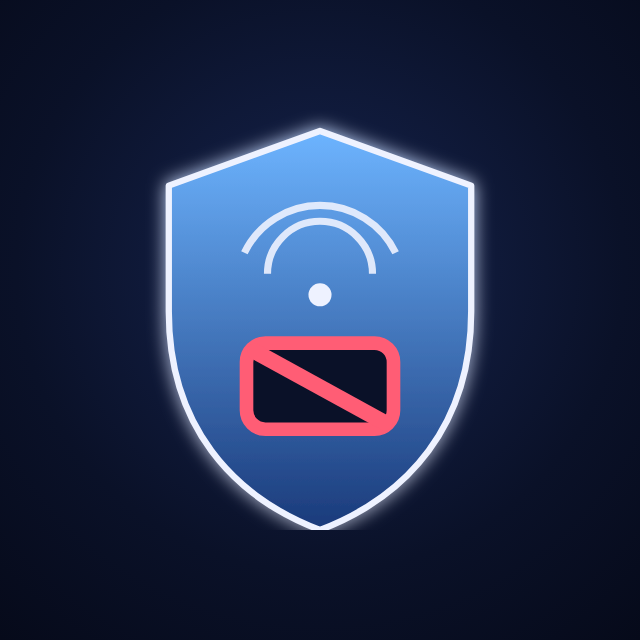
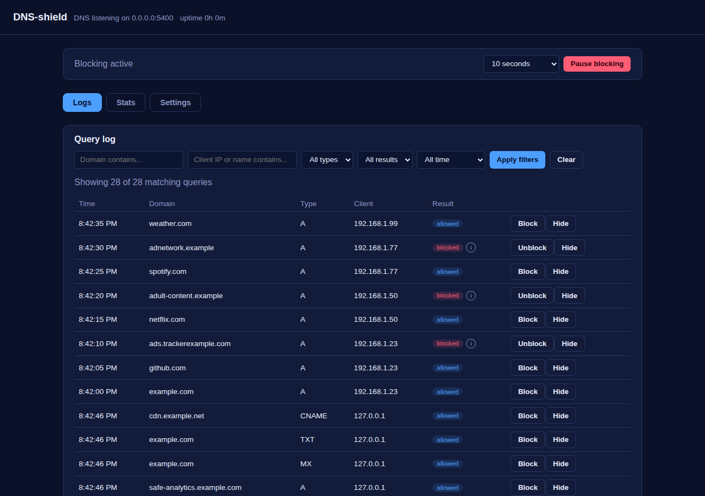
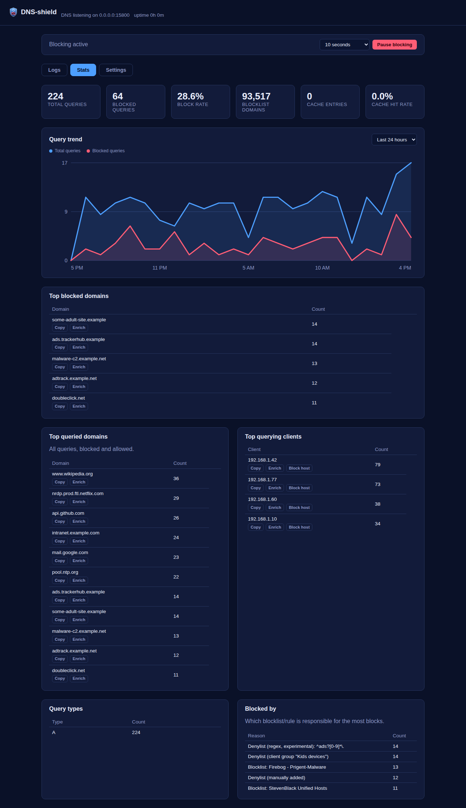
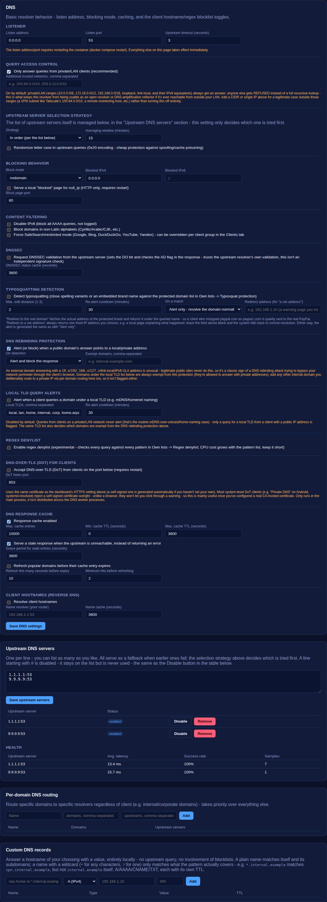
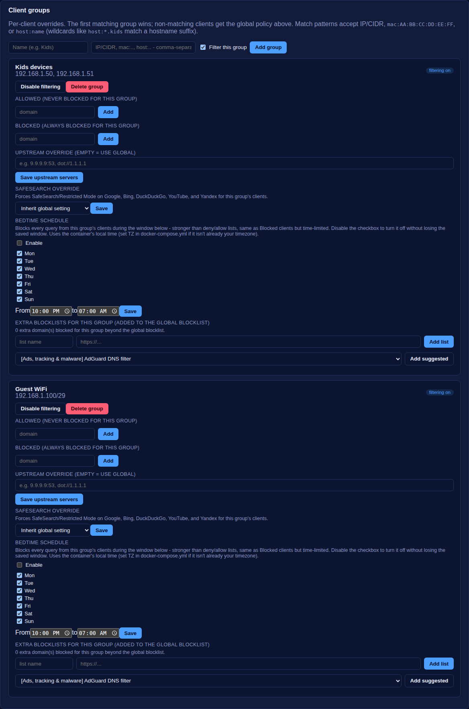
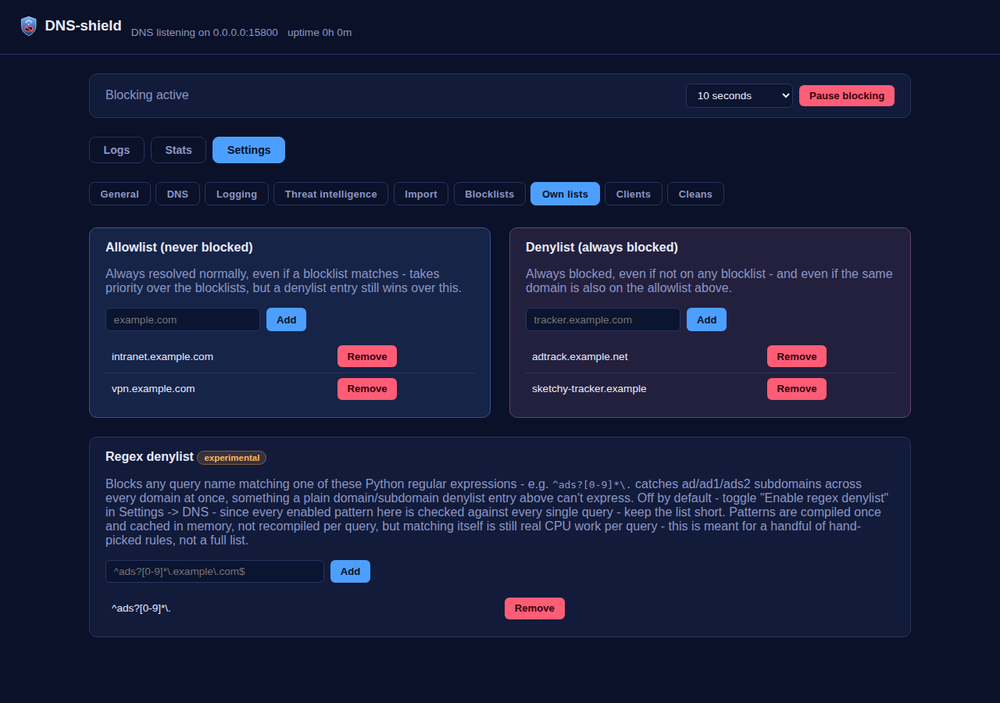
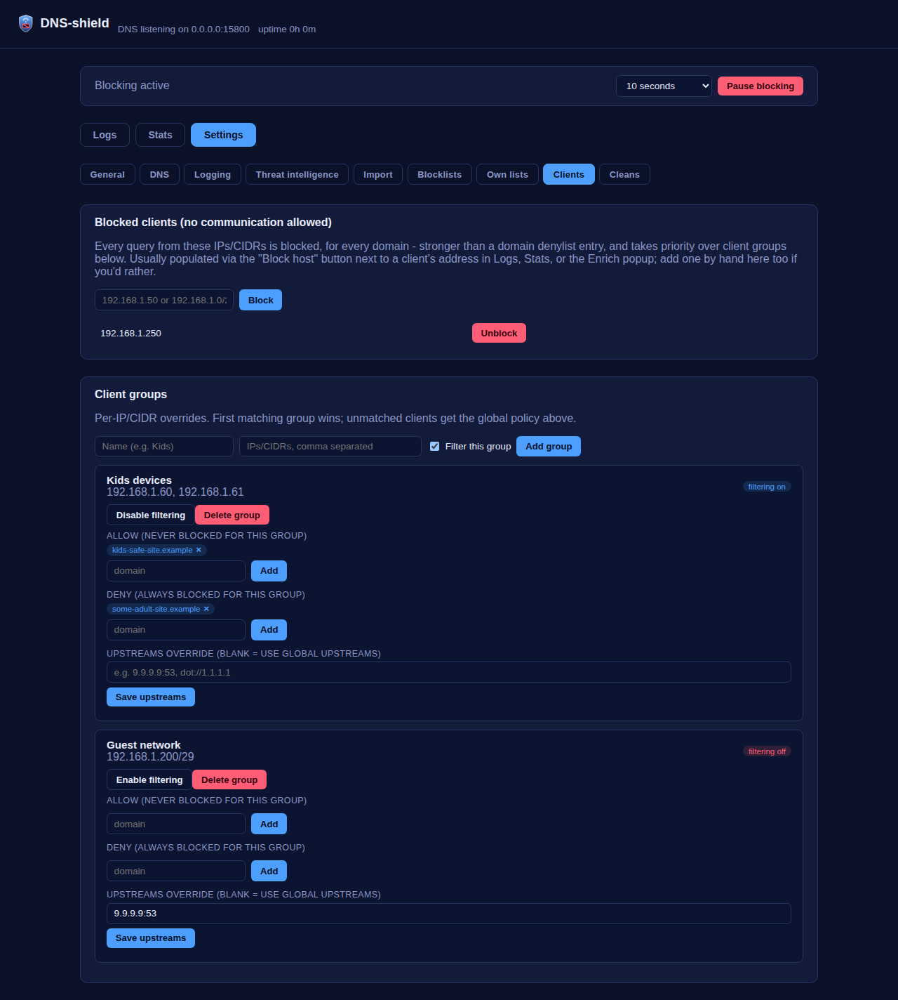
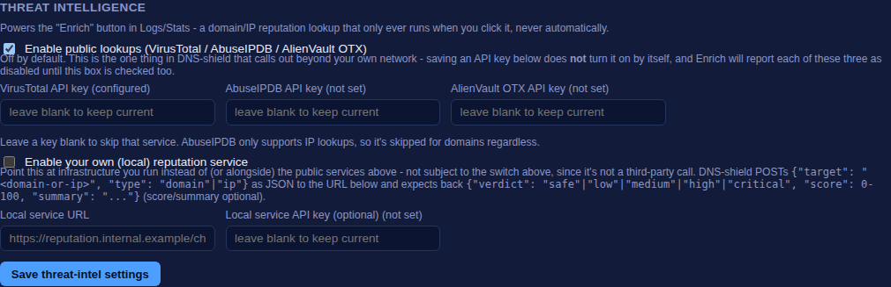
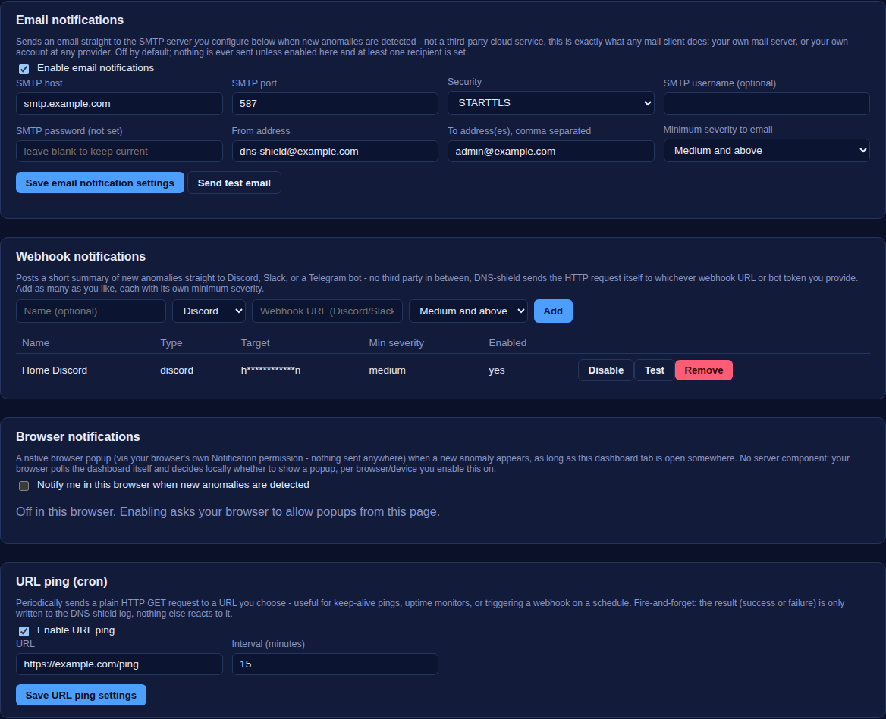
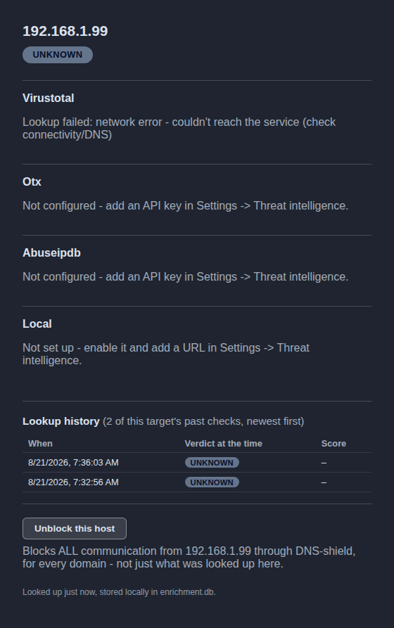

# DNS-shield

<p align="center"></p>

> To pełne polskie tłumaczenie pliku [`README.md`](README.md). W razie
> rozbieżności rozstrzyga wersja angielska.

Mały, samodzielnie hostowany bloker reklam i trackerów DNS, działający w
całej sieci, uruchamiany w Dockerze. Robi to samo co
[AdGuard Home](https://github.com/AdguardTeam/AdGuardHome) - pełni funkcję
resolwera DNS Twojej sieci i odrzuca zapytania kierowane do domen
reklamowych i śledzących - ale ma dużo mniejszy, łatwiejszy do
zweryfikowania kod i **nie ma żadnych wbudowanych połączeń z usługami
chmurowymi firm trzecich**.

Pełny, skategoryzowany spis wszystkich funkcji projektu znajdziesz w pliku
[`docs/features.html`](docs/features.html) (otwórz go w przeglądarce po
sklonowaniu repozytorium albo pobierz bezpośrednio z GitHub).

## Zrzuty ekranu

| Logi | Statystyki |
| --- | --- |
|  |  |

| Ustawienia - DNS i serwery nadrzędne | Ustawienia - grupy klientów |
| --- | --- |
|  |  |

| Lista dozwolonych / zablokowanych | Wstrzymanie blokowania |
| --- | --- |
|  |  |

| Zablokowani klienci | Ustawienia - Threat intelligence |
| --- | --- |
|  |  |

| Ustawienia - Powiadomienia (e-mail, webhooki, przeglądarka, URL ping) | Okno wyników Enrich |
| --- | --- |
|  |  |

## Dlaczego nie użyć po prostu AdGuard Home?

### Czym właściwie jest AdGuard Home i jak działa

AdGuard Home to sinkhole DNS (rodzaj filtrującego proxy DNS) z interfejsem
webowym. W skrócie działa tak:

1. Router lub urządzenia wskazują go jako swój serwer DNS.
2. Przy każdym zapytaniu sprawdza domenę względem list filtrów (w formacie
   hosts i AdBlock, odświeżanych z adresów URL podanych przez Ciebie lub
   przez samego AdGuarda) oraz reguł zezwoleń i blokad ustawionych dla
   poszczególnych użytkowników.
3. Trafienia są obsługiwane lokalnie (odpowiedź NXDOMAIN albo `0.0.0.0`);
   wszystko inne trafia dalej, do serwerów nadrzędnych, opcjonalnie przez
   DNS-over-HTTPS, DNS-over-TLS lub QUIC.
4. Ten sam program dostarcza też DHCP, kontrolę rodzicielską, "bezpieczne
   przeglądanie" oraz statystyki i logi zapytań - wszystko za jednym
   panelem webowym.

### Skąd bierze się obawa o "wyciek danych"

Do samego, podstawowego blokowania reklam żadna z tych funkcji nie musi
łączyć się z serwerami producenta - ale kilka innych funkcji AdGuard Home
domyślnie komunikuje się z infrastrukturą samego AdGuarda, i to właśnie
ludzie mają na myśli, mówiąc o "wycieku":

- **Safe Browsing i kontrola rodzicielska** wysyłają zapytanie (zahaszowane
  i przycięte do prefiksu) o *każdą odwiedzaną domenę* do własnego API
  chmurowego AdGuarda (`family.adguard-dns.com` albo endpoint bezpiecznego
  przeglądania AdGuarda), gdy tylko te funkcje są włączone - czyli kopia
  metadanych Twojego przeglądania opuszcza sieć i trafia do firmy trzeciej.
- **Sprawdzanie aktualizacji** cyklicznie odpytuje serwery AdGuarda w
  poszukiwaniu nowych wydań.
- **Domyślne listy filtrów i domyślny nadrzędny resolwer DNS-over-HTTPS**
  (własny serwer DoH AdGuarda, `dns.adguard-dns.com`) kierują Twój ruch DNS
  i odświeżanie list przez infrastrukturę AdGuarda, o ile sam ich nie
  zmienisz.
- To obszar bliski telemetrii, nawet jeśli nikt go tak nie nazywa: nawet
  funkcje typu opt-in bywają w niektórych wydaniach domyślnie włączone, a
  narzędzie samodzielnie hostowane, którego zadaniem jest "widzieć każdą
  domenę odwiedzaną przez Twoją sieć", jest dokładnie tego rodzaju
  oprogramowaniem, w którym każde połączenie wychodzące do firmy trzeciej
  zasługuje na szczególną uwagę.

Nic z tego nie czyni AdGuard Home złośliwym oprogramowaniem - producent
opisuje te funkcje w dokumentacji - ale dla narzędzia, które widzi
dosłownie każdą domenę odwiedzaną przez każde urządzenie w Twojej sieci,
domyślne zaufanie do chmury producenta to coś, czego warto unikać.

### Co DNS-shield robi inaczej

DNS-shield realizuje ten sam podstawowy mechanizm (sinkhole DNS + listy
filtrów + interfejs webowy), ale z założenia działa **wyłącznie lokalnie**:

- Jedyne połączenia wychodzące, jakie kiedykolwiek wykonuje, to: (a)
  żądania do adresów URL list blokad, które sam konfigurujesz, (b)
  zapytania do serwerów nadrzędnych, które sam konfigurujesz, (c) sprawdzenie
  reputacji przez threat-intel (VirusTotal, AbuseIPDB, AlienVault OTX i
  inne) - wymagające jednocześnie klucza API *i* osobnego przełącznika
  "Enable public lookups", domyślnie wyłączonego, uruchamiane dopiero w
  chwili kliknięcia "Enrich" przy konkretnej domenie lub adresie IP (zobacz
  [Wzbogacanie threat-intel](#wzbogacanie-threat-intel-virustotal--abuseipdb--alienvault-otx--i-inne)
  poniżej, wraz z opcją skierowania Enrich na własną usługę reputacji) -
  oraz (d) e-mail do serwera SMTP, który sam konfigurujesz, domyślnie
  wyłączony, wysyłany tylko wtedy, gdy
  [wykrywanie anomalii](#lokalne-wykrywanie-anomalii) jest włączone i coś
  wykryje (zobacz [Powiadomienia](#powiadomienia) poniżej). Nie ma żadnego
  domyślnego adresu należącego do AdGuarda i nic nie łączy się samo z
  siebie.
- Żadnych zapytań chmurowych do funkcji Safe Browsing ani kontroli rodzicielskiej,
  żadnych pingów sprawdzających aktualizacje, żadnej analityki, żadnej
  telemetrii jakiegokolwiek rodzaju.
- Cały stan aplikacji - konfiguracja, zbuforowane listy blokad, statystyki
  i log zapytań, wyniki wzbogacania, wykryte anomalie - trzymany jest na
  zamontowanym woluminie `./data`: osobna baza SQLite dla konfiguracji
  (`config.db`), osobna dla logu zapytań (`stats.db`), osobna dla wyników
  wzbogacania (`enrichment.db`), osobna dla alertów
  [wykrywania anomalii](#lokalne-wykrywanie-anomalii) (`anomalies.db`),
  plus zbuforowane pliki list. Nic nie trafia nigdzie indziej, a każdą z
  tych baz możesz sam otworzyć dowolnym klientem SQLite i sprawdzić
  dokładnie, co jest w niej przechowywane.
- Każde ustawienie da się skonfigurować z poziomu panelu - nie trzeba
  edytować pliku YAML i restartować usługi, żeby zmienić serwer nadrzędny
  albo listę blokad.
- Kod jest na tyle mały, że da się go przeczytać od początku do końca;
  dokładny opis tego, co robi każdy plik, znajdziesz w rozdziale
  [Architektura](#architektura) poniżej.

DNS-shield celowo **nie** próbuje w pełni zastąpić AdGuard Home - nie ma tu
serwera DHCP, nie ma DoQ, nie ma kontroli na poziomie pojedynczej aplikacji.
To podzbiór funkcji ograniczony do hasła "blokuj reklamy i trackery w
całej sieci z kontenera Docker, nie wypuszczając niczego, o co nie
prosiłem", uzupełniony o te elementy kontroli rodzicielskiej na poziomie
DNS, które pasują do tego podzbioru: wymuszone SafeSearch / tryb
ograniczony oraz listy blokad określonych kategorii, przypisane do grupy
klientów (zobacz
[Kontrola rodzicielska / SafeSearch](#kontrola-rodzicielska--safesearch)).

## Szybki start

```bash
git clone <adres tego repozytorium>
cd DNS-shield
docker compose up -d --build
```

Przy pierwszym uruchomieniu `./data/config.db` zostaje zasiane danymi z
`config/config.example.yaml`. Po otwarciu `https://<host>:3000` trafisz
na publiczny widok tylko do odczytu (trend zapytań i najczęściej
blokowane domeny, bez logowania) z linkiem "Sign in". HTTPS jest
domyślnie włączone, z samopodpisanym certyfikatem, który DNS-shield sam
sobie generuje przy pierwszym uruchomieniu - przeglądarka pokaże
ostrzeżenie "niebezpieczne"/"niezaufane" przy pierwszym połączeniu,
ponieważ nic nie poświadcza samopodpisanego certyfikatu; kliknij przez
to ostrzeżenie raz (zobacz [HTTPS dla panelu](#https-dla-panelu) niżej,
gdzie jest opisane faktycznie poprawne rozwiązanie, a także jak wrócić
do zwykłego HTTP, jeśli wolisz nie zajmować się tym ostrzeżeniem przy
wdrożeniu ograniczonym do samej sieci LAN). Zaloguj się domyślnymi
danymi `admin` / `changeme`, **od razu zmień hasło** (Settings ->
General -> "Your account") i skieruj DNS jakiegoś urządzenia na
`<host>:53`, żeby to przetestować.

Żeby używać tego w całej sieci, ustaw ten adres jako serwer DNS w
ustawieniach DHCP routera (albo osobno na każdym urządzeniu).

Po zalogowaniu panel ma cztery zakładki (zapamiętywane między
przeładowaniami strony): **Logs** - przeglądarka logu zapytań; **Alerts** -
wszystko, co oznaczył lokalny detektor anomalii, Twoje reguły alertów albo
wyszukiwanie threat-intel ze złą reputacją;
**Stats** - karty z podsumowaniem, najczęściej blokowane domeny,
najczęściej odpytywane domeny w ogóle, najbardziej aktywni klienci, podział
według typu zapytania oraz zestawienie "blocked by" (która lista blokad
albo reguła odpowiada za najwięcej blokad); wreszcie **Settings** -
wszystko inne (ustawienia DNS i webowe, konta użytkowników, serwery
nadrzędne, listy blokad, listy dozwolonych i zablokowanych, grupy
klientów, importer z AdGuard Home oraz "Delete all logged queries" w
sekcji Logging & blocklist refresh). Pasek wstrzymania blokowania na
górze widzą wyłącznie konta administratora - zobacz **Konta
wieloużytkownikowe, role i widok publiczny** poniżej.

## Sieć: domyślnie tryb host

Dołączony `docker-compose.yml` uruchamia kontener z `network_mode: host`
zamiast zwykłej sieci typu bridge z listą `ports:`. To nie jest tylko dla
DHCP (zobacz niżej) - **to jest właśnie to, co pozwala DNS-shield w ogóle
zobaczyć prawdziwy adres IP każdego urządzenia.** Przy sieci typu bridge
z opublikowanymi portami Docker przekazuje ruch do kontenera przez NAT
(a dla UDP w szczególności przez własny proxy w przestrzeni użytkownika),
co zastępuje prawdziwy adres źródłowy każdego klienta własnym adresem
bramy Dockera (zwykle `172.17.0.1`), zanim zapytanie w ogóle dotrze do
resolvera. Ponieważ niemal każda funkcja tutaj jest oparta na adresie IP
odpytującego klienta - grupy klientów, statystyki per-klient, reguły
blokowania klientów, wykrywanie anomalii, reguły alertów, DHCP, wykrywanie
nieautoryzowanego DHCP oraz [graf klient-domena](#graf-klient-domena) -
tryb bridge po cichu psuje je wszystkie naraz: każde urządzenie w Twojej
sieci wygląda dla DNS-shield jak ten sam "jeden klient". Tryb host
całkowicie usuwa NAT Dockera, więc `handler.client_address` (i wszystko,
co na nim bazuje) to prawdziwy adres IP z Twojej sieci LAN.

Kompromis: przy `network_mode: host` nie ma listy `ports:` do edycji
(Docker ją ignoruje w tym trybie) - kontener wiąże się bezpośrednio z
portami, o które prosi jego własna konfiguracja, na hoście: `53` dla DNS,
`3000` dla panelu, plus `80`/`443` jeśli włączysz
[reverse proxy](#reverse-proxy-opcjonalnie), `853` dla DNS-over-TLS, albo
`67` dla DHCP - każdy tylko wtedy, gdy dana funkcja jest faktycznie
włączona. Upewnij się, że nic innego na hoście nie zajmuje już portu,
którego zamierzasz użyć - najczęściej chodzi o `53`: wiele dystrybucji
Linuksa domyślnie uruchamia własny stub-listener `systemd-resolved` na
`127.0.0.1:53`, co nie koliduje, ale pełny lokalny resolver związany z
`0.0.0.0:53` już by kolidował (sprawdź poleceniem `sudo ss -ulpn 'sport =
:53'`).

Jeśli wolisz zachować izolację sieciową kontenera i nie zależy Ci na
dokładnym rozróżnianiu klientów (na przykład DNS-shield jest ostatnim
krokiem za innym resolverem/forwarderem, który i tak już zlewa wszystkie
zapytania do jednego źródła), możesz nadal przełączyć się z powrotem na
sieć typu bridge:

```yaml
services:
  dns-shield:
    ports:
      - "53:53/udp"
      - "53:53/tcp"
      - "3000:3000/tcp"
```

(dodaj też `80:80/tcp` i `443:443/tcp`, jeśli korzystasz z reverse proxy,
oraz `853:853/tcp` dla DNS-over-TLS). Miej tylko na uwadze, że wtedy
każdy klient będzie widoczny jako adres bramy Dockera, dopasowywanie
`mac:` w [grupach klientów](#polityki-dla-poszczególnych-klientów-i-grup)
nie zobaczy prawdziwej tablicy ARP Twojej sieci LAN, a DHCP w ogóle nie
zadziała (zobacz [Serwer DHCP](#serwer-dhcp-opcjonalnie) niżej).

## Konfiguracja

Każde ustawienie da się edytować z poziomu panelu, w sekcji **Settings** -
na co dzień nie trzeba w tym celu edytować żadnego pliku. Settings jest
podzielone na podzakładki tematyczne: **General** (interfejs webowy, kopia
zapasowa konfiguracji), **DNS** (podstawowy resolwer, serwery nadrzędne,
routing według domeny, rekordy niestandardowe), **Logging** (retencja,
wykluczone domeny i adresy klientów), **Threat intelligence**, **Import**
(AdGuard Home / Pi-hole), **Blocklists** (źródła, sugerowane listy, źródła
listy dozwolonych, harmonogram odświeżania), **Own lists** (lista
dozwolonych, lista zablokowanych, lista zablokowana wg wyrażeń regularnych),
**Clients** (zablokowani klienci, grupy klientów) oraz **Cleans** (cache
odpowiedzi DNS, usunięcie wszystkich zalogowanych zapytań).

Pod spodem aktywna konfiguracja trzymana jest w `./data/config.db`
(SQLite), a jej pełna kopia jest eksportowana do
`./data/config.backup.yaml` co 12 godzin oraz raz przy każdym starcie -
wyłącznie jako czytelna dla człowieka kopia zapasowa i materiał
referencyjny:

```yaml
dns:
  listen_address: "0.0.0.0"
  listen_port: 53
  upstreams: ["1.1.1.1:53", "9.9.9.9:53"]   # dowolna liczba - zobacz niżej
  upstream_timeout_seconds: 3.0
  upstream_strategy: "in_order"  # albo "fastest" / "most_stable" / "race" - zobacz niżej
  upstream_stats_window_minutes: 15
  block_mode: "nxdomain"                     # albo "null_ip"
  blocked_ipv4: "0.0.0.0"        # używane, gdy block_mode to "null_ip"
  blocked_ipv6: "::"              # to samo, dla AAAA
  block_page_enabled: false      # serwuj lokalną stronę "zablokowano" - zobacz niżej
  block_page_port: 80
  block_ipv6: false             # true: odpowiadaj na zapytania AAAA pusto, zamiast je przekazywać
  block_non_latin: false        # true: blokuj domeny w cyrylicy/arabskim/CJK itd. - zobacz niżej
  regex_denylist_enabled: false  # eksperymentalne - zobacz "Lista zablokowana wg wyrażeń regularnych" niżej
  cache_enabled: true            # cache odpowiedzi z serwerów nadrzędnych w pamięci, zgodnie z ich TTL
  cache_max_entries: 10000
  cache_min_ttl_seconds: 0        # dolna granica dla buforowanych TTL
  cache_max_ttl_seconds: 3600     # górna granica dla buforowanych TTL
  resolve_client_names: false    # odwrotny DNS dla IP klientów, wyłącznie do wyświetlania (zobacz niżej)
  client_name_resolver: ""       # np. "192.168.1.1:53" - adres routera, nie serwera nadrzędnego do filtrowania
  client_name_cache_seconds: 3600

blocklists:
  refresh_interval_hours: 24
  sources:
    - name: "StevenBlack Unified Hosts"
      url: "https://raw.githubusercontent.com/StevenBlack/hosts/master/hosts"
      enabled: true
  allow_sources: []   # ten sam format, ale nadpisuje listy blokad - zobacz niżej

allowlist: []   # zawsze rozwiązywane normalnie, nawet gdy pasuje do listy blokad
denylist: []    # zawsze blokowane, nawet jeśli nie ma tego na liście blokad
denylist_regex: []   # eksperymentalna lista zablokowana wg wyrażeń regularnych - działa tylko, gdy regex_denylist_enabled
blocked_clients: []   # adresy IP/CIDR z KAŻDYM zapytaniem blokowanym - zobacz niżej

dns_rewrites: []   # niestandardowe, lokalne rekordy A/AAAA - zobacz niżej

domain_upstreams: []   # kieruj wybrane domeny do wybranych resolwerów - zobacz niżej

client_groups: []   # nadpisania ustawień dla konkretnych IP/CIDR - zobacz niżej

web:
  listen_address: "0.0.0.0"
  listen_port: 3000
  theme: "navy"           # 8 palet w parach ciemny/jasny - zobacz "Motywy kolorystyczne" niżej

# Konta panelu - zobacz "Konta wieloużytkownikowe, role i widok
# publiczny" niżej. Przy pierwszym uruchomieniu (albo przy aktualizacji z
# wersji, która miała tylko pola web.username/web.password powyżej) jedno
# konto administratora jest tworzone tu automatycznie, a jego hasło
# zapisywane jest od razu jako hash bcrypt.
# users: []

logging:
  level: "INFO"             # poziom logowania Pythona; tylko w YAML, nie w panelu
  retention_days: 30       # jak długo wpisy logu zapytań są trzymane w stats.db
  ignored_domains: []      # nigdy nie logowane, ale nadal normalnie rozwiązywane i blokowane
  ignored_clients: []      # to samo, wg adresu IP/CIDR klienta

enrichment:                    # ustawienia threat-intel - zobacz "Wzbogacanie threat-intel" niżej
  public_enabled: false         # główny przełącznik dla trzech kluczy poniżej - domyślnie wyłączony
  virustotal_api_key: ""
  abuseipdb_api_key: ""
  otx_api_key: ""
  greynoise_api_key: ""
  shodan_api_key: ""
  urlhaus_api_key: ""
  rdap_enabled: false
  crtsh_enabled: false
  local_enabled: false           # własna usługa reputacji - zobacz niżej
  local_url: ""
  local_api_key: ""
```

Ten przykładowy plik (`config/config.example.yaml`) ma znaczenie tylko
przy *pierwszym* uruchomieniu na świeżym woluminie danych, albo gdy
trzeba odzyskać konfigurację po wyczyszczeniu `config.db` - zobacz
[Bezpośrednia edycja pliku konfiguracyjnego](#bezpośrednia-edycja-pliku-konfiguracyjnego)
niżej.

### Szyfrowane połączenie z serwerem nadrzędnym (DNS-over-TLS / DNS-over-HTTPS)

Każdy wpis w `upstreams` można poprzedzić prefiksem, który szyfruje odcinek
między DNS-shield a danym resolwerem - ukrywa to treść zapytania przed kimś,
kto podsłuchuje ruch po drodze (np. Twoim dostawcą internetu). Sam operator
serwera nadrzędnego nadal widzi, o co pytasz, tak samo jak przy zwykłym DNS:

```yaml
dns:
  upstreams:
    - "dot://1.1.1.1"                          # DNS-over-TLS
    - "doh://cloudflare-dns.com/dns-query"     # DNS-over-HTTPS
    - "https://dns.quad9.net/dns-query"        # DNS-over-HTTPS, pełny adres URL też działa
```

Zwykłe wpisy w formacie `host:port` korzystają z UDP, z automatycznym
ponowieniem przez TCP, gdy odpowiedź jest obcięta. Ta sekcja dotyczy
wyłącznie połączenia *do serwera nadrzędnego* - DNS-shield zawsze
nasłuchuje też zwykłego DNS od klientów Twojej sieci LAN na porcie 53,
a opcjonalnie także DoH/DoT dla klientów, które chcą szyfrowanego
połączenia do samego DNS-shield; zobacz
[DNS-over-HTTPS / DNS-over-TLS dla klientów](#dns-over-https--dns-over-tls-dla-klientów)
niżej.

### Wiele serwerów nadrzędnych i strategia wyboru

`dns.upstreams` przyjmuje dowolną liczbę resolwerów - wszystkie są zawsze
dostępne jako rezerwa na wypadek, gdyby wcześniejsze zawiodły.
`dns.upstream_strategy` decyduje, który jest próbowany *jako pierwszy* przy
każdym zapytaniu - a przy `race` wszystkie naraz:

- `in_order` (domyślnie) - kolejno, w takim porządku, w jakim są podane.
- `fastest` - najpierw ten o najniższym średnim czasie odpowiedzi w
  ostatnich `upstream_stats_window_minutes` (domyślnie 15 minutach).
- `most_stable` - najpierw ten z najmniejszą liczbą awarii i najbardziej
  stabilnym czasem odpowiedzi w tym oknie - niezawodność liczy się tu
  bardziej niż surowa szybkość.
- `race` ("Wszystkie naraz - FIFO") - zapytanie idzie jednocześnie do
  każdego skonfigurowanego serwera nadrzędnego, a klient dostaje odpowiedź
  od tego, który odpowie pierwszy; pozostałe nadal pracują w tle, wyłącznie
  po to, by ich opóźnienie i skuteczność były rejestrowane, ale ich
  odpowiedzi są odrzucane. Daje to najniższe możliwe opóźnienie kosztem
  odpytywania każdego serwera nadrzędnego przy każdym pojedynczym żądaniu
  (więcej ruchu wychodzącego, a każdy serwer nadrzędny widzi każde
  zapytanie, nie tylko to, które "wygrało").

Wątek działający w tle sprawdza kondycję każdego skonfigurowanego serwera
nadrzędnego co 2 minuty, niezależnie od tego, który z nich faktycznie
obsługuje ruch - dzięki temu statystyki widoczne w panelu, w tabeli
Settings -> Upstream DNS servers, pozostają aktualne nawet dla serwera,
którego strategia przestała wybierać, i może on zostać wybrany ponownie,
jeśli jego kondycja się poprawi. Sprawdzane są wyłącznie hosty już
wpisane w Twojej konfiguracji.

### Wyłączanie serwera nadrzędnego bez jego usuwania

Każdy skonfigurowany serwer nadrzędny ma w panelu, w tabeli Settings ->
Upstream DNS servers, własny przycisk Disable/Enable - zostaje na liście
(i w tabeli statystyk kondycji), ale jest pomijany przy faktycznym
rozwiązywaniu zapytań, więc nie tracisz adresu ani jego historii z pliku
konfiguracyjnego czy importu, usuwając go całkowicie. Pod spodem robi to
po prostu poprzedzenie wpisu znakiem `#` w `dns.upstreams` (albo w
`domain_upstreams[].upstreams` czy `client_groups[].upstreams`, jeśli
wyłączasz wpis tam) - dokładnie ta sama konwencja, co ręczne zakomentowanie
linii w polu tekstowym "jeden wpis na linię" nad tabelą, albo w ręcznie
edytowanym pliku konfiguracyjnym.

### DNSSEC

`dns.dnssec_enabled` (Settings -> DNS, domyślnie wyłączone) sprawia, że
DNS-shield ustawia bit DNSSEC OK (`DO`) w każdym przekazywanym zapytaniu i
sprawdza flagę `AD` (Authenticated Data) w odpowiedzi. To obsługa DNSSEC
**oparta na zaufaniu do serwera nadrzędnego**, a nie niezależna walidacja
kryptograficzna: DNS-shield sam nie parsuje rekordów RRSIG, DNSKEY ani DS
i nie przechodzi łańcucha zaufania (to ogromny zakres mechanizmów
kryptograficznych, którego ten projekt się nie podejmuje) - zamiast tego
zakłada, że serwer nadrzędny już zweryfikował odpowiedź, i prosi go, by to
potwierdził. Żeby miało to jakikolwiek sens, trzeba wskazać walidujący,
publiczny resolwer (1.1.1.1, 9.9.9.9 i 8.8.8.8 domyślnie walidują) - serwer
nadrzędny, który nie waliduje, po prostu nigdy nie ustawi flagi `AD`, i ta
funkcja nie ma czego sprawdzić.

Sprawdzanie statusu domeny nie powinno oznaczać ponownej weryfikacji przy
każdym kolejnym zapytaniu o nią, więc wyniki trzymane są w małym cache w
pamięci, niezależnym od zwykłego cache odpowiedzi DNS - `{domena: (czy
bezpieczna, kiedy wygasa)}` - z własnym czasem życia,
`dns.dnssec_cache_seconds` (domyślnie 3600 sekund). Ma to znaczenie,
ponieważ zapytanie odpowiedziane ze *zwykłego* cache odpowiedzi w ogóle
nie przechodzi przez ścieżkę kodu odpowiedzialną za przekazywanie
zapytań - bez osobnego cache DNS-shield nie miałby więc pojęcia, czy dana
zbuforowana odpowiedź była kiedykolwiek uwierzytelniona przez DNSSEC.
Dedykowany cache wypełnia się wyłącznie przy żywym zapytaniu do serwera
nadrzędnego, i to z niego czytane są liczniki `dnssec.cached_domains`
(`secure`/`insecure`) zwracane przez `GET /api/status`. To obserwowalność,
nie egzekwowanie reguł - niepodpisana odpowiedź jest czymś normalnym dla
sporej części domen, które w ogóle nie podpisują swojej strefy, więc
DNS-shield nie blokuje takich odpowiedzi ani nie traktuje ich inaczej;
walidujący serwer nadrzędny i tak sam odmówi (SERVFAIL) zwrócenia
odpowiedzi, której podpis nie przechodzi weryfikacji, zanim jeszcze
DNS-shield ją zobaczy.

Wyłączenie tej opcji z powrotem (albo pozostawienie jej wyłączonej)
przywraca dokładnie wcześniejsze zachowanie - zapytania są pakowane i
przekazywane bez dodatkowego rekordu EDNS0, bez żadnego dodatkowego
kosztu.

### Nazwy hostów serwerów nadrzędnych i list blokad są zawsze rozwiązywalne i nigdy nie trafiają do logu

Każda nazwa hosta, którą serwer nadrzędny `dot://`/`doh://` musi rozwiązać
przez DNS (np. `dns.nextdns.io`), oraz host adresu URL subskrypcji listy
blokad czy listy dozwolonych (np. `raw.githubusercontent.com`), jest
automatycznie zwolniona z każdego mechanizmu blokowania - nawet ręczny
wpis na liście zablokowanych czy obejście przez wstrzymanie blokowania nie
musiałyby jej w ogóle sprawdzać - i domyślnie pomijana w logu zapytań. Nie
trzeba tego nigdzie konfigurować: DNS-shield wylicza to bezpośrednio z
`dns.upstreams`, `domain_upstreams[].upstreams`,
`client_groups[].upstreams` oraz każdego adresu URL z
`blocklists.sources`/`blocklists.allow_sources`, za każdym razem od nowa,
więc pozostaje to poprawne, gdy tylko coś z tego się zmieni. Chodzi o to,
żeby nie dało się przypadkiem odciąć DNS-shield od jego własnego serwera
nadrzędnego albo jego własnych list blokad (przypadkowe trafienie listy
blokad w którąś z tych nazw hostów byłoby inaczej awarią spowodowaną
samemu sobie - zablokowanie własnego źródła listy blokad jest szczególnie
przykre, bo po cichu zatrzymałoby odświeżanie wszystkich list) - a przy
okazji, żeby to stałe wyszukiwanie w tle nie zaśmiecało logu, który ma
pokazywać, do czego faktycznie łączą się Twoje urządzenia.

Trzy publiczne hosty threat-intel (VirusTotal, AbuseIPDB, OTX - zobacz
[Wzbogacanie threat-intel](#wzbogacanie-threat-intel-virustotal--abuseipdb--alienvault-otx--i-inne)
niżej) są traktowane tak samo, ale **dopiero po włączeniu
`enrichment.public_enabled`** - dopóki ten przełącznik jest wyłączony, nie
ma powodu, żeby DNS-shield się z nimi łączył, więc celowo nie ma dla nich
też stałego zwolnienia. Host Twojej własnej, lokalnej usługi wzbogacania
jest zwalniany niezależnie, zawsze gdy `enrichment.local_enabled` jest
włączone i ustawiony jest adres URL.

### Routing DNS według domeny i według klienta

`domain_upstreams` kieruje wybrane domeny do wybranych resolwerów,
niezależnie od tego, który klient pyta - przydatne np. dla domen
wewnętrznych czy firmowych, o których wie tylko Twój własny serwer DNS:

```yaml
domain_upstreams:
  - name: "Sieć wewnętrzna"
    domains: ["corp.local", "internal.example"]
    upstreams: ["192.168.1.1:53"]
```

Wpis w `client_groups` może też mieć własną listę `upstreams`, używaną dla
zapytań tego klienta zamiast listy globalnej (np. żeby przekierować DNS
klienta VPN przez inny resolwer). Kolejność pierwszeństwa, gdy pasuje
kilka reguł naraz: najpierw wygrywa pasująca reguła z `domain_upstreams`
(routing po domenie jest zwykle twardym wymogiem technicznym), potem
własne `upstreams` dopasowanej grupy klientów, na końcu globalne
`dns.upstreams`.

### Niestandardowe rekordy DNS ("rewrites")

`dns_rewrites` odpowiada na daną nazwę hosta wybranym przez Ciebie
adresem IP, całkowicie lokalnie - bez pytania serwera nadrzędnego, bez
udziału listy blokad. Przydatne dla wewnętrznych nazw hostów, o których
Twój publiczny DNS nic nie wie:

```yaml
dns_rewrites:
  - name: "nas.home"
    type: "A"
    value: "192.168.1.10"
```

Zwykła nazwa rewrite'a (bez `*`/`?`) dopasowuje daną nazwę i jej subdomeny
(więc `printer.nas.home` również się rozwiąże na podstawie powyższego
wpisu); nazwa zawierająca `*` (dowolny ciąg znaków) albo `?` (dowolny
pojedynczy znak) jest zamiast tego dopasowywana jako wzorzec glob względem
pełnej odpytywanej nazwy, więc można dokładniej określić, co ma obejmować:

```yaml
dns_rewrites:
  - name: "*.internal.example"
    type: "A"
    value: "10.0.0.5"
```

`*.internal.example` dopasuje `vpn.internal.example` i
`db.staging.internal.example`, ale - w odróżnieniu od zwykłej nazwy
powyżej - *nie* dopasuje samej `internal.example`, ponieważ wzorzec wymaga
przynajmniej jednego znaku przed dosłownym `.internal.example`; jeśli
zależy Ci też na samej domenie bez subdomeny, dodaj dla niej osobny wpis.
W obu przypadkach wyłącznie dla rekordów A/AAAA - bez podążania za CNAME,
żeby to wyszukiwanie zawsze kończyło się w jednym kroku. Jest sprawdzane
*po* blokowaniu, nie przed nim: w pełni zablokowany klient albo już
zablokowana domena nadal zachowują się jak zablokowane, niezależnie od
jakiegokolwiek rewrite'a - rewrite to odpowiedź, a nie zwolnienie z
blokady. Rewrite'ami zarządzasz z panelu (Settings -> Custom DNS records)
albo edytując listę bezpośrednio.

### Formaty list blokad i sugerowane listy

Źródła list blokad występują w trzech powszechnych formatach, a listy
spotykane w praktyce wcale nie trzymają się jednego z nich - niektóre
mieszają je nawet w obrębie jednego pliku:

- **format pliku hosts**: `0.0.0.0 ads.example.com`
- **format AdBlock/uBlock**: `||ads.example.com^`
- **zwykła lista domen**: `ads.example.com`

DNS-shield sam wykrywa format każdej linii podczas pobierania źródła, więc
możesz wskazać dowolny z tych trzech formatów (albo źródło, które je
miesza) bez konieczności ręcznego wyboru. Tabela Blocklists w panelu
pokazuje wykryty format pod liczbą domen każdego źródła - np. "hosts file
(0.0.0.0/127.0.0.1 domain)" albo "mixed formats (...)" dla źródła, które
naprawdę łączy więcej niż jedną składnię (pojedyncza zabłąkana linia się
nie liczy - jako mieszany format raportowane jest tylko prawdziwe
pomieszanie).

Źródła w formacie AdBlock/uBlock mogą też zawierać linie wyjątków
`@@||domain^` - wiele popularnych list używa ich, by wyłączyć subdomenę
spod szerszej reguły wcześniej w tym samym pliku. DNS-shield je respektuje:
domena dopasowana przez regułę wyjątku danego źródła jest traktowana tak,
jakbyś sam dodał ją do listy dozwolonych, więc to źródło nigdy jej nie
zablokuje. Dla własnych, dodatkowych `blocklist_sources` grupy klientów
wyjątek zwalnia tylko tę jedną grupę - tak samo, jak blokowanie przez
grupę jest wyłącznie addytywne (zobacz niżej). Zobacz
[Ograniczenia](#ograniczenia--plany-na-przyszłość), co dokładnie *nie*
jest interpretowane ze składni AdBlock i dlaczego.

Sekcja Blocklists ma też tabelę **Suggested lists**: krótką, ustaloną
listę wbudowaną w sam DNS-shield (żeby ją zbudować, nic nie trzeba
pobierać) - Unified Hosts StevenBlacka, własny filtr DNS AdGuarda, garść
rekomendowanych ("odhaczonych") list [Firebog](https://firebog.net),
aktywnie utrzymywane listy Multi PRO, Threat Intelligence Feeds oraz
Newly Registered Domains od [HaGeZi](https://github.com/hagezi/dns-blocklists)
(zobacz niżej), listę [1Hosts (Lite)](https://github.com/badmojr/1Hosts)
autorstwa badmojr oraz skoncentrowaną na oszustwach listę DurableNapkin.
Kliknięcie Add po prostu wypełnia za Ciebie zwykły formularz dodawania
źródła; lista jest wtedy pobierana i od tego momentu można ją wyłączyć
albo usunąć dokładnie tak samo, jak każde źródło wpisane ręcznie. Wpis
znika z Suggested lists, gdy tylko go dodasz - nie ma już czego
sugerować - więc lista pokazuje zawsze tylko to, czego jeszcze nie
dodałeś. Ten sam katalog jest też dostępny osobno dla każdej grupy
klientów, w zakładce Clients (zobacz
[Kontrola rodzicielska](#kontrola-rodzicielska--safesearch) wyżej).

Dodanie źródła w dowolnym miejscu panelu - tu, w Allow sources, we
własnych dodatkowych listach grupy klientów, czy na liście obserwowanej w
Alert rules - pobiera i ponownie parsuje *wszystkie* skonfigurowane listy,
nie tylko tę nową, więc na wolniejszym łączu albo przy dużej liczbie już
dodanych list może to potrwać kilka sekund. Przycisk Add pokazuje wtedy
"kółeczko" i pozostaje wyłączony na czas oczekiwania, a po zakończeniu
pojawia się krótkie potwierdzenie (toast) - oba zastępują dawną ciszę bez
żadnego sygnału, że coś się dzieje.

Wszystkie źródła danej kategorii (listy blokujące, listy dozwolone,
własne listy grupy itd.) są pobierane równolegle, nie po kolei, więc
dodanie kolejnej listy do już długiego łańcucha nie mnoży czasu
oczekiwania. Konkretnie przy starcie DNS-shield najpierw wczytuje to, co
zostało zapisane na dysku z ostatniego udanego pobrania - praktycznie
natychmiastowo, więc blokowanie jest już aktywne, zanim panel czy serwer
DNS w ogóle skończą się uruchamiać - a dopiero chwilę później pobiera
wszystko na żywo w tle. Tylko naprawdę pierwsze uruchomienie, gdy nigdzie
nic jeszcze nie jest zapisane w pamięci podręcznej, czeka na sieć, zanim
zacznie chronić.

### Nowo zarejestrowane domeny (NRD)

Firmowe produkty do bezpieczeństwa DNS (Infoblox BloxOne Threat Defense
nazywa to "Newly Observed Domains", a to standardowa funkcja Cisco Umbrella
i podobnych systemów) blokują lub oznaczają każdą domenę zarejestrowaną w
ciągu mniej więcej ostatnich 7-30 dni. Opiera się to na obserwacji, że
kampanie phishingowe i malware'owe w przytłaczającej większości rejestrują
domenę i zaczynają jej używać w ciągu kilku dni - zanim domena "pożyje"
miesiąc, jest już poza oknem czasowym, w którym ta technika cokolwiek
wyłapuje. To realna, skuteczna technika, która nie wymaga do wdrożenia ani
uczenia maszynowego, ani subskrypcji żywego feedu - to po prostu kolejna
lista domen, więc podpina się pod dokładnie ten sam mechanizm
`blocklists.sources`/`blocklist_sources` co wszystko inne w tej sekcji.
Katalog Suggested lists zawiera właśnie w tym celu listę **HaGeZi Newly
Registered Domains (7-day)**.

Zanim ją włączysz, przeczytaj to jednak do końca - to prawdziwy kompromis,
nie darmowy zysk:

- **Jest ogromna.** Na świecie codziennie rejestruje się około 2,8 miliona
  domen, a lista jest odświeżana codziennie. Po załadowaniu zajmuje
  mniej więcej **650 MB pamięci RAM** (zmierzone bezpośrednio - zobacz
  [Współbieżność](#współbieżność), jak listy blokad są trzymane w całości
  w pamięci jako `frozenset`, żeby dopasowanie działało w czasie O(1), i
  ile to ogólnie kosztuje). Na hoście z ograniczonymi zasobami sam ten
  fakt może być powodem, by z niej zrezygnować - a jeśli uruchamiasz kilka
  [procesów roboczych DNS](#współbieżność), każdy z nich ładuje własną,
  niezależną kopię.
- **Blokuje też legalne, nowe strony.** Zupełnie nowy produkt SaaS,
  osobisty blog znajomego, startup, który właśnie wystartował - wszystkie
  są nie do odróżnienia od domeny phishingowej, jeśli patrzeć wyłącznie na
  datę rejestracji, i wszystkie są blokowane przez pierwszy tydzień
  istnienia. To zaakceptowany koszt tej techniki w każdym produkcie, który
  ją oferuje, a nie błąd tej konkretnej implementacji.

Mając to na uwadze, rozważ dodanie tej listy jako własnego, dodatkowego
wpisu `blocklist_sources` konkretnej grupy klientów (powiedzmy, urządzeń
administratora świadomego zagrożeń), a nie na listę globalną - dzięki temu
koszt fałszywych trafień poniesie tylko ten, kto zdecydował się go
zaakceptować, tak samo jak przy listach kategorii z kontroli
rodzicielskiej wyżej. Oferowane jest tylko okno 7-dniowe; HaGeZi publikuje
też okna 14/21/28/35-dniowe pod adresem
[github.com/hagezi/nrd](https://github.com/hagezi/nrd), jeśli chcesz dodać
takie ręcznie - ale wartość takiej listy dla bezpieczeństwa gwałtownie
spada wraz z wiekiem domeny, podczas gdy koszt pamięci pozostaje równie
duży, więc te listy nie są tutaj sugerowane.

[Lokalne wykrywanie anomalii](#lokalne-wykrywanie-anomalii) DNS-shield
pokrywa już zbliżoną, korporacyjną technikę - scoring entropii w
heurystyce `domain_burst` oznacza klienta, który szybko odpytuje wiele
domen wyglądających na wygenerowane algorytmicznie, o wysokiej entropii -
to ten sam wzorzec DGA (Domain Generation Algorithm), który analityka
oparta na uczeniu maszynowym w BloxOne ma wykrywać w ruchu
command-and-control malware. Ten element istnieje więc już niezależnie od
jakiejkolwiek subskrypcji listy.

### Lista zablokowana wg wyrażeń regularnych (eksperymentalne)

`denylist_regex` blokuje każde zapytanie o nazwę pasującą do wyrażenia
regularnego Pythona, sprawdzaną funkcją `re.search()` względem pełnej
nazwy - np. wzorzec `^ads?[0-9]*\.` wyłapuje naraz, we wszystkich
domenach, subdomeny w stylu `ad.`/`ad1.`/`ads2.`, czego zwykły wpis na
liście zablokowanej (domena albo subdomena) nie potrafi wyrazić. Funkcja
jest domyślnie wyłączona (`dns.regex_denylist_enabled`) i nieprzypadkowo
oznaczona w panelu jako eksperymentalna: każdy włączony wzorzec jest
sprawdzany przy **każdym pojedynczym zapytaniu**, więc koszt CPU na
zapytanie rośnie wraz z liczbą wzorców. Wzorce są kompilowane raz i
trzymane w pamięci - nigdy nie kompilowane od nowa przy każdym zapytaniu -
ale samo dopasowywanie to nadal realna praca, więc jest to pomyślane dla
garści ręcznie dobranych reguł, nie dla pełnej listy. Nieprawidłowy wzorzec
jest od razu odrzucany z błędem przy próbie dodania, a nie po cichu
pomijany później. Zarządzaj tym z panelu (Settings -> Regex denylist) albo
edytując `denylist_regex` bezpośrednio.

### Nazwy hostów klientów (odwrotny DNS)

Ustaw `dns.client_name_resolver` na adres IP swojego **routera** (nie
jednego z serwerów nadrzędnych filtrujących reklamy - to router faktycznie
zna nazwy klientów przydzielone przez DHCP) oraz
`dns.resolve_client_names: true`, a log zapytań i lista klientów w panelu
zaczną pokazywać np. `laptop-jan.lan (192.168.1.50)` zamiast samego,
surowego adresu IP. Rozwiązywanie nazw odbywa się w wątku działającym w
tle i jest wyłącznie pomocą przy wyświetlaniu - nigdy nie opóźnia
odpowiedzi na faktyczne zapytanie klienta, a wyniki nie są zapisywane na
dysk (tylko w pamięci, `dns.client_name_cache_seconds`).

### Polityki dla poszczególnych klientów i grup

`client_groups` pozwala nadpisać globalną politykę dla wybranych klientów -
np. surowszą listę zablokowanych dla urządzeń dzieci, albo całkowite
wyłączenie filtrowania dla NAS-a czy serwera, który przestaje działać, gdy
jakieś domeny są zablokowane. Wygrywa pierwsza pasująca grupa; klient, który
nie pasuje do żadnej z nich, po prostu dostaje politykę globalną opisaną
wyżej. Wpis w `match` może być adresem IP/CIDR (domyślnie), adresem MAC w
formie `mac:AA:BB:CC:DD:EE:FF`, albo rozwiązaną nazwą hosta w formie
`host:nazwa` (lub `host:*.sufiks` przy dopasowaniu po sufiksie):

```yaml
client_groups:
  - name: "Dzieci"
    match: ["192.168.1.50", "192.168.1.0/28"]
    enabled: true
    allowlist: []
    denylist: ["strona-dla-doroslych.example"]
    blocklist_sources:
      - name: "Dodatkowa lista bezpieczna dla dzieci"
        url: "https://example.org/extra-blocklist.txt"
        enabled: true
  - name: "Goście"
    match: ["192.168.1.200/29"]
    enabled: false   # przepuszczanie: brak blokowania reklam/trackerów dla tej grupy
  - name: "Telefony"
    match: ["mac:AA:BB:CC:DD:EE:FF", "host:tablet-dzieci"]
    enabled: true
```

Dopasowanie po `mac:` czyta tabelę ARP jądra systemu (`/proc/net/arp`) -
znajdują się w niej tylko wpisy urządzeń, z którymi host DNS-shield
faktycznie rozmawiał na warstwie łącza, a rzeczywiste wpisy z sieci LAN
pojawiają się w niej wyłącznie wtedy, gdy kontener współdzieli sieć hosta
(`network_mode: host` w `docker-compose.yml`, co jest dostarczonym
ustawieniem domyślnym - zobacz
[Sieć: domyślnie tryb host](#sieć-domyślnie-tryb-host) - albo konfiguracja
typu macvlan); jeśli przełączyłeś się na sieć typu bridge, widzi ona
tylko swój własny bridge, więc wzorce `mac:` niczego tam nie dopasują.
Dopasowanie po `host:` korzysta z tego samego cache rozwiązanych
nazw hostów, co `dns.resolve_client_names` wyżej, i wymaga włączenia tej
opcji - nazwa hosta klienta jest znana dopiero po zakończeniu jej
rozwiązywania choćby raz, więc pierwsze zapytanie od nowego klienta nigdy
nie może dopasować wzorca `host:`.

Kolejność pierwszeństwa dla zapytania od dopasowanego klienta: lista
zablokowanych grupy > globalna lista zablokowanych > lista dozwolonych
grupy > globalna lista dozwolonych > `enabled: false` grupy (brak
jakiegokolwiek filtrowania) > listy blokad > własne, dodatkowe
`blocklist_sources` grupy. Lista zablokowanych wygrywa z listą dozwolonych
na obu poziomach, więc jawny wpis blokujący naprawdę oznacza "zawsze
zablokowane", nawet dla domeny, która jest jednocześnie na liście
dozwolonych (np. po użyciu Unblock w logu zapytań, co dodaje domenę do
listy dozwolonych - ponowne, ręczne zablokowanie tej samej domeny nadal
zadziała); lista dozwolonych wygrywa tylko z *listami blokad*
(subskrybowanymi listami), i to jest główny powód, żeby w ogóle coś do
niej dodawać. Grupami (i ich listami dozwolonych/zablokowanych) zarządzasz
z panelu albo edytując tę listę bezpośrednio.

Własne `blocklist_sources` grupy to jej osobne, subskrybowane listy (te
same formaty hosts/AdBlock/plain oraz sposób pobierania, parsowania i
buforowania, co globalna sekcja Blocklists), pobierane i dopasowywane
*dodatkowo do* globalnej listy blokad dla klientów w tej grupie - nigdy
zamiast niej. Jest to celowo jednokierunkowe: grupa może stać się tylko
*bardziej restrykcyjna* niż domyślna polityka (np. dodatkowa lista treści
dla dorosłych, ponad zwykłymi listami reklam i trackerów, dla grupy
urządzeń dzieci). Chęć posiadania *łagodniejszej* listy dla danej grupy
jest już pokryta przez istniejącą listę dozwolonych per grupa i
przełącznik przepuszczania `enabled: false`, opisany wyżej. Dodatkowymi
źródłami grupy zarządzasz z jej karty w panelu, w zakładce Clients, tuż
pod jej listami dozwolonych i zablokowanych.

### Kontrola rodzicielska / SafeSearch

Dwa mechanizmy działające na poziomie DNS pokrywają ten zakres kontroli
rodzicielskiej, jaki resolwer DNS w ogóle może osiągnąć - oba są opcjonalne
i oba budują na `client_groups` opisanych wyżej, zamiast dokładać osobny
podsystem:

- **Wymuszone SafeSearch / tryb ograniczony**: `dns.safe_search_enabled:
  true` (Settings -> DNS) przepisuje faktyczną odpowiedź A/AAAA dla
  własnych nazw hostów wyszukiwania i wideo Google, Bing, DuckDuckGo,
  YouTube oraz Yandex na udokumentowaną przez każdego z tych dostawców
  nazwę hosta wymuszającą tryb bezpieczny (np. `forcesafesearch.google.com`,
  `restrict.youtube.com`), rozwiązywaną na żywo przez skonfigurowane
  serwery nadrzędne i buforowaną dokładnie jak każda inna odpowiedź.
  Dotyczy to wyłącznie konkretnych nazw hostów wyszukiwania i wideo
  (`google.<tld>`, `www.google.<tld>`, `youtube.com`, `bing.com`,
  `duckduckgo.com`, `yandex.ru`/`.com` i kilku odpowiedników) - inne
  subdomeny tej samej domeny (`mail.google.com`, `accounts.google.com`,
  `drive.google.com`) rozwiązują się normalnie, więc nie dotyka to niczego
  poza samą powierzchnią wyszukiwania i wideo. Grupa klientów może
  nadpisać ustawienie globalne własnym polem "SafeSearch override"
  (zakładka Clients, na karcie każdej grupy): zawsze włączone, zawsze
  wyłączone, albo dziedziczone z ustawienia globalnego - zwykły sposób,
  by wymusić tę opcję dla grupy urządzeń dzieci, niezależnie od domyślnego
  ustawienia w całej sieci.
- **Listy blokad wybranych kategorii przez grupy klientów**: istniejący
  mechanizm `blocklist_sources` per grupa (opisany wyżej) to też sposób,
  by dla wybranych klientów dodać blokowanie treści dla dorosłych,
  hazardu czy mediów społecznościowych. Selektor Suggested lists na karcie
  każdej grupy w panelu zawiera kategorię "Parental control" - aktywnie
  utrzymywane listy HaGeZi: NSFW, Gambling, Social Networks, Anti-Piracy
  oraz Fake/Scam-Sites - a obok niego jest ten sam selektor w globalnej
  zakładce Blocklists, gdybyś wolał zastosować którąś z tych list w całej
  sieci.

Żaden z tych mechanizmów nie widzi wnętrza ruchu HTTPS ani nie
inspekcjonuje treści strony - to kontrola na poziomie DNS (która nazwa
hosta rozwiązuje się do czego), a nie filtr treści czy produkt do
nadzorowanego przeglądania. Technicznie sprawny nastolatek, który zmieni
serwer DNS swojego urządzenia albo użyje VPN, obejdzie to wszystko, tak
samo jak każdą kontrolę rodzicielską opartą na DNS (włącznie z AdGuard
Home i Pi-hole) - jeśli to ma faktycznie zadziałać, połącz to z
zablokowaniem na routerze wychodzącego DNS-over-HTTPS/TLS do firm
trzecich i wymuszeniem, żeby cały DNS w sieci LAN szedł przez DNS-shield.

Trzeci element, również opcjonalny i ustawiany per grupa: **harmonogram
godziny snu**, który blokuje każde zapytanie od klientów danej grupy w
jednym lub kilku oknach czasowych - "brak internetu 22:00-07:00" zamiast
"brak treści dla dorosłych". Ustawiasz go z karty grupy w zakładce Clients
(jedno okno: dni tygodnia + godzina początku i końca, plus własna
checkbox włączająca) albo przez `client_groups[].schedule`:

```yaml
client_groups:
  - name: "Dzieci"
    match: ["192.168.1.50"]
    schedule:
      enabled: true
      timezone: ""            # puste = czas lokalny kontenera (ustaw TZ w docker-compose.yml)
      windows:
        - days: [0, 1, 2, 3, 4, 5, 6]   # poniedziałek=0 .. niedziela=6
          start: "22:00"
          end: "07:00"
```

Okno jest sprawdzane względem klientów grupy przy każdym zapytaniu - gdy
jest aktywne, wygrywa nawet z własną listą dozwolonych grupy (sens
blokady na czas snu polega właśnie na tym, że jest całkowita), tak samo
jak `blocked_clients` wygrywa ze wszystkim poza `enabled: false`.
`start`/`end` mogą przechodzić przez północ (podane wyżej `22:00`-`07:00`
obejmuje dwa dni kalendarzowe); flaga `enabled` wyłącza całość, nie
usuwając zapisanego okna, i domyślnie jest wyłączona dla grupy, która jej
nie ustawia - cała ta funkcja jest więc w pełni opcjonalna.

### Całkowite blokowanie klienta

`blocked_clients` to osobny, silniejszy mechanizm niż wszystkie powyższe:
adres IP/CIDR (albo wzorzec `mac:`/`host:`, ta sama składnia co w
`client_groups.match` wyżej) oznacza tu, że *każde* zapytanie jest
blokowane, dla *każdej* domeny - "żadnej komunikacji z tym hostem" zamiast
reguły ograniczonej do konkretnej domeny. Ma priorytet nad `client_groups`
i nad każdym wpisem dozwolonych/zablokowanych dla pojedynczej domeny,
choć wstrzymanie blokowania (zobacz niżej) i tak to omija, tak jak omija
wszystko inne.

Przycisk **Block host** w panelu robi to za Ciebie - pojawia się przy
każdym adresie IP klienta, gdziekolwiek jest on pokazany (log zapytań,
tabela "Top querying clients" w zakładce Stats oraz
[okno wyników Enrich](#wzbogacanie-threat-intel-virustotal--abuseipdb--alienvault-otx--i-inne)
przy wyszukiwaniu adresu IP) - i zmienia się na **Unblock host**, gdy dany
klient jest już zablokowany. Settings -> "Blocked clients" pokazuje
wszystko, co jest aktualnie zablokowane, i pozwala ręcznie dodawać albo
usuwać wpisy (również zakresy CIDR):

```yaml
blocked_clients:
  - "192.168.1.50"
  - "192.168.1.0/28"
```

### Blokowanie docelowego adresu IP, nawet dla domeny z listy dozwolonych

`blocked_answer_ips` (Settings -> Own lists -> "Blocked destination IPs")
jest sprawdzane po tym, jak zapytanie faktycznie się rozwiąże, względem
każdego adresu A/AAAA w odpowiedzi - niezależnie od tego, czy sama domena
jest na liście dozwolonych. Wpis na liście dozwolonych chroni wyłącznie
przed dopasowaniem po *nazwie domeny* (listy blokad, `denylist`, lista
zablokowana wg wyrażeń regularnych) - nigdy nie miał gwarantować, że
jakikolwiek adres IP, do którego ta domena akurat teraz się rozwiązuje,
jest bezpieczny, a przejęta albo poddana atakowi rebindingu domena może w
dowolnej chwili zacząć rozwiązywać się do innego, złośliwego adresu IP,
bez żadnej zmiany swojej nazwy. Ta lista wyłapuje właśnie ten przypadek:
dodaj tu znany, zły adres IP/CIDR, a każde zapytanie rozwiązujące się do
niego zostanie zablokowane (NXDOMAIN/null_ip, tak samo jak przy każdej
innej blokadzie), nawet dla domeny, którą jawnie dodałeś do listy
dozwolonych. Sprawdzane jest to przy każdej odpowiedzi, również z cache,
więc dodanie wpisu tutaj działa natychmiast, bez czekania na wygaśnięcie
TTL. Nie dotyczy to
[niestandardowych rekordów DNS ("rewrites")](#niestandardowe-rekordy-dns-rewrites) -
to adresy IP, które sam skonfigurowałeś, a nie coś, co DNS-shield
rozwiązał z internetu.

```yaml
blocked_answer_ips:
  - "203.0.113.5"
  - "203.0.113.0/24"
```

Poza listą ręczną, sekcja "Malicious-IP lists" w tym samym miejscu
pozwala subskrybować adres URL tak samo jak w Blocklists: jeden adres IP
albo CIDR na linię (znaki `#`/`!`/`;` oznaczają komentarz, wszystko inne
jest parsowane automatycznie - większość publicznych feedów threat-intel
z adresami IP już tak wygląda), pobierane, buforowane i odświeżane wg
tego samego harmonogramu `blocklists.refresh_interval_hours`, co listy
blokad domen, z tym samym mechanizmem awaryjnym: powrotem do ostatniej
dobrej, zbuforowanej kopii przy błędzie pobierania. Dopasowanie działa w
czasie O(1) dla dokładnego adresu IP oraz przez krótkie przeszukiwanie
liniowe dla zakresów CIDR, liczone raz na odświeżenie, a nie przy każdym
zapytaniu, więc duży subskrybowany feed nie dodaje żadnego narzutu na
pojedyncze zapytanie.

```yaml
blocked_answer_ip_sources:
  - name: "Przykładowy feed threat-intel"
    url: "https://example.org/malicious-ips.txt"
    enabled: true
```

### Wyłączanie IPv6

Jeśli Twoja sieć nie korzysta z IPv6, włącz `dns.block_ipv6` (panel:
Settings -> DNS -> "Disable IPv6"). Zapytania AAAA dostają wtedy od razu
pustą odpowiedź `NOERROR` - nie NXDOMAIN, co błędnie sugerowałoby
klientowi z obsługą obu protokołów, że cała nazwa w ogóle nie istnieje -
więc klienci od razu przechodzą na IPv4, zamiast najpierw czekać na
przekroczenie limitu czasu połączenia IPv6. Dla zapytań AAAA całkowicie
pomija to listę blokad i serwer nadrzędny, a same zapytania też nie trafiają
do logu - przy wyłączonym IPv6 każde urządzenie i tak pyta o AAAA dla
wszystkiego, więc logowanie tych zapytań byłoby tylko szumem przy każdym
pojedynczym wyszukiwaniu.

### Blokowanie domen zapisanych w innych pismach niż łacińskie

`dns.block_non_latin` (panel: Settings -> DNS -> "Block non-Latin-script
domains") blokuje domeny zapisane cyrylicą, alfabetem arabskim, w CJK,
hangulem, alfabetem greckim, hebrajskim, tajskim, dewanagari lub podobnym
pismem - po zdekodowaniu ich etykiet punycode/IDNA z powrotem do Unicode.
Zwykłe domeny w ASCII i akcentowane domeny łacińskie (`café.fr`,
`münchen.de`) nigdy nie są tym dotknięte - reaguje na to wyłącznie pismo
spoza alfabetu łacińskiego. Jeśli potrzebujesz konkretnego wyjątku, zawsze
nadpisze to globalna lub grupowa lista dozwolonych. Domyślnie wyłączone.

### Cache odpowiedzi DNS

`dns.cache_enabled` (domyślnie włączone) trzyma rozwiązane odpowiedzi w
pamięci, kluczowane wg domeny i typu rekordu, tak długo, jak pozwala na to
ich własny czas życia (TTL) - ograniczony z dołu przez
`cache_min_ttl_seconds` i z góry przez `cache_max_ttl_seconds` (przydatne,
jeśli któryś z serwerów nadrzędnych zwraca nietypowo krótkie albo długie
TTL, którym nie ufasz), a łączna liczba wpisów jest ograniczona przez
`cache_max_entries` z wypieraniem najstarszych (LRU). Powtórne zapytanie o
coś, co nadal jest w cache, jest odpowiadane od razu, bez przekazywania go
w ogóle do serwera nadrzędnego - niższe opóźnienie i mniej ruchu
wychodzącego dla nazw hostów CDN, reklam i trackerów, które i tak stanowią
większość powtarzalnego ruchu. To wyłącznie pamięć procesu: nic nie trafia
na dysk i po restarcie cache jest znów pusty. Zakładka Stats pokazuje
bieżącą liczbę wpisów i współczynnik trafień; w Settings -> DNS answer
cache jest przycisk "Clear cache", który czyści cache na żądanie (np. zaraz
po zmianie serwerów nadrzędnych, żeby przestać serwować cokolwiek, co
odpowiedział jeszcze poprzedni).

### Lokalna strona "zablokowano"

Przy `dns.block_mode: "null_ip"` zablokowana domena zwykle po prostu
przekracza limit czasu połączenia albo odmawia go na adresie
`blocked_ipv4` - technicznie poprawne, ale niezbyt informatywne dla osoby,
która na to trafiła. Włącz `dns.block_page_enabled`, a sam DNS-shield
zamiast tego zaserwuje krótką stronę "ta domena jest zablokowana": skieruj
`blocked_ipv4` na własny, osiągalny adres IP tego hosta w sieci LAN, a
zwykłe żądanie HTTP do zablokowanej domeny trafi na `dns.block_page_port`
(domyślnie 80) i dostanie w odpowiedzi stronę, która podaje nazwę domeny
(odczytaną wprost z nagłówka `Host` żądania) **oraz powód blokady** -
która subskrypcja listy blokad zadziałała, ręczny wpis na liście
zablokowanych, albo fakt, że zablokowany jest sam klient - sprawdzane w
ten sam sposób co ikona (i) w logu zapytań, względem Twojej *aktualnej*
konfiguracji, a nie tego, co obowiązywało w chwili udzielenia oryginalnej
odpowiedzi DNS.

Działa to wyłącznie dla zwykłego HTTP. **Dla HTTPS taka strona nie da się
pokazać** - przeglądarka odrzuci sprawdzenie certyfikatu, zanim w ogóle
wyśle żądanie; to fundamentalne ograniczenie blokowania na poziomie DNS, a
nie coś, co dałoby się tutaj obejść. Obejście oznaczałoby terminowanie
TLS certyfikatem, któremu klient nie ufa - czyli atak typu MITM, którego
ten projekt celowo nie robi. Domyślnie wyłączone; zmiana któregokolwiek z
tych dwóch pól wymaga restartu kontenera, tak samo jak zmiana adresu czy
portu nasłuchu DNS.

Przy uruchomieniu w Dockerze: dzięki sieci hosta w dostarczonym
`docker-compose.yml` (zobacz
[Sieć: domyślnie tryb host](#sieć-domyślnie-tryb-host)) jest to dostępne
z innych urządzeń od razu po włączeniu - bez żadnego mapowania portów.
Jeśli przełączyłeś się na sieć typu bridge, opublikuj samodzielnie port
zgodny z ustawionym `block_page_port`, żeby faktycznie dało się to
osiągnąć z innych urządzeń w Twojej sieci.

### Przeglądarka logu zapytań: szybkie blokowanie i szybkie ukrywanie

Sekcja **Query log** w panelu przeszukuje pełną, zachowaną historię (nie
tylko kilka ostatnich wpisów) - filtruj po fragmencie nazwy domeny,
fragmencie adresu klienta (IP albo rozwiązana nazwa), typie rekordu, tym,
czy zapytanie było zablokowane, oraz po zakresie czasu; kolejne strony
wyników wczytuje się przyciskiem "Load more". Każdy wiersz ma przycisk
**Block**/**Unblock** (ten, który pasuje do aktualnego stanu danego
wiersza) oraz przycisk **Hide**.

Block dodaje domenę do globalnej listy zablokowanych; Unblock cofa to, co
akurat spowodowało zablokowanie danego zapytania - jeśli powodem był
ręczny wpis na liście zablokowanej, usuwa go (lista zablokowanych zawsze
wygrywa z listą dozwolonych - zobacz
[Polityki dla poszczególnych klientów i grup](#polityki-dla-poszczególnych-klientów-i-grup) -
więc pozostawienie nieaktualnego wpisu na liście zablokowanych i tak by
tę zmianę po cichu unieważniło), a dodatkowo dodaje domenę do globalnej
listy dozwolonych, co nadpisuje dopasowanie z listy blokad. Hide dodaje
domenę do `logging.ignored_domains` (zobacz niżej) - to po prostu skrót do
tej samej czynności, którą można wykonać z poziomu Settings, tylko bez
ręcznego wpisywania. Istniejące wiersze dla danej domeny od razu znikają z
aktualnie wyświetlanej strony, żeby dać informację zwrotną, ale
przestają być logowane dopiero przyszłe zapytania - Hide nie usuwa
niczego, co już zostało zapisane w `stats.db`, i nie wpływa na
rozwiązywanie ani blokowanie, tylko na to, co pokazuje się w tym logu.

**Delete all logged queries** (Settings -> Cleans) usuwa z `stats.db`
każdy wiersz bez wyjątku - to pełny reset logu zapytań, nie filtrowane
kasowanie. Nieodwracalne; panel najpierw prosi o potwierdzenie.

Zablokowany wiersz pokazuje też ikonę (i) - najedź na nią kursorem, żeby
zobaczyć dokładny powód blokady: która subskrypcja listy blokad zadziałała
(z nazwy), ręczny wpis na liście zablokowanej (globalny albo konkretnej
grupy klientów), albo filtr domen spoza pisma łacińskiego. Powód jest
wyliczany w momencie zapytania i zapisywany osobno dla każdego wiersza
(kolumna `reason` w `stats.db`, dla wierszy zalogowanych zanim ta funkcja
powstała uzupełniona wartością `null` - dla nich najechanie kursorem
niczego nie pokaże).

Przy każdej domenie i adresie klienta w logu jest też przycisk **Copy**,
który kopiuje dokładną wartość do schowka (np. żeby wkleić ją do
wyszukiwarki, reguły zapory sieciowej albo zgłoszenia) bez ręcznego
zaznaczania tekstu. Adres klienta ma dodatkowo przycisk **Block host** -
zobacz [Całkowite blokowanie klienta](#całkowite-blokowanie-klienta)
wyżej.

Gdy jest znany, faktyczny adres A/AAAA zwrócony klientowi dla danego
zapytania pojawia się tuż pod jego domeną (np. `→ 93.184.216.34`), z
własnymi przyciskami Copy i Enrich - to inny cel wyszukiwania niż sama
domena, więc jego wynik z Enrich jest od niej niezależny (reputacja
domeny to nie to samo pytanie, co reputacja jakiegokolwiek adresu IP, do
którego akurat teraz się rozwiązała). Jest to adres z blokady w trybie
`null_ip`, adres z rewrite'a, adres z
trafienia w cache, albo pierwszy rekord A/AAAA w prawdziwej odpowiedzi
serwera nadrzędnego (ewentualne przeskoki przez CNAME są pomijane) - i
jest całkowicie pomijany przy blokadzie NXDOMAIN albo przy zapytaniu o typ
bez adresu (MX, TXT, ...), gdzie po prostu nie ma czego pokazać.
Zapisywane jest to osobno dla każdego wiersza (kolumna `answer_ip` w
`stats.db`, dla wierszy sprzed powstania tej funkcji uzupełniona jako
`null` - dla nich nic się nie pokazuje).

### Zakładka Stats

Zakładkę otwiera wykres **Query trend**: łączna liczba zapytań na tle
liczby zablokowanych, w czasie, z filtrem zakresu (ostatnie 24 godziny, 7
dni albo 30 dni), który po stronie serwera na nowo grupuje tę samą
historię z `stats.db` (odpowiednio w punkty godzinowe, 6-godzinne albo
dzienne), zamiast po prostu przycinać to, co pobrało ostatnie zapytanie.
Najedź kursorem (albo przeciągnij palcem po ekranie na telefonie) na
dowolny punkt, żeby zobaczyć dokładną liczbę w tym momencie. Nie zbiera
się do tego żadnych nowych danych - to ten sam log zapytań, który już
czyta każda inna tabela w tej zakładce, tylko zagregowany inaczej.

Są tu karty z łączną i zablokowaną liczbą zapytań, współczynnikiem
blokowania, liczbą domen na liście blokad, liczbą wpisów w cache i
współczynnikiem trafień cache, a do tego pięć tabel liczonych z pełnej,
zachowanej historii w `stats.db` (nie tylko z tego, co akurat widać gdzie
indziej): **Top blocked domains**, **Top queried domains** (wszystko,
zarówno zablokowane, jak i dozwolone - przydatne, żeby zobaczyć, z czym
dane urządzenie faktycznie się łączy), **Top querying clients**
(najbardziej aktywne urządzenie w sieci), **Query types** (podział wg
A/AAAA/CNAME/...) oraz **Blocked by** (która konkretna subskrypcja listy
blokad albo reguła odpowiada za najwięcej blokad - te same powody, co przy
ikonie (i) w logu zapytań, tylko zagregowane). Wszystko to aktualizuje się
na żywo co 10 sekund, razem z resztą panelu. Tak jak w logu zapytań,
tabele domen i klientów mają przy każdym wierszu przycisk **Copy**, a
wiersze klientów dodatkowo przycisk **Block host**.

### Graf klient-domena

Zakładka **Graph** pokazuje, którzy klienci pytają o które domeny, jako
graf skierowany typu force-directed - klienci po jednej stronie, domeny
po drugiej, a krawędź dla każdej pary klient/domena, jaka kiedykolwiek
wystąpiła w zapytaniach. Pomysł jest luźno inspirowany narzędziem
JPCERT [LogonTracer](https://github.com/JPCERTCC/LogonTracer), które w
podobny sposób rysuje graf host-konto dla zdarzeń logowania w Windows,
żeby wykryć ruch lateralny; to, co jest tutaj, to dużo prostszy kuzyn
tego pomysłu zastosowany do wzorców zapytań DNS, a nie jego
reimplementacja - nie ma tu ani PageRank, ani HITS, ani bazy grafowej w
tle, tylko zwykła tabela ważonych krawędzi i heurystyka oparta o stopień
węzła (patrz niżej).

Domeny są grupowane wg **domeny rejestrowalnej**, a nie naiwnie wg
dwóch ostatnich etykiet: `app/domain_suffix.py` przepuszcza każdą nazwę
zapytania przez [`tldextract`](https://github.com/john-kurkowski/tldextract)
w trybie w pełni offline (`suffix_list_urls=()`, wyłącznie dołączony do
paczki zrzut listy publicznych sufiksów, bez żadnego pobierania z sieci),
zanim trafi na wykres - dzięki temu `sub.deep.example.co.uk` i
`other.example.co.uk` zwijają się w jeden węzeł `example.co.uk`, zamiast
błędnie podzielić po `co.uk`, jakby to była domena rejestrowalna.
Odwrotny DNS (`*.in-addr.arpa`/`*.ip6.arpa`) jest z tego całkowicie
wykluczony, bo rozwiązanie rekordu PTR trudno nazwać "odwiedzeniem"
czegokolwiek.

Ta historia relacji żyje we własnym magazynie, `data/graph.db`, całkiem
osobno od `stats.db` i jego czyszczenia wg `logging.retention_days` -
wątek w tle co ok. 10 sekund sprawdza nowo zalogowane zapytania i
dokłada je do bieżącego licznika par (klient, domena), więc graf
zachowuje długoterminową historię relacji klienta nawet wtedy, gdy sam
log zapytań już wyczyścił albo skrócił surowe zapytania, z których ta
historia powstała.

Każdy węzeł - klient albo domena - dostaje **stopień** (liczbę
odrębnych krawędzi: ile różnych domen odpytał dany klient, albo ilu
różnych klientów odpytało daną domenę) i może zostać oznaczony jako
**podejrzany** (suspicious): DNS-shield liczy wynik z (z-score) tego
stopnia względem populacji węzłów tego samego typu (klientów porównuje
się z klientami, domeny z domenami) i oznacza węzeł, gdy wynik
przekroczy `graph.suspicious_zscore` (domyślnie **2,5**) *i*
jednocześnie jego surowy stopień wynosi co najmniej
`graph.suspicious_min_degree` (domyślnie **15** - próg minimalny, żeby
węzeł z zaledwie kilkoma krawędziami nie został oznaczony tylko dlatego,
że wyróżnia się w spokojnej, mało aktywnej sieci) - chodzi o wyłapanie
klienta odpytującego zauważalnie więcej różnych domen niż reszta sieci,
albo domeny odpytywanej przez zauważalnie więcej różnych klientów niż
reszta. Oba progi konfiguruje się z poziomu panelu (to ustawienia
wyłącznie dla administratora, `PATCH /api/settings/graph`) i są one
celowo proste: to heurystyka stopień/z-score, a nie analiza grafowa
oparta o centralność (PageRank, HITS, wykrywanie społeczności), jaką
potrafi zrobić np. baza Neo4j stojąca za LogonTracerem - wystarczająco
dobra, żeby wskazać "ten węzeł wygląda nietypowo", ale nie zastępuje
faktycznego sprawdzenia, o co dany węzeł właściwie pytał.

Sam wykres to ręcznie napisany układ typu force-directed (ta sama
filozofia co wykres trendu zapytań w inline SVG opisany wyżej - bez
zewnętrznej biblioteki do wykresów), z **polem wyszukiwania** (filtruje
po adresie IP klienta albo domenie), filtrem **minimalnej liczby
zapytań na krawędź**, pozwalającym odchudzić zapełniony graf,
przełącznikiem **"Suspicious nodes only"**, który przygasza resztę
grafu bez jej usuwania, oraz możliwością kliknięcia węzła, żeby zobaczyć
jego szczegóły (wszystkie domeny odpytane przez klienta albo wszystkich
klientów, którzy odpytali daną domenę, wraz z licznikami) w panelu
bocznym. Przewiń kółkiem myszy (albo uszczypnij, na urządzeniu
dotykowym), żeby przybliżyć lub oddalić względem wskaźnika, przeciągnij
tło, żeby przesunąć widok, przeciągnij węzeł, żeby go przenieść, a
podwójne kliknięcie (albo przycisk **Reset view**) przywraca domyślne
przybliżenie i przesunięcie widoku - przydatne, gdy ruchliwa sieć
rozciągnęła graf szerzej, niż mieści się na płótnie naraz. Przycisk
**Clear graph data**, dostępny wyłącznie dla administratora (`POST
/api/graph/clear`), czyści całą historię relacji w `graph.db` - nie ma
to żadnego wpływu na sam log zapytań, tylko na pamięć grafu o tym, kto z
kim "rozmawiał".

Tak jak Logi i Stats, zakładka Graph jest zabezpieczona własnym
uprawnieniem - **Can see the client-domain graph** (`view_graph`) - a
ograniczony użytkownik typu User, któremu przyznano tylko to
uprawnienie, widzi graf ograniczony wyłącznie do jego własnych
**allowed clients / groups**, dokładnie tak samo jak filtrowanie po
stronie serwera opisane w sekcji
[Konta wieloużytkownikowe, role i widok publiczny](#konta-wieloużytkownikowe-role-i-widok-publiczny)
niżej, które już dotyczy Logów i Stats.

### Wzbogacanie threat-intel (VirusTotal / AbuseIPDB / AlienVault OTX / i inne)

Każda domena i adres IP pokazane w zakładkach Query log i Stats mają też
przycisk **Enrich**, który sprawdza reputację danego wskaźnika przez
[VirusTotal](https://www.virustotal.com/), [AbuseIPDB](https://www.abuseipdb.com/),
[AlienVault OTX](https://otx.alienvault.com/) i/albo przez własną usługę
reputacji - skonfigurowaną w Settings -> Threat intelligence.

**To uruchamia się wyłącznie po kliknięciu.** Nie ma tu skanowania w tle,
automatycznego sprawdzania każdego zapytania, żadnego harmonogramu ani
sprawdzania wywołanego samym wczytaniem panelu czy rozwiązaniem zapytania
DNS - kliknięcie Enrich to jedyny sposób, w jaki kiedykolwiek dochodzi do
połączenia wychodzącego z którąkolwiek z tych usług, i to tylko dla
jednego, konkretnego wskaźnika, który akurat kliknąłeś.

Sam przycisk jest wyszarzony i nieklikalny, z podpowiedzią tłumaczącą
dlaczego, dopóki choć jedno źródło nie jest naprawdę gotowe do użycia -
więc nie ma tu niczego, co dałoby się przypadkiem kliknąć, zanim
cokolwiek skonfigurujesz.

**Usługi publiczne (VirusTotal/AbuseIPDB/OTX)** wymagają dwóch rzeczy,
zanim Enrich zacznie z nich korzystać: klucza API (klucze darmowego
poziomu działają bez problemu) *oraz* przełącznika **"Enable public
lookups"** w Settings, który jest **domyślnie wyłączony**. To celowo
drugi, niezależny warunek obok samego klucza - te trzy usługi to jedyna
kategoria połączeń wychodzących w tym projekcie, które opuszczają Twoją
własną sieć, a DNS-shield powstał właśnie dlatego, że inny bloker DNS
wykonywał tego rodzaju połączenia bez pytania (zobacz
[Dlaczego nie użyć po prostu AdGuard Home?](#dlaczego-nie-użyć-po-prostu-adguard-home)
wyżej) - więc samo zapisanie klucza nigdy niczego nigdzie nie wysyła; trzeba
jeszcze przełączyć ten drugi przełącznik. Skonfigurowanie klucza przy
wyłączonym przełączniku nie idzie jednak na marne: okno wyników nadal
pokazuje wtedy to źródło jako "disabled", a nie "not configured", więc
możesz przygotować je z wyprzedzeniem i włączyć dopiero, kiedy będziesz
gotowy. AbuseIPDB nie ma punktu końcowego do wyszukiwania domen, więc dla
celów będących domenami jest po prostu pomijany (nie traktowane jest to
jako błąd) i odpytywany wyłącznie dla adresów IP; VirusTotal i OTX
obsługują oba typy celów.

**Pięć kolejnych publicznych źródeł** stoi obok tych trzech, pod tym samym
przełącznikiem i tym samym wymogiem darmowego klucza:
[GreyNoise](https://www.greynoise.io/) i [Shodan](https://www.shodan.io/)
(oba wyłącznie dla adresów IP) dodają odpowiednio klasyfikację skanowania
internetu (czy dany adres to szum, znana i nieszkodliwa usługa biznesowa,
czy coś aktywnie złośliwego) oraz rekonesans wystawionych usług (otwarte
porty, znane CVE, tagi nadużyć); [URLhaus](https://urlhaus.abuse.ch/)
(abuse.ch, działa zarówno dla domen, jak i adresów IP, wymaga darmowego
klucza Auth-Key z ich strony) sprawdza, czy dany wskaźnik hostował znane,
złośliwe adresy URL - na żywo albo w przeszłości. **Wyszukiwanie
RDAP domen/adresów IP** oraz **transparentność certyfikatów z
[crt.sh](https://crt.sh/)** to jedyne dwa źródła, które w ogóle nie
wymagają klucza API - obydwa to darmowe, publiczne wyszukiwania bez konta
i bez klucza, kontrolowane wyłącznie własnym przełącznikiem on/off (nadal
schowanym za głównym przełącznikiem publicznych wyszukiwań, bo to nadal
są połączenia z firmami trzecimi); przełącznik RDAP jest domyślnie
**włączony**, bo nic nie kosztuje i nie wymaga żadnych danych
uwierzytelniających, podczas gdy każde inne źródło (w tym crt.sh) nadal
jest domyślnie wyłączone. RDAP oznacza domenę zarejestrowaną podejrzanie
niedawno - ten sam odruch, co przy
[wykrywaniu typosquattingu](#wykrywanie-typosquattingu) wyżej: świeża
rejestracja obok nazwy łudząco podobnej do jakiejś marki to klasyczny
sygnał phishingu - a dodatkowo pokazuje rejestratora oraz, jeśli rejestr
go publikuje i nie jest ukryty ze względu na prywatność (powszechne przy
polityce GDPR/ICANN, wtedy pomijane zamiast pokazywane jako prawdziwe
dane), organizację lub osobę będącą właścicielem domeny. Dla adresów IP
RDAP pokazuje zamiast tego nazwę sieci, kraj, przydzieloną pulę adresów
(CIDR) oraz zarejestrowaną organizację. Jeśli wyszukiwanie RDAP dla danej
domeny zawiedzie (brak rekordu RDAP, rejestr nieobsługiwany przez usługę
bootstrap itd.), DNS-shield automatycznie przechodzi na starszy protokół
WHOIS (surowy port 43, przez standardowy łańcuch odesłań IANA), by mimo
wszystko spróbować pokazać rejestratora/właściciela/datę wygaśnięcia -
również za darmo, bez klucza API, pod tym samym przełącznikiem. crt.sh
(tylko dla domen) po prostu, dla Twojej własnej wiedzy, podaje, ile
certyfikatów i ile odrębnych nazw subdomen jest zarejestrowanych dla
danej domeny. Wszystkie osiem publicznych źródeł zawodzi w ten sam,
przewidywalny sposób: są pomijane (nie jako błąd) dla typu celu, którego
nie obsługują, pokazywane jako wyłączone, gdy przełącznik publicznych
wyszukiwań jest wyłączony, pokazywane jako nieskonfigurowane, gdy ich
własny klucz albo przełącznik jest wyłączony, i pokazywane jako
zakończone niepowodzeniem, z powodem w prostym języku, jeśli samo
wywołanie się nie powiedzie (zły klucz, przekroczony limit zapytań, brak
danych w rejestrze, usługa nieosiągalna).

Linia statusu zapisanego klucza w Settings pokazuje jego pierwszy i
ostatni znak (np. `a***********f`), a nie tylko sam fakt, że jest
"configured" - wystarczy to, żeby rozpoznać, *który* klucz jest zapisany
(przydatne, jeśli masz więcej niż jedno konto VirusTotal), bez wysyłania
pełnej wartości z powrotem do przeglądarki; sam klucz jest maskowany po
stronie serwera i po zapisaniu nigdy nie wraca w pełnej postaci.

**Twoja własna, lokalna usługa** nie ma takiego przełącznika - to nie jest
połączenie z firmą trzecią, tylko infrastruktura, którą sam uruchamiasz i
na którą sam wskazujesz. Włącz opcję **"Enable your own (local) reputation
service"** i podaj adres URL (np. coś we własnej sieci LAN albo
samodzielnie hostowane narzędzie); DNS-shield wysyła na ten adres żądanie
`POST` z ciałem JSON `{"target": "<domena-lub-ip>", "type": "domain"|"ip"}`
(z nagłówkiem `Authorization: Bearer <klucz>`, jeśli go ustawiłeś) i
oczekuje w odpowiedzi
`{"verdict": "safe"|"low"|"medium"|"high"|"critical", "score": 0-100,
"summary": "..."}` (pola `score`/`summary` są opcjonalne) - to na tyle
prosty kontrakt, że da się go zastosować do czegokolwiek: skryptu,
wewnętrznego narzędzia, a nawet innego, otwartoźródłowego feedu, któremu
ufasz bardziej. Odpowiedź, w której brakuje `verdict` albo jest ono
zniekształcone, jest traktowana jako nieudane wyszukiwanie, a nie
zgadywana na siłę.

Wynik otwiera się w **nowym oknie przeglądarki**, którego kolor tła
zależy od najgorszego werdyktu spośród wszystkich źródeł, które
faktycznie coś zwróciły - spokojna zieleń dla czystego, bezpiecznego
wyniku, przechodząca przez żółty i pomarańczowy aż do czerwieni dla
czegoś oznaczonego jako złośliwe - a obok niej własny werdykt i krótkie
podsumowanie każdego źródła (silniki, które je oznaczyły, wynik pewności
nadużycia, liczba pulse'ów, podsumowanie z Twojej własnej usługi itd.).
Źródło, które jest nieskonfigurowane, wyłączone (bo publiczny przełącznik
jest off) albo zawiodło (zły klucz, limit zapytań, brak danych w
rejestrze, usługa nieosiągalna, źle sformatowana odpowiedź), pokazuje
powód zamiast wywracać całe okno.

Każdy wynik - łącznie z nieskonfigurowanymi, wyłączonymi i nieudanymi -
jest zapisywany lokalnie w `data/enrichment.db`, wyłącznie po to, żebyś
miał zapis wcześniejszych wyszukiwań; nic z tej bazy nigdy nigdzie nie
jest wysyłane.

Okno wyników pokazuje też tabelę **historii wyszukiwań** dla tego samego
celu - każdy poprzedni raz, kiedy klikałeś Enrich dla tego wskaźnika, od
najnowszego, wraz z werdyktem i wynikiem, jaki miał *w tamtym momencie* -
dzięki temu widać, czy reputacja danego wskaźnika zmieniła się od
ostatniego sprawdzenia, bez opuszczania okna. Pokazywane są tylko
wcześniejsze wyniki dla dokładnie tego celu, który właśnie sprawdziłeś
(`GET /api/enrich/history?target=...`), pobierane wprost z
`enrichment.db`; przy pierwszym w ogóle sprawdzeniu widać po prostu jeden
wiersz z bieżącym wynikiem.

Dla celu będącego adresem IP, który jest jednocześnie klientem
odpytującym DNS-shield (kolumna klienta w logu zapytań i w Stats oraz
edytor grup klientów zawsze mają na myśli właśnie to; jedynym wyjątkiem
jest wyświetlany w logu zapytań rozwiązany adres IP pod nazwą domeny -
zobacz
[Przeglądarka logu zapytań](#przeglądarka-logu-zapytań-szybkie-blokowanie-i-szybkie-ukrywanie)
wyżej - gdzie cel będący adresem IP to zamiast tego po prostu adres, do
którego akurat rozwiązała się dana domena, a nie klient, więc żadna
kontrola blokowania nie ma tu sensu) - okno wyników ma przycisk **Block
this host**/**Unblock this host**: tę samą funkcję, co przycisk "Block
host" w logu zapytań i w Stats, tylko dostępną bez opuszczania okna;
zobacz [Całkowite blokowanie klienta](#całkowite-blokowanie-klienta)
wyżej, co dokładnie ona robi.

Dla celu będącego **domeną**, dla którego wrócił ogólny werdykt **safe**,
okno wyników ma też przycisk **Add to allowlist** - skrót do dokładnie tego
samego porządkowania, które robi przycisk Unblock w logu zapytań (zobacz
[Przeglądarka logu zapytań](#przeglądarka-logu-zapytań-szybkie-blokowanie-i-szybkie-ukrywanie)
wyżej): najpierw czyści dla niej każdy ręczny wpis na liście zablokowanej,
a potem dodaje ją do globalnej listy dozwolonych, bo wpis na liście
zablokowanej zawsze wygrywa z listą dozwolonych i inaczej po cichu
utrzymałby blokadę. Nie jest to oferowane dla celów będących adresami IP -
lista dozwolonych i zablokowanych w DNS-shield dopasowuje *nazwy* zapytań,
nie literały adresów IP, więc nie ma tu równoważnej akcji "dodaj ten adres
IP do listy dozwolonych" do zaoferowania.

Sprawdzenie, które wróci z wynikiem co najmniej średnim (konfigurowalne,
Settings -> Threat intelligence -> "Add an Alert when a lookup comes back
with a bad reputation"), dodaje też wpis do zakładki **Alerts** - tam
samo, gdzie lądują trafienia lokalnego wykrywania anomalii i reguł
alertów - zobacz kolejną sekcję. Powtórne sprawdzenie tego samego złego
wskaźnika respektuje ten sam cooldown ponownego alarmowania, co reszta
Alerts (Settings -> Anomalies -> "Re-alert cooldown"), więc kliknięcie
Enrich dziesięć razy z rzędu na domenie, o której już wiadomo, że jest
zła, nie tworzy dziesięciu identycznych wpisów.

### Automatyczne wzbogacanie nowo widzianych domen

Poza tym Enrich jest w pełni ręczny - zobacz wyżej - ale Settings ->
Threat intelligence -> "Automatically enrich newly-seen domains"
(domyślnie wyłączone) dodaje jeden wyjątek: przy pierwszym zapytaniu o
daną domenę, jakie DNS-shield kiedykolwiek widział, uruchamia dla niej
Enrich w tle - z założenia, że domena, o którą nikt w Twojej sieci
nigdy wcześniej nie pytał, to właśnie moment, w którym nowe zagrożenie
najprawdopodobniej pojawi się jeszcze niezablokowane, i najbardziej
warto wtedy sprawdzić jej reputację. Każde kolejne zapytanie o tę samą
domenę jest już do tego celu ignorowane - raz sprawdzona domena nigdy
nie jest wzbogacana automatycznie ponownie, więc nie zamienia się to w
sprawdzanie przy każdym pojedynczym zapytaniu.

Nadal wymaga to włączonego "Enable public lookups" (albo własnej usługi
reputacji) - dokładnie tej samej bramki, co ręczny Enrich; automatyczna
jest wyłącznie decyzja, *które* domeny i *kiedy* sprawdzić, nigdy sposób
na obejście tego przełącznika. Sprawdzenie w tle co 30 sekund (obie
wartości konfigurowalne) patrzy na to, co zostało odpytane od ostatniego
sprawdzenia, i wzbogaca do 5 nowo widzianych domen z tej puli (też
konfigurowalne) - celowo z limitem, żeby nagły skok liczby nowych domen
naraz (urządzenie właśnie się podłączyło, telefon przywraca aplikacje)
nie wyczerpał w jednej chwili darmowego limitu API; zamiast tego panel po
prostu zostaje w tyle i nadrabia w kolejnych sprawdzeniach, nie sprawdza
wszystkiego naraz ani po cichu nie gubi nadwyżki. "Nowo widziana" przeżywa
też restart: opiera się na tym, czy dana domena była już kiedykolwiek
zapisana w `enrichment.db` (zobacz niżej), a nie na liście trzymanej
tylko w pamięci, więc restart kontenera nie resetuje wszystkich domen z
powrotem do stanu "nowa" i nie sprawdza całej historii od nowa.

Każdy wynik Enrich - ręczny czy automatyczny - zapisywany jest w
`enrichment.db`: cel, znacznik czasu, ogólny werdykt/wynik oraz surowe
odpowiedzi z poszczególnych źródeł, przechowywane bezterminowo, żeby
historia reputacji danej domeny była zawsze dostępna do wglądu. Wynik
uruchomiony w ten sposób oznaczony jest jako `source: "auto"` (ręcznie
kliknięty to `"manual"`) - widoczne jako kolumna "How" w tabeli historii
sprawdzeń w popupie Enrich, a także w `GET /api/enrich/history`, więc
zawsze wiadomo, czy dane sprawdzenie wynikło z kliknięcia, czy z tego,
że DNS-shield sam zauważył domenę.

### Zakładka Alerts i lokalne wykrywanie anomalii

Wszystko, co DNS-shield oznacza samodzielnie - trafienie lokalnego
wykrywania anomalii, dopasowanie obserwowanej domeny/listy
([Reguły alertów](#reguły-alertów-obserwowane-domeny-i-listy) niżej) albo
sprawdzenie threat-intel ze złą reputacją (poprzednia sekcja) - ląduje w
jednym miejscu: zakładce **Alerts**. Trzy pola wyboru nad tabelą
("Anomalies" / "Alert rules" / "Threat intelligence", domyślnie
wszystkie zaznaczone, zapamiętywane per przeglądarka) filtrują listę do
interesującego Cię źródła, a kolumna **Source** oznacza tak samo każdy
wiersz. To czysto wizualne grupowanie - wszystkie trzy źródła nadal
zapisują się do tego samego magazynu alertów, dzielą te same akcje
potwierdzenia/usunięcia/wyczyszczenia, a licznik nieoznaczonych na
zakładce liczy je razem.

Wiersz alertu dotyczący konkretnej domeny (obserwowana domena, dopasowanie
typosquatu, trafienie rebindingu, zapytanie o lokalny TLD) można wyłączyć
na stałe wprost z alertu: "Show domains" otwiera okno z listą domen za
nim stojących, każda z własnym przyciskiem **Enrich** do sprawdzenia
reputacji, a teraz też z przyciskiem **Exclude** tuż obok - jedno
kliknięcie dodaje tę domenę (i jej subdomeny) do Settings -> Anomalies ->
"Excluded from anomaly detection", więc już nigdy nie wywoła alertu
watched-domain/typosquat/rebinding/local-TLD. Nie dotyka to sprawdzeń
wolumetrycznych (skoki liczby zapytań, wysoki odsetek blokowanych, DNS
tunneling, skanowanie PTR) - te oznaczają ogólne zachowanie klienta w
wielu domenach naraz, nie jedną konkretną domenę, więc wykluczenie jednej
domeny nie miałoby tam sensu; jeśli któreś z nich jest zbyt czułe dla
Twojej sieci, zamiast tego popraw progi wyżej. Tę samą listę można też
edytować bezpośrednio w Settings, bez czekania, aż domena najpierw
wywoła alert.

### Lokalne wykrywanie anomalii

Settings -> Anomalies konfiguruje opcjonalne sprawdzanie w tle Twojego
własnego logu zapytań pod kątem garści prostych, statystycznych sygnałów
ostrzegawczych, liczonych osobno dla każdego klienta - żadnego ML, żadnego
wywołania w chmurze, nic ponad arytmetykę na danych, które i tak już leżą
w `stats.db`. **Domyślnie wyłączone.** Po włączeniu DNS-shield co jakiś
czas ponownie sprawdza ostatnią aktywność (`anomaly.check_interval_minutes`,
domyślnie co 5 minut) w kroczącym oknie czasowym patrzącym wstecz
(`anomaly.window_minutes`, domyślnie 15 minut), osobno dla każdego
klienta, który w tym oknie coś odpytał:

- **Wysoki udział zablokowanych zapytań** - duża część zapytań klienta w
  danym oknie została zablokowana. Klasyczny objaw zainfekowanej aplikacji
  albo urządzenia, które bombarduje domeny reklamowe, trackery czy
  malware. Sprawdzane dopiero wtedy, gdy klient wykona w tym oknie
  przynajmniej `anomaly.min_queries` (domyślnie 20) zapytań, więc garstka
  zapytań nie wywoła tego na małej próbce.
- **Wybuch odrębnych domen** - klient rozwiązał w oknie niezwykle dużą
  liczbę *odrębnych* domen (`anomaly.domain_burst_threshold`, domyślnie
  50), **i** znacząca część tych domen wygląda na wygenerowaną losowo,
  zamiast być prawdziwymi słowami. To typowe zachowanie malware'u DGA
  (domain generation algorithm), który przełącza się cyklicznie między
  kandydackimi domenami command-and-control. "Wygląda na wygenerowaną
  losowo" oznacza tu entropię Shannona samej etykiety danej domeny (np.
  `kq7xzpqm3f` z `kq7xzpqm3f.info`) - liczoną tylko dla etykiet o długości
  co najmniej `anomaly.domain_burst_min_label_length` znaków (domyślnie
  10; krótsze etykiety dają zbyt zaszumiony wynik, by można było na nim
  polegać), porównywaną z progiem losowości
  (`anomaly.domain_burst_min_entropy`, domyślnie 3,3 bita na znak). Wybuch
  zostaje zgłoszony dopiero, gdy przynajmniej
  `anomaly.domain_burst_entropy_fraction` (domyślnie 50%) odrębnych domen
  przekroczy ten próg. Ten drugi warunek chroni przed oznaczeniem zwykłego
  wybuchu wielu różnych domen - strona ładująca trzydzieści różnych,
  *prawdziwych* domen dostawców reklam i trackerów też jest przecież
  wybuchem odrębnych domen: prawdziwe słowa konsekwentnie wypadają niżej w
  tej skali niż naprawdę losowe ciągi znaków o podobnej długości, choć
  sama entropia liczona na poziomie znaków to tylko przybliżenie, nie
  pewność, dla pojedynczej domeny.
- **Wybuch odrębnych zablokowanych domen** - klient trafił w oknie w
  niezwykle dużą liczbę odrębnych, *zablokowanych* domen
  (`anomaly.blocked_domain_burst_threshold`, domyślnie 15) - to silniejszy
  sygnał niż samo sprawdzanie udziału, bo nie da się go wytłumaczyć jedną
  stroną pełną reklam, która w kółko przeładowuje tę samą garść domen
  reklamowych.
- **Tunelowanie DNS** - klient odpytał w oknie niezwykle dużą liczbę
  *odrębnych subdomen tej samej domeny* (`anomaly.dns_tunneling_threshold`,
  domyślnie 30), z których większość wygląda długo i losowo, zamiast
  przypominać normalną garść subdomen prawdziwej strony - ten sam sposób
  liczenia entropii, co przy sprawdzaniu wybuchu domen wyżej, tylko
  zastosowany do pierwszej etykiety każdej subdomeny, a nie do całej
  domeny (`anomaly.dns_tunneling_min_label_length`, domyślnie 20;
  `anomaly.dns_tunneling_min_entropy`, domyślnie 3,0 bita na znak).
  Tunelowanie DNS wykorzystuje DNS jako ukryty kanał przesyłania danych,
  kodując fragment danych w unikalną subdomenę przypadającą na jedno
  zapytanie (`k3f9a...92mz.tunnel.example.com`, jedno zapytanie na jeden
  fragment) - to standardowa, korporacyjna technika wykrywania tego
  zjawiska, tyle że zastosowana do samej *liczby* domen, a nie do surowej
  objętości ruchu, więc nie wymaga żadnych nowych danych ponad to, co i
  tak jest już logowane. Różnica względem wybuchu odrębnych domen wyżej:
  tamten reaguje na wiele różnych *domen* (malware DGA próbujący
  kolejnych kandydackich domen C2), ten reaguje na wiele różnych
  *subdomen jednej domeny* (dane wykradane przez jedną domenę kontrolowaną
  przez atakującego).
- **Wybuch liczby subdomen** - klient odpytał w oknie niezwykle dużą
  liczbę *odrębnych subdomen tej samej domeny*
  (`anomaly.subdomain_count_threshold`, domyślnie 50), bez żadnego filtra
  losowości - to zwykłe liczenie. To celowo osobne sprawdzenie od
  tunelowania DNS wyżej: filtr entropii w tunelowaniu sprawia, że
  uruchamia się on tylko wtedy, gdy subdomeny wyglądają na zakodowane/
  losowe, więc pomija wzorce o niskiej entropii, jak sekwencyjne albo
  wyliczane subdomeny (`host1.example.com`, `host2.example.com`, ...),
  brute-force/wyliczanie subdomen albo nadużycie wildcardów/CDN, które
  akurat nie wyglądają "losowo". Ponieważ nie ma tu filtra wstępnego,
  legalna infrastruktura o dużej liczbie subdomen (CDN-y, systemy
  pocztowe, usługi chmurowe) też może to uruchomić, więc właściwy próg
  zależy od konkretnej sieci; Settings -> Anomalies ma obok tego
  ustawienia narzędzie "Analizuj zapisane dane", które zestawia domeny
  bazowe z Twojego dziennika zapytań według liczby odrębnych subdomen w
  wybranym oknie (ostatnia godzina/24h/7 dni, top 20), żebyś mógł
  zobaczyć, co jest normalne w Twojej sieci, zanim wybierzesz liczbę.
  Zignorowane domeny (patrz niżej) w ogóle nie pojawiają się w tym
  rankingu - skoro już zdecydowano, że dana domena jest w porządku, nie
  ma powodu, żeby wciąż tu wracała. Przy każdej pozostałej domenie na
  liście jest przycisk **Pokaż subdomeny** (otwiera rzeczywiste nazwy
  subdomen w nowym oknie, z przyciskiem do skopiowania wszystkich naraz)
  oraz przycisk **Ignoruj**, który dodaje ją do
  `anomaly.subdomain_count_excluded_domains` i od razu usuwa z listy. Ta
  lista wykluczeń ma własną, osobną sekcję w ustawieniach - "Ignorowane
  domeny (liczba subdomen)" - tuż pod ogólną listą "Wykluczone z
  wykrywania anomalii"; można tam dodawać, usuwać i przeglądać wpisy
  bezpośrednio, bez potrzeby ponownego uruchamiania analizy. To osobna
  lista od tamtej ogólnej, która wprost nie obejmuje tego ani innych
  sprawdzeń ilościowych.
- **Skanowanie PTR** - klient wykonał w oknie niezwykle dużą liczbę
  odwrotnych wyszukiwań DNS (PTR) dla *prywatnych, lokalnych* adresów IP
  (`anomaly.ptr_scan_threshold`, domyślnie 15) - jedno urządzenie
  metodycznie pytające "kim jest 192.168.1.1? kim jest 192.168.1.2? ..."
  wygląda jak narzędzie mapujące sieć i wyliczające hosty w LAN, a nie
  normalne przeglądanie internetu. Liczą się wyłącznie cele z prywatnych
  zakresów adresów (odczytane z odwróconej nazwy zapytania
  `in-addr.arpa`/`ip6.arpa`), bo wyszukiwania PTR dla publicznych adresów
  IP są czymś zupełnie zwyczajnym; ważność rośnie z `medium` do `high`
  przy podwojeniu progu.

Każda oznaczona anomalia jest zapisywana lokalnie w `data/anomalies.db` i
pokazywana w osobnej, głównej zakładce **Alerts** (między Logs a Stats,
z odznaką pokazującą liczbę nieprzyjętych do wiadomości), wraz z klientem,
tym, co ją wywołało, czytelnym dla człowieka podsumowaniem oraz - używając
tych samych przycisków, co log zapytań, Stats i okno wyników Enrich -
szybkimi akcjami **Enrich**/**Block host** na adresie IP klienta.
**Acknowledge** odrzuca wpis z domyślnego widoku, nie usuwając go;
**Remove** usuwa go całkowicie; **Clear all** czyści całą tabelę. Settings
-> Anomalies zawiera samą konfigurację (progi, obserwowane domeny i
listy) - to ten sam podział, co między zakładką Logs (dane) a Settings ->
Logging (konfiguracja).

Przycisk **Show domains** przy dowolnym wierszu otwiera okno z listą
faktycznych nazw domen stojących za zagregowaną liczbą w danej anomalii
(np. które 12 domen złożyło się na trafienie "12 distinct blocked
domains") - odtwarzaną na żądanie z logu zapytań dla tego klienta i tego
okna czasowego, a nie przechowywaną osobno w samej anomalii. Dla
**tunelowania DNS** i **wybuchu liczby subdomen** ta lista jest dodatkowo
zawężona wyłącznie do subdomen tej jednej domeny bazowej, która wywołała
alert (pozostały, niezwiązany ruch klienta w tym oknie jest pomijany),
ponieważ te dwa sprawdzenia dotyczą subdomen jednej domeny, a nie całej
aktywności klienta.

Alert typu **wybuch liczby subdomen** ma też przycisk **Ignoruj domenę**
wprost przy swoim wierszu (bez potrzeby wcześniejszego otwierania "Show
domains") - dodaje domenę bazową alertu do
`anomaly.subdomain_count_excluded_domains` (tej samej listy, której
używa przycisk Ignoruj w narzędziu "Analizuj zapisane dane" oraz lista
Settings -> Anomalie -> "Ignorowane domeny (liczba subdomen)") i usuwa
ten konkretny alert, skoro nie może już wystąpić w tej samej postaci.
Domena z
`logging.ignored_domains`/`ignored_clients` nigdy się tu nie pojawia, z
tego samego powodu, dla którego nigdy nie pojawia się w ogóle w logu
zapytań: nigdy nie trafia do `stats.db` (Settings -> Logging -> "Excluded
from the log").

Przycisk **Check now** uruchamia sprawdzenie natychmiast, zamiast czekać
na najbliższy cykl - przydatne zaraz po zmianie progów. **Reanalyse**
robi coś innego: pozwala wybrać zakres historyczny (12/24/48 godzin albo
7/14/30 dni) i przechodzi przez cały ten zakres w porcjach wielkości
`anomaly.window_minutes`, uruchamiając dla każdej porcji dokładnie te same
heurystyki, tak jakby detektor działał nieprzerwanie przez cały ten okres
- przydatne po zmianie progów albo do audytu odcinka historii, dla
którego wykrywanie nie było wtedy włączone. Nadal obowiązuje przerwa
(cooldown) dla danej pary klient/typ anomalii, liczona chronologicznie,
więc wybuch obejmujący kilka kolejnych porcji uruchamia się tylko raz.
Reanalyse nigdy nie wysyła powiadomienia o tym, co znajdzie (retroaktywny
audyt to nie żywe zdarzenie, warte alarmowania kogokolwiek), choć wyniki i
tak trafiają na normalną listę anomalii, ze znacznikiem czasu ustawionym
na moment, w którym historyczna aktywność faktycznie miała miejsce, a nie
na moment uruchomienia analizy. Zakres 7 dni lub dłuższy oznacza
skanowanie naprawdę sporej ilości danych i może to chwilę potrwać - panel
ostrzega o tym, zanim uruchomisz taką analizę.

Utrzymujący się stan nie zasypuje tabeli świeżym wierszem co cykl: gdy
dana kombinacja klient/typ anomalii się uruchomi, jest wyciszona przez
`anomaly.cooldown_minutes` (domyślnie 60 minut), zanim będzie mogła
uruchomić się ponownie.

Wszystko to działa na własnym, osobnym wątku w tle, odłączonym od
rozwiązywania zapytań DNS - jedynie czyta `stats.db` co jakiś czas i
zapisuje do własnej bazy `anomalies.db`, w ogóle nie dotykając ścieżki
odpowiadania na zapytania. Błąd w tym miejscu może w najgorszym razie
przestać produkować nowe alerty; nie jest w stanie zepsuć ani spowolnić
rozwiązywania DNS.

### Wykrywanie typosquattingu

Settings -> DNS ma osobny przełącznik "Detect typosquatting" (również
domyślnie wyłączony), który sprawdza każde zapytanie względem listy
znanych domen znanych marek pod kątem dwóch rzeczy, jakich prawdziwa
wizyta na stronie tej marki nigdy by nie wyprodukowała:

- **Bliski wariant literowy** - domena różniąca się od prawdziwej jednym
  albo dwoma znakami (`paypa1.com`, `faceb00k.com`, `gooogle.com`),
  mierzona jako
  [odległość edycyjna Levenshteina](https://en.wikipedia.org/wiki/Levenshtein_distance)
  między etykietą odpytywanej domeny a etykietą domeny chronionej, w
  granicach `dns.typosquat_max_distance` (domyślnie 2).
- **Nazwa marki osadzona w dłuższej domenie** - `paypal-security-check.com`,
  `secure-allegro-login.pl` - klasyczny wzorzec combosquattingu, którego
  sama odległość edycyjna nie wychwyci, bo dodanie tuzina dodatkowych
  znaków to już duża odległość, mimo że sama nazwa marki siedzi tam
  niezmieniona.

Dokładne dopasowanie albo prawdziwa subdomena samej chronionej domeny
(`mail.google.com`, `accounts.google.com`) nigdy nie jest przy tym
oznaczana - tylko coś, co jest *blisko, ale tym nie jest*. Dopasowanie
zawsze uruchamia alert przez ten sam mechanizm, co heurystyki anomalii
opisane wyżej (widoczny w zakładce Alerts, zdolny wysyłać powiadomienia,
z własną przerwą dla danej pary klient/domena -
`dns.typosquat_cooldown_minutes`, domyślnie 30 minut); to, co dzieje się z
samą *odpowiedzią*, kontroluje osobno `dns.typosquat_action` (też Settings
-> DNS):

- `"alert"` (domyślnie) - rozwiąż odpytywaną domenę normalnie. Jedynym
  efektem jest sam alert; w odpowiedzi nic się nie zmienia.
- `"redirect_real"` - rozwiąż prawdziwy adres samej *chronionej* domeny i
  zwróć go pod nazwą, która faktycznie została odpytana - więc klient,
  który wpisał `paypa1.com`, w niewidoczny dla siebie sposób trafia na
  prawdziwy PayPal, zamiast tam, gdzie faktycznie wskazuje `paypa1.com`.
  Korzysta z tego samego mechanizmu rozwiązywania pod inną nazwą hosta, co
  [wymuszone SafeSearch](#kontrola-rodzicielska--safesearch) wyżej -
  łącznie z tym samym sposobem korzystania z cache odpowiedzi.
- `"redirect_custom"` - zawsze odpowiadaj jednym, stałym adresem ustawionym
  w `dns.typosquat_redirect_ip`, np. lokalną stroną tłumaczącą, co się
  stało (taką stronę musisz uruchomić sam - DNS-shield jej nie dostarcza).
  Gdy to pole jest puste, funkcja wraca do normalnego rozwiązywania,
  zamiast nie odpowiadać wcale.

`"redirect_real"` to decyzja, o której warto powiedzieć wprost: jest
wygodna (pomyłkowo wpisana nazwa marki po cichu nadal działa), ale
jednocześnie oznacza, że DNS-shield zgaduje, co użytkownik *chciał*
wpisać, zamiast po prostu zgłosić, co *faktycznie* odpytał - to rozsądne
przy zwykłej literówce, mniej rozsądne, jeśli wolisz, żeby każde trafienie
najpierw obejrzał człowiek, zanim cokolwiek zacznie się rozwiązywać
inaczej. `"alert"` zostawia tę decyzję Tobie; bliski, lecz błędny wynik to
realny sygnał, a nie pewność, więc fałszywe trafienia wylądowałyby tu na
zupełnie legalnym ruchu (na domenie, która akurat jest kilka znaków od
nazwy jakiejś marki z zupełnie niepowiązanych powodów) - zamiast zostać po
cichu wchłonięte, tak jak mogłoby się to zdarzyć przy zbyt szerokim wpisie
na liście blokad.

Own lists -> Typosquat protection pokazuje wbudowaną listę około 50
chronionych domen (główne marki technologiczne, finansowe i kurierskie,
plus garść często atakowanych polskich usług - banki, Allegro, InPost,
operatorzy komórkowi) i pozwala dopisać własne, np. domenę własnej firmy.
Ta lista jest z założenia wyłącznie addytywna - to samo rozumowanie, co
przy dodatkowych źródłach listy blokad grupy klientów: sprawdzanie można
tylko rozszerzyć, nie da się po cichu usunąć żadnej z wyselekcjonowanych,
domyślnych pozycji.

To sprawdzanie działa dla każdego zapytania z osobna, w czasie
rzeczywistym (w odróżnieniu od opisanych wyżej heurystyk działających w
oknach czasowych), ale jest tanie: odległość liczona jest tylko względem
około 50 krótkich ciągów znaków, a wyniki są buforowane osobno dla każdej
odrębnej domeny, więc powtórne zapytanie nigdy nie powtarza tego samego
porównania - cache jest czyszczony automatycznie za każdym razem, gdy
zmieni się lista chronionych domen albo ustawienie maksymalnej odległości.

### Kontrola dostępu do zapytań (ACL rekursji)

Settings -> DNS -> "Kontrola dostępu do zapytań" (domyślnie włączona,
`dns.query_acl_enabled`) ogranicza, komu resolver w ogóle odpowiada,
niezależnie od `dns.listen_address` - te dwa ustawienia rozwiązują różne
problemy. `listen_address` decyduje, na którym interfejsie sieciowym
DNS-shield nasłuchuje; bez osobnego sprawdzenia, *kto pyta*, związanie z
`0.0.0.0` (potrzebne, żeby klienci z LAN mogli w ogóle dotrzeć do
serwera) oznacza też, że każdy, kto potrafi wysłać pakiet pod ten adres -
w tym cały internet, jeśli host jest wystawiony bezpośrednio - dostaje
pełną, rekursywną odpowiedź. To klasyczna konfiguracja "otwartego
resolvera", wykorzystywana jako reflektor w atakach DNS amplification
wobec osób trzecich oraz jako cel ataków cache poisoning. Przy włączonym
ACL zapytanie z adresu prywatnego/LAN (`10.0.0.0/8`, `172.16.0.0/12`,
`192.168.0.0/16`, loopback, link-local oraz ich odpowiedniki IPv6) jest
obsługiwane normalnie; każdy inny klient dostaje od razu `REFUSED`,
zanim jeszcze cokolwiek z listami blokad/cache/serwerem nadrzędnym się
wydarzy. Dla uzasadnionego przypadku spoza tych zakresów (sieć VPN, jak
np. `100.64.0.0/10` w Tailscale, zdalny host monitorujący) dodaj CIDR
albo pojedynczy adres do `dns.query_acl_extra_networks`, zamiast
wyłączać całą tę ochronę - przełącznik istnieje dla kogoś, kto świadomie
chce mieć otwarty resolver, ale to powinien być świadomy wybór, a nie
ustawienie domyślne.

### Ochrona przed DNS rebindingiem

[DNS rebinding](https://en.wikipedia.org/wiki/DNS_rebinding) to atak, w
którym domena, której ufa przeglądarka ofiary (bo ta właśnie na nią
weszła), zaczyna rozwiązywać się do prywatnego, wewnętrznego adresu IP -
dzięki temu JavaScript serwowany z tej domeny może sięgnąć w głąb własnej
sieci LAN ofiary: do panelu administracyjnego routera, do NAS-a, do
wewnętrznego API - omijając zabezpieczenia same-origin, które normalnie
powstrzymałyby publiczną stronę przed czymś takim. Settings -> DNS ma
przełącznik "DNS rebinding protection" (domyślnie wyłączony), który
wyłapuje to już w momencie rozwiązywania: każda odpowiedź A/AAAA wracająca
od serwera nadrzędnego jest sprawdzana funkcją
[`ipaddress.is_private`](https://docs.python.org/3/library/ipaddress.html)
(obejmuje jednym wywołaniem RFC1918, adresy loopback, link-local oraz
IPv6 ULA), a jeśli odpytywana domena rozwiązuje się do adresu prywatnego,
o tym, co dzieje się dalej z tą odpowiedzią, decyduje `dns.rebinding_action`:

- `"alert"` (domyślnie) - rozwiąż normalnie, po prostu zgłoś alert. W
  odpowiedzi nic się nie zmienia.
- `"block"` - odpowiedz zamiast tego jako zablokowane, dokładnie w tej
  samej formie, co trafienie w listę blokad, z powodem zapisanym jako
  `DNS rebinding protection (<ip>)`.

Dwie rzeczy są z tego sprawdzania całkowicie zwolnione, bo *legalnie*
rozwiązują się do adresów prywatnych: domeny z tej samej listy lokalnych
TLD, z jakiej korzystają
[Alerty zapytań o lokalne TLD](#alerty-zapytań-o-lokalne-tld) niżej
(`.local`, `.lan`, `.home` itd. - router albo NAS odpowiadający własną
nazwą hosta w sieci LAN to nie jest rebinding), oraz wszystko, co sam
wpiszesz pod `dns.rebinding_exempt_domains` (wraz z subdomenami) dla
własnych usług wewnętrznych, które mają się rozwiązywać lokalnie.
Trafienie ląduje też w zakładce Alerts jako osobny wiersz o ważności
`high` (ten sam mechanizm przerwy i powiadomień, co przy każdej innej
anomalii tutaj, przez `anomaly.cooldown_minutes`), więc tryb `"alert"`
nadal Cię o tym powiadomi, mimo że sama odpowiedź DNS przechodzi bez
zmian.

### Alerty zapytań o lokalne TLD

Osobny, niezwiązany z powyższym przełącznik w Settings -> DNS - "Local
TLD query alerts", również domyślnie wyłączony - po prostu loguje, gdy
klient odpytuje domenę pod jednym z tych samych, wyłącznie lokalnych TLD
(`dns.local_tld_list`, domyślnie `local`, `lan`, `home`, `internal`,
`corp`, `home.arpa`). Sam w sobie nie jest to sygnał zagrożenia (ruch
mDNS i homenet jest w większości sieci LAN czymś zupełnie normalnym) -
to niskoważny, czysto informacyjny wiersz w zakładce Alerts
(`dns.local_tld_cooldown_minutes` osobno dla każdej pary domena/TLD,
domyślnie 30 minut), dla osób, które chcą widzieć, co jest odpytywane pod
tymi sufiksami - powiedzmy, urządzenia IoT sondujące nazwy `.local` - bez
traktowania tego jako incydentu. Zostaw to wyłączone, jeśli w Twojej
sieci to tylko szum.

### Reguły alertów (obserwowane domeny i listy)

Cztery heurystyki opisane wyżej to statystyczne domysły liczone w
kroczącym oknie czasowym - przydatne, gdy chcesz wiedzieć, że "coś tu nie
gra", ale nieprzydatne, gdy chcesz wiedzieć od razu, że "ta konkretna
domena właśnie została odpytana". Do tego drugiego celu służą reguły
alertów: nadal w Settings -> Anomalies, tuż pod ustawieniami wykrywania
anomalii, jest sekcja "Watched domains & lists", w której wypisujesz
konkretne domeny (razem z ich subdomenami) i/albo subskrybujesz listy
obserwowanych domen (te same formaty hosts/AdBlock/plain oraz sposób
pobierania, parsowania i buforowania, co globalna sekcja Blocklists -
zobacz
[Formaty list blokad i sugerowane listy](#formaty-list-blokad-i-sugerowane-listy)
wyżej). Lista rozwijana pozwala jednym kliknięciem zacząć obserwować
listę już skonfigurowaną w Blocklists (znika z niej, gdy już ją
obserwujesz, tak samo jak w katalogu Suggested lists); tuż pod nią jest
też zwykły formularz nazwa/URL, do obserwowania listy, której w
Blocklists w ogóle nie ma. Odpytanie czegokolwiek z którejkolwiek z tych
list uruchamia alert - **niezależnie od tego, czy zapytanie zostało
faktycznie zablokowane** - i pojawia się jako wiersz o ważności "high" w
tej samej, głównej zakładce Alerts, przechodząc przez dokładnie te
same kontrolki Acknowledge/Remove/Clear-all i ten sam mechanizm
powiadomień e-mail/przeglądarki, opisany wyżej. Nie ma tu osobnego
przełącznika on/off: pusta lista domen albo źródeł po prostu niczego nie
dopasuje, tak samo jak źródła listy blokad czy dozwolonych, które to
odzwierciedla. Pasujące zapytanie dostaje też w zakładce Logs mały,
czerwony znacznik "watched", więc widać je bez wychodzenia z logu
zapytań.

Samo dopasowywanie działa dokładnie tak, jak dopasowywanie listy blokad -
to tanie sprawdzenie w pamięci, względem zbioru odświeżanego w normalnym
cyklu odświeżania listy blokad (a także od razu po dodaniu lub usunięciu
obserwowanej domeny czy źródła z panelu) - więc nie kosztuje nic dodatkowego
na gorącej ścieżce obsługi DNS. To, co jest sprawdzane mniej więcej co
`alert_rules.check_interval_seconds` (domyślnie 15 sekund), to osobna,
dużo lżejsza pętla działająca w tle: odpytuje log zapytań w poszukiwaniu
nowo zalogowanych trafień i zamienia każde z nich w alert - ten sam
podział "tani odpyt, cięższa praca poza ścieżką DNS", co przy samym
wykrywaniu anomalii. `alert_rules.cooldown_minutes` (domyślnie 15 minut)
działa tak samo, jak przerwa w detektorze anomalii: gdy dana para
klient/domena się uruchomi, jest wyciszona na tyle długo, zanim może
uruchomić się ponownie, więc klient wielokrotnie trafiający w tę samą
obserwowaną domenę nie zalewa tabeli alertów.

### Powiadomienia

Settings -> Notifications daje trzy niezależne sposoby, by dowiedzieć się
o nowo wykrytej anomalii bez trzymania panelu stale otwartego - wszystkie
domyślnie wyłączone, wszystkie całkowicie pod Twoją kontrolą:

**E-mail**, wysyłany bezpośrednio na serwer SMTP, który *sam*
konfigurujesz - może to być Twój własny serwer pocztowy albo zwykłe konto
u dowolnego dostawcy - z użyciem wyłącznie standardowej biblioteki Pythona
(`smtplib`); to nie jest usługa chmurowa firmy trzeciej, tylko dokładnie
to samo, co robi każdy klient pocztowy na komputerze. Wpisz host, port,
tryb zabezpieczeń (STARTTLS/SSL/brak), opcjonalną nazwę użytkownika i
hasło, adres nadawcy oraz przynajmniej jednego odbiorcę, a potem kliknij
**Save email notification settings**. Przycisk **Send test email** pozwala
od razu sprawdzić konfigurację, zamiast czekać na prawdziwą anomalię.
`notifications.email.min_severity` (domyślnie `medium`) ogranicza, które
anomalie faktycznie wysyłają e-mail, więc zalew mało istotnych alertów nie
zaleje też Twojej skrzynki - niezależnie od tego ustawienia każda anomalia
i tak trafia do zakładki Alerts, ono decyduje wyłącznie o tym, co
wychodzi mailem. Hasło do SMTP jest maskowane tak samo, jak klucze API
threat-intel (widoczny jest tylko pierwszy i ostatni znak, np. `s******t`)
i po zapisaniu nigdy nie wraca w pełnej postaci do przeglądarki.

**Webhooki**, prosto na Discorda, Slacka albo do bota Telegram -
DNS-shield sam wysyła żądanie HTTP (zwykłe `requests.post`, ta sama
biblioteka, której używają już zapytania threat-intel), więc nic nie
przechodzi przez żaden pośredniczący serwis firmy trzeciej poza tym, na
który sam wskażesz. Dodaj tyle wpisów, ile chcesz, w sekcji **Webhook
notifications** - każdy z własną nazwą, celem (adresem URL webhooka
przychodzącego Discorda/Slacka, albo tokenem bota Telegram i ID czatu) i
własnym `min_severity`, więc mniej ważne powiadomienia mogą trafiać np. na
cichy kanał Slack, a tylko te o ważności `high` alarmują czat Telegram.
Każdy wpis ma własny przycisk **Test** oraz możliwość Enable/Disable bez
usuwania. Adres URL webhooka Discorda/Slacka oraz token bota Telegram są
maskowane tak samo, jak hasło SMTP wyżej (to poświadczenia typu bearer -
kto je ma, może przez nie publikować) i po zapisaniu nigdy nie wracają w
pełnej postaci do przeglądarki; ID czatu Telegram nie jest sekretem, więc
jest pokazywany jawnym tekstem. Awaria jednego webhooka (zły adres URL,
unieważniony token, błąd sieci) jest logowana i nigdy nie blokuje
pozostałych - każdy jest wysyłany niezależnie, tak samo jak e-mail jest
niezależny od nich wszystkich.

**Powiadomienia w przeglądarce**, przez wbudowane
[Notification API](https://developer.mozilla.org/en-US/docs/Web/API/Notifications_API)
Twojej przeglądarki - bez żadnego komponentu po stronie serwera.
Zaznaczenie "Notify me in this browser when new anomalies are detected"
prosi przeglądarkę o zgodę na wyskakujące powiadomienia z panelu; po jej
przyznaniu ta karta przeglądarki co 30 sekund odpytuje licznik
nieprzyjętych do wiadomości anomalii (dopóki panel jest otwarty w
jakiejkolwiek karcie) i pokazuje natywne powiadomienie, gdy ten licznik
rośnie. To wybór dokonywany osobno dla każdej przeglądarki i każdego
urządzenia, zapisywany w jej własnym `localStorage`, a nie ustawienie po
stronie serwera - włączenie tego na laptopie nie włącza tego na telefonie,
a DNS-shield w ogóle nie wie, czy to włączyłeś.

Notification API przeglądarki działa wyłącznie w tzw. bezpiecznym
kontekście - przez HTTPS, albo gdy panel jest otwarty pod
`localhost`/`127.0.0.1`. Otwarty przez zwykłe HTTP pod adresem w sieci LAN
(a tak większość osób łączy się z DNS-shield domyślnie), przeglądarka po
cichu odmawia nawet pokazania prośby o zgodę; checkbox to tłumaczy i sam
się wyłącza, zamiast po prostu nic nie robić bez wyjaśnienia. Jeśli
zależy Ci na powiadomieniach w przeglądarce z adresu w LAN, postaw przed
panelem reverse proxy z TLS.

Oba kanały uruchamiają się zawsze z tego samego zdarzenia: nowego wiersza
lądującego w `anomalies.db` z opisanego wyżej detektora anomalii. Żaden z
nich nie jest sam w sobie nowym źródłem połączeń wychodzących ponad to, co
już opisano - e-mail trafia na serwer pocztowy, który sam wpisałeś, a
powiadomienie w przeglądarce nigdy nie opuszcza samej przeglądarki.

Na tej samej stronie Ustawienia -> Powiadomienia jest też sekcja
**Odpytywanie adresu URL (cron)**, niezwiązana z anomaliami - to zwykły
zegar, a nie powiadomienie wywoływane zdarzeniem. Włącz ją, podaj adres
URL i odstęp w minutach (domyślnie 15), a DNS-shield będzie wysyłać pod
ten adres zwykłe żądanie HTTP `GET` z tym interwałem tak długo, jak
długo działa, tą samą biblioteką `requests`, której używają już
wyszukiwania threat-intel i webhooki. Przydatne np. do pingów
podtrzymujących (keep-alive) usługę, która usypia przy bezczynności, do
adresu "check-in" monitora dostępności albo po prostu do wywoływania
jakiegoś innego endpointu według harmonogramu. Działa całkowicie
bezobsługowo: wynik (status odpowiedzi albo błąd, jeśli żądanie się nie
powiodło) trafia wyłącznie do logu DNS-shield - nic innego na niego nie
reaguje, a nieudany ping nigdy nie wpływa na rozwiązywanie DNS ani żadną
inną funkcję.

### Konta wieloużytkownikowe, role i widok publiczny

DNS-shield obsługuje więcej niż jedno konto w panelu, każde z własnym
hasłem i własnym widokiem danych - Settings -> Users (wyłącznie dla kont
administratora).

**Role.** **Administrator** widzi i może zrobić wszystko: każdą zakładkę,
każdego klienta i grupę, wszystkie Settings, Enrich z threat-intel,
anomalie oraz pasek wstrzymania "Blocking active". **User** ma dostęp
głównie do odczytu, ograniczony do tego, na co pozwoli administrator:

- **Allowed clients / groups** - wzorce IP/CIDR i/albo nazwy
  `client_groups`. Logi, Stats, Anomalie i Graph ograniczonego
  użytkownika są w całości filtrowane po stronie serwera, tak by
  pokazywały tylko tych klientów (to nie jest ukrywanie po stronie
  przeglądarki - samo API nigdy nie zwraca mu wierszy innego klienta);
  zostawienie obu pól pustych oznacza, że konto w ogóle nie widzi
  żadnych danych klientów, dopóki administrator czegoś mu nie przyzna.
- **Can see threat-intel results** - bez tego przyciski Enrich są
  wyłączone, a `/api/enrich` odmawia dostępu.
- **Can see detected anomalies** - bez tego zakładka Alerts jest
  ukryta, a jej punkty końcowe odmawiają dostępu.
- **Can see the client-domain graph** - bez tego zakładka Graph jest
  ukryta, a jej punkty końcowe `/api/graph*` odmawiają dostępu.
- **Can block a domain/host** - bez tego "Block host" i dodawanie do
  globalnej listy zablokowanych są niedostępne (edycja listy zablokowanej
  danej grupy oraz każda inna zmiana w Settings i tak pozostają wyłącznie
  dla administratora).
- **Can whitelist a domain** - to samo, ale dla globalnej listy
  dozwolonych.
- **Can manage reverse-proxy domains / allowed domains** - pozwala
  użytkownikowi typu User tworzyć, edytować i usuwać wpisy w Ustawienia ->
  Reverse proxy, ale wyłącznie dla nazw hostów pasujących do jego listy
  **allowed domains** (dokładne dopasowanie albo subdomena, ta sama reguła
  co przy allowed clients powyżej); pusta lista oznacza, że uprawnienie
  na razie nie daje nic do zarządzania. Edycja surowego pola
  niestandardowej konfiguracji nginx zawsze pozostaje wyłącznie dla
  administratora, niezależnie od tego uprawnienia.

Sama zakładka Settings oraz pasek wstrzymania "Blocking active" są zawsze
dostępne wyłącznie dla administratora - konto User nigdy ich nie widzi, a
odpowiadające im punkty końcowe API odmawiają dostępu kontu bez uprawnień
administratora, niezależnie od tego, co pokazuje panel.

**Logowanie.** `/login` to osobna, dedykowana strona (nie wyskakujące
okno przeglądarki typu Basic-Auth), więc może mieć własny wygląd i link
"back to the public view". Udane logowanie ustawia ciasteczko sesji z
flagą `HttpOnly` (`SameSite=Lax`, bez flagi `Secure` - to wdrożenie
pomyślane pod zwykłe HTTP w sieci LAN, tak jak reszta panelu; jeśli
potrzebujesz ciasteczek z flagą `Secure`, postaw przed panelem reverse
proxy z TLS). Sesje żyją wyłącznie w pamięci serwera, więc restart
kontenera wylogowuje wszystkich; zmiana hasła użytkownika (własnego, albo
cudzego zmienianego przez administratora) też natychmiast wylogowuje
każdą sesję tego konta.

**Po wylogowaniu** `/` pokazuje minimalny widok publiczny: sam wykres
trendu zapytań i listę najczęściej blokowanych domen (domena i liczba,
nic ponadto) - bez adresów IP klientów, bez logu zapytań, bez przycisków
Copy czy Enrich, bez zakładek, bez paska wstrzymania. Ten widok ma być na
tyle bezpieczny, by można go było zostawić otwartym na współdzielonym
ekranie albo pokazać domownikowi bez dawania mu logowania. Serwuje go
osobny punkt końcowy, `GET /api/public/summary`, który nie wymaga
ciasteczka sesji.

**Hasła** są zawsze haszowane bcryptem (`app/auth.py`) - nigdy nie są
przechowywane ani zwracane jawnym tekstem. Aktualizacja z wersji, która
miała tylko jedną parę `web.username`/`web.password`, przy pierwszym
uruchomieniu nowej wersji automatycznie przenosi to jedno konto na nową
listę `users`, konwertując jego dotychczasowe hasło na hash bcrypt w
locie - niczego nie trzeba powtarzać ręcznie, a ta sama nazwa użytkownika
i hasło nadal działają. Każdy użytkownik może zmienić własne hasło w
Settings -> General -> "Your account"; tworzyć, edytować i usuwać konta
(Settings -> Users) może wyłącznie administrator, a DNS-shield nie
pozwoli zdegradować ani usunąć ostatniego pozostałego administratora, więc
nie da się w ten sposób całkiem zablokować sobie dostępu.

Pobrana kopia zapasowa konfiguracji (zobacz **Pobieranie kopii zapasowej**
niżej) zawiera hash bcrypt każdego konta - nie da się z niego odtworzyć
oryginalnego hasła, ale nadal warto trzymać go w tajemnicy, tak jak
każde inne poświadczenie w tym pliku.

**Uwierzytelnianie dwuskładnikowe (TOTP)** dodaje do logowania drugi krok
- Settings -> General -> "Two-factor authentication", domyślnie wyłączone,
włączane osobno dla każdego konta (każde konto włącza to samo dla siebie,
administrator nie może wymusić tego na kimś innym). Po włączeniu pojawia
się kod QR do zeskanowania dowolną, standardową aplikacją uwierzytelniającą
(Google Authenticator, Authy, 1Password, Bitwarden itd.), a obok niego -
gdybyś wolał wpisać go ręcznie, niż skanować - sam klucz w formacie
base32; oba warianty kodują ten sam sekret TOTP zgodny z
[RFC 6238](https://www.rfc-editor.org/rfc/rfc6238), generowany po stronie
serwera biblioteką `pyotp` i renderowany do wbudowanego w stronę SVG
biblioteką `qrcode` (bez Pillow i bez zewnętrznej usługi obrazów - cała
operacja to jeden przelot HTTP). Potwierdzenie 6-cyfrowym kodem z
aplikacji włącza tę funkcję i pokazuje 8 jednorazowych kodów zapasowych,
widocznych dokładnie raz - warto zapisać je w bezpiecznym miejscu, bo
każdy z nich wart jest jedno logowanie, gdyby zgubiło się urządzenie z
aplikacją uwierzytelniającą. Od tego momentu `/api/login`, zamiast
ustawiać ciasteczko sesji od razu po poprawnym haśle, zwraca
`{"totp_required": true, "totp_token": ...}`; dopiero `/api/login/totp`,
przyjmujący ten token razem z 6-cyfrowym kodem (albo nieużytym kodem
zapasowym), ustawia ciasteczko. Błędny kod liczy się do tego samego,
przypisanego do adresu IP limitu prób co błędne hasło
(`web.login_max_attempts`/`web.login_lockout_minutes`, zobacz **Uwagi o
bezpieczeństwie** niżej) - zgadywanie kodów nie jest więc darmowe.
Wyłączenie tej funkcji z powrotem najpierw wymaga podania aktualnego
hasła, tak samo jak przy jej włączaniu.

**Klucze dostępu (Passkeys, WebAuthn)** to druga opcja drugiego składnika
logowania, obok TOTP, a nie zamiast niego - Settings -> General ->
"Passkeys". Sprzętowy klucz bezpieczeństwa albo wbudowany uwierzytelniacz
urządzenia (Touch ID, Windows Hello, odcisk palca czy rozpoznawanie
twarzy w telefonie) pełni tę samą rolę "drugiego kroku", co TOTP, tylko
bez wpisywania kodu: samo zarejestrowanie takiego klucza wystarczy, by
przy logowaniu wymagany był drugi składnik - niezależnie od tego, czy dla
danego konta włączone jest też TOTP. Gdy konto ma oba, strona logowania
oferuje jedno i drugie do wyboru - można wpisać kod albo kliknąć "Use a
passkey instead" - a jeśli konto ma tylko klucz dostępu (bez TOTP), prompt
klucza dostępu w przeglądarce pojawia się automatycznie w momencie, gdy
tylko powiedzie się krok z hasłem, bez żadnego dodatkowego kliknięcia.
Zbudowane na bibliotece [`webauthn`](https://github.com/duo-labs/py_webauthn),
która obsługuje same ceremonie rejestracji i uwierzytelniania
(`credential.create()`/`credential.get()` w przeglądarce, weryfikowane po
stronie serwera względem wyzwania ważnego przez 5 minut niezależnie od
wyniku), przechowując dla każdego konta publiczne klucze poświadczeń oraz
liczniki podpisów - nigdy niczego, co dałoby się samodzielnie odtworzyć i
użyć ponownie.

Wiąże się to z prawdziwym, nieuniknionym ograniczeniem, o którym warto
wiedzieć, zanim zaczniesz na tym polegać: identyfikator relying party w
WebAuthn musi być prawdziwą domeną, a **przeglądarki wprost odrzucają goły
adres IP w sieci LAN** - rejestracja klucza dostępu podczas gdy panel jest
otwarty pod `http://192.168.1.50:3000` kończy się natychmiast błędem "This
is an invalid domain" (potwierdzone na Chromium, to nie jest domysł).
`localhost` działa, tak samo jak dowolna prawdziwa nazwa hosta (wpis w
lokalnym DNS-ie, linia w pliku hosts, domena przez reverse proxy) - jeśli
zwykle łączysz się z DNS-shield, wpisując adres IP, wskaż na niego
najpierw jakąś nazwę (pasek adresu samego panelu pokaże Ci, pod jaką
nazwą hosta jest w danej chwili osiągalny).

**Tokeny API** pozwalają skryptowi, zadaniu cron albo innemu panelowi
(Grafanie, automatyzacji w Home Assistant, Twoim własnym narzędziom)
wywoływać API bez sesji przeglądarki - Settings -> General -> "API
tokens". Każdy token jest przypisany do konta, które go utworzyło, i przy
każdym sprawdzeniu uprawnień działa dokładnie jak to konto: token
administratora może przez API zrobić wszystko, co może administrator,
token ograniczonego użytkownika jest ograniczony tak samo, jak już jest
to konto. Wysyła się go w nagłówku `Authorization: Bearer <token>` przy
dowolnym żądaniu; `GET /metrics` oraz punkt końcowy DoH (`/dns-query`)
nigdy go nie potrzebują, bo oba z założenia nie wymagają uwierzytelnienia
(zobacz wyżej) - token ma znaczenie tylko dla reszty API. Sam token to
256-bitowa losowa wartość (`secrets.token_urlsafe`, z prefiksem `dnss_`,
żeby dało się go rozpoznać w pliku konfiguracyjnym czy w pliku `.env`) -
przechowywany jest wyłącznie jego hash SHA-256, a wartość jawną pokazuje
się dokładnie raz, w momencie tworzenia, bez żadnego miejsca w interfejsie,
żeby odzyskać ją później; jeśli ją zgubisz, wystarczy stworzyć nowy token i
unieważnić stary. Unieważnienie tokenu (albo usunięcie posiadającego go
użytkownika) natychmiast pozbawia go ważności - nie ma tu żadnego okresu
przejściowego. Podobnie jak hash hasła bcrypt, hash tokenu nie da się
odwrócić do oryginalnej wartości, ale pobrana kopia zapasowa konfiguracji
i tak go zawiera - to samo zastrzeżenie, co przy **Hasłach** wyżej.

**Log audytu** (Settings -> Users -> "Audit log") to bieżący, przeznaczony
wyłącznie do odczytu zapis każdej udanej zmiany ustawień czy konfiguracji
wprowadzonej przez API - kto (które konto), co (`METODA /api/ścieżka`) i z
jakiego adresu, od najnowszych wpisów - a do tego logowania i wylogowania.
Zbudowany jest wokół jednego elementu middleware, który obserwuje każde
żądanie `POST`/`PUT`/`PATCH`/`DELETE` pod `/api/`, więc nowe punkty
końcowe są nim automatycznie objęte, bez potrzeby dodawania osobnego
wywołania logu do każdego z nich; logowanie i wylogowanie są logowane
jawnie, osobnym mechanizmem, bo w momencie, gdy przychodzi żądanie
logowania, ciasteczko sesji jeszcze nie istnieje. Zapisywane są wyłącznie
żądania, które faktycznie się powiodły (kod statusu poniżej 400) -
odrzucona albo nieudana próba nie zostawia żadnego wpisu - i wyłącznie
żądania coś zmieniające: rutynowe odczyty, jak wczytanie strony czy
10-sekundowe odpytywanie statystyk przez panel, nigdy się tu nie pojawiają.
`GET /dns-query` (DoH) i `POST /dns-query` są celowo wykluczone z tego
samego powodu - inaczej każde zapytanie DNS zalałoby ten log, czyniąc go
bezużytecznym, a ma on odpowiadać na pytanie "kto co zmienił", a nie być
drugim logiem zapytań. Przechowywany jest we własnej bazie `audit.db`,
przycinanej wg tego samego harmonogramu `logging.retention_days`, co log
zapytań.

### Logowanie SSO (OpenID Connect)

Settings -> Users -> "Single sign-on" pozwala logować się przez zewnętrznego
dostawcę tożsamości zamiast (albo obok) lokalnego hasła DNS-shield - działa
z każdym dostawcą mówiącym standardowym OpenID Connect: Authentik,
Keycloak, Authelia, Okta, Google Workspace, Microsoft Entra ID i tak dalej.
Domyślnie wyłączone; włączenie dodaje na stronie logowania przycisk "Sign
in with ..." obok formularza login/hasło, nigdy go nie zastępując.

Do skonfigurowania potrzeba czterech rzeczy od dostawcy: **adresu URL
wystawcy (issuer)** (DNS-shield sam pobiera z niego
`<issuer>/.well-known/openid-configuration`, żeby odkryć adresy endpointów
autoryzacji, tokenu i JWKS - nie trzeba wpisywać ich osobno), **Client ID**
i **Client secret** z aplikacji OAuth zarejestrowanej u dostawcy, oraz
**redirect URI**, który trzeba zarejestrować po stronie tej aplikacji -
strona ustawień pokazuje go dokładnie w takiej postaci, w jakiej ma być
(`<adres Twojego panelu>/api/sso/callback`). Reszta - zakresy (scopes),
które pole (claim) niesie nazwę użytkownika, etykieta przycisku logowania
oraz czy pierwsze logowanie ma automatycznie założyć lokalne konto (i z
jaką rolą) - ma sensowne wartości domyślne, które można zostawić bez zmian.

Sam przebieg to standardowy OIDC z kodem autoryzacyjnym: kliknięcie
przycisku przekierowuje do dostawcy z losowym `state` i `nonce`, które
DNS-shield generuje i pamięta po stronie serwera (nic czytelnego dla
przeglądarki, więc żadnego z nich nie da się sfałszować ani odtworzyć);
dostawca przekierowuje z powrotem z kodem, DNS-shield wymienia go na
tokeny bezpośrednio serwer-serwer (przeglądarka nigdy nie widzi client
secret), po czym weryfikuje podpis zwróconego tokenu ID względem
publicznego zestawu kluczy (JWKS) dostawcy, a także jego wystawcę
(issuer), odbiorcę (audience) i nonce - dopiero wtedy ustawiane jest
ciasteczko sesji DNS-shield, dokładnie tak samo jak przy logowaniu hasłem.
Zbudowane na [Authlib](https://docs.authlib.org/) - takiej samej,
dobrze przetestowanej bibliotece OAuth, po jaką sięgnąłby każdy framework,
a nie na własnoręcznie napisanej weryfikacji tokenów.

Pierwsze udane logowanie tożsamości, której DNS-shield jeszcze nie zna,
automatycznie zakłada dla niej lokalne konto (ustawienie **username claim**,
domyślnie `preferred_username`, decyduje, co staje się nazwą użytkownika;
w razie braku używane jest pole `email`, potem `sub`) z rolą wybraną w
ustawieniach - chyba że auto-provisioning zostanie wyłączony, wtedy konto
musi najpierw ręcznie założyć administrator, a SSO tylko uwierzytelnia już
istniejące. Tak czy inaczej, konto założone przez SSO dostaje losowy, nigdy
nie pokazywany lokalny hash hasła, więc logowanie hasłem pozostaje dla
niego niemożliwe - zalogować może je tylko dostawca tożsamości (albo
późniejszy ręczny reset hasła przez administratora). Istniejące konta
też działają z SSO: jeśli nazwa użytkownika zwrócona przez dostawcę
pasuje do konta już wcześniej założonego, obowiązuje rola i uprawnienia
tego konta, niezależnie od SSO. Client secret przechowywany jest tak samo,
jak hasło SMTP czy klucze API do threat-intel - po zapisaniu widoczny jest
tylko jako krótki, zamaskowany podgląd, a ponowny zapis formularza bez
wpisania nowej wartości zostawia go bez zmian.

### HTTPS dla panelu

`web.https_enabled` (Settings -> General, **domyślnie włączone**)
sprawia, że własny port webowy panelu zaczyna serwować HTTPS zamiast
zwykłego HTTP - to zastępuje dotychczasowy port, nie dodaje drugiego,
więc dopóki jest włączone, do panelu na `web.listen_port` dociera już
tylko `https://` ([strona startowa](#uruchamianie) pokazywana, zanim
reszta usługi wstanie, też serwuje HTTPS, tym samym certyfikatem, więc
nie ma niezgodności protokołów podczas rozruchu). Zmiana tego ustawienia
wymaga restartu kontenera, tak samo jak zmiana samego adresu czy portu
nasłuchu.

Bez skonfigurowanego certyfikatu DNS-shield przy pierwszym uruchomieniu z
włączonym HTTPS generuje własny, samopodpisany certyfikat i używa go
ponownie przy każdym kolejnym restarcie
(`<katalog danych>/tls/cert.pem`/`key.pem` - część woluminu danych, więc
przetrwa ponowne utworzenie kontenera, a klucz prywatny zapisywany jest z
uprawnieniami `0600`). Przy pierwszym połączeniu przeglądarka pokaże
ostrzeżenie "niezaufane", ponieważ za samopodpisanym certyfikatem nie
stoi żaden urząd certyfikacji, któremu przeglądarka już ufa - samo
połączenie jest jednak w obu przypadkach naprawdę zaszyfrowane, a
ostrzeżenie dotyczy wyłącznie weryfikacji tożsamości, nie siły
szyfrowania. Możesz kliknąć przez to ostrzeżenie raz, albo - co jest
faktycznie poprawnym rozwiązaniem, jeśli Ci na tym zależy - ustawić
`web.https_cert_path`/`web.https_key_path` na prawdziwą parę certyfikatu
i klucza (np. taką, jaką wystawia klient ACME typu `certbot`/`lego` dla
nazwy domeny faktycznie rozwiązującej się do tego hosta, zamontowaną do
kontenera obok woluminu danych). DNS-shield sam nigdy nie łączy się z
żadnym dostawcą ACME - tylko czyta pliki certyfikatu i klucza, które mu
wskażesz; to ta sama zasada "żadnych połączeń wychodzących, o które nie
prosiłeś", co wszędzie indziej w tym projekcie. Jeśli wolisz w ogóle
uniknąć ostrzeżenia o samopodpisanym certyfikacie przy wdrożeniu
ograniczonym do samej sieci LAN, którym się nie martwisz, wyłącz z
powrotem `web.https_enabled` w Settings -> General (albo zedytuj to w
konfiguracji przed pierwszym uruchomieniem), żeby wrócić do zwykłego
HTTP.

HTTPS automatycznie dodaje też flagę `Secure` do ciasteczka sesji
(zobacz **Uwagi o bezpieczeństwie** niżej) oraz nagłówek
`Strict-Transport-Security` do każdej odpowiedzi. Jeśli `web.https_enabled`
jest wyłączone, a panel nasłuchuje na czymkolwiek innym niż loopback
(`web.listen_address` nie jest `127.0.0.1`/`::1`), w logu przy starcie
pojawia się wyraźne ostrzeżenie - dane logowania i ciasteczko sesji są
wysyłane w sieci bez szyfrowania, dopóki tak jest, niezależnie od tego,
czy sam wyłączyłeś HTTPS, czy wciąż działasz na konfiguracji sprzed
czasu, gdy stało się to ustawieniem domyślnym. Włącz z powrotem
`web.https_enabled` albo postaw przed panelem reverse proxy kończący TLS
(do tego świetnie nadaje się [wbudowany reverse
proxy](#reverse-proxy-opcjonalnie)).

### DNS-over-HTTPS / DNS-over-TLS dla klientów

Wszystko powyżej tego punktu dotyczyło DNS-shield jako *klienta* DoH/DoT,
rozmawiającego z Twoim serwerem nadrzędnym. Ta sekcja to kierunek
odwrotny: sam DNS-shield odpowiadający na zapytania DoH/DoT *od* Twoich
klientów, obok zwykłego portu 53 UDP/TCP, na którym zawsze nasłuchuje.

**DoH** nie potrzebuje osobnego przełącznika - `POST /dns-query` oraz
`GET /dns-query?dns=<base64url>` (RFC 8484, surowy format DNS zapakowany w
`application/dns-message`) są zawsze dostępne na tym samym porcie
webowym, co panel, dzieląc z nim cache, cache DNSSEC i stan listy blokad -
więc zapytanie DoH jest filtrowane, blokowane i logowane dokładnie tak
samo, jak zwykłe. Faktycznie przydaje się to jednak dopiero, gdy włączone
jest `web.https_enabled` - DoH to przecież DNS-over-*HTTPS*, a większość
obsługujących go klientów (wbudowane ustawienia DoH w przeglądarkach,
`curl --doh-url` itd.) albo wprost wymaga TLS, albo nie wyśle prawdziwego
ruchu przez zwykłe HTTP.

**DoT** jest domyślnie wyłączone - `dns.dot_enabled` (Settings -> DNS,
wymaga restartu kontenera) otwiera drugi nasłuch na `dns.dot_port`
(domyślnie 853), obsługujący DNS-over-TLS (RFC 7858): ten sam format z
prefiksem długości, co zwykłe DNS-over-TCP, tylko owinięty w TLS. Używa
ponownie tego samego certyfikatu, na jaki wskazuje ustawienie HTTPS
panelu - Twój własny `web.https_cert_path`/`web.https_key_path`, jeśli go
ustawiłeś, w przeciwnym razie ten sam, automatycznie wygenerowany,
samopodpisany certyfikat opisany wyżej. Tu ma to większe znaczenie niż w
przypadku panelu: większość klientów DoT na poziomie systemu operacyjnego
(Android "Private DNS", systemd-resolved itd.) weryfikuje certyfikat
względem zaufanego urzędu certyfikacji i po prostu odrzuca samopodpisany -
nie ma tu opcji "kliknij przez ostrzeżenie", jaką daje przeglądarka - więc
z samopodpisanym certyfikatem DoT jest w dużej mierze nie do
przetestowania, choć technicznie działa, dopóki nie wskażesz na prawdziwy
certyfikat.

Oba te nasłuchy działają wyłącznie w głównym procesie, nie są rozproszone
między procesy robocze `DNSSHIELD_DNS_WORKERS`, tak jak zwykły UDP/TCP -
sam panel webowy już jest jednoprocesowy, a DoH/DoT trzymają się tej samej
granicy, zamiast dokładać ładowanie certyfikatu w każdym procesie roboczym
i interakcję z `SO_REUSEPORT` dla ścieżki o stosunkowo niskiej
przepustowości. Dzięki sieci hosta w dostarczonym `docker-compose.yml`
DoT jest dostępny natychmiast po włączeniu `dns.dot_enabled` - bez
żadnego mapowania portów. Przy sieci typu bridge dodaj mapowanie
`- "853:853/tcp"` (albo inny port, jaki ustawiłeś) samodzielnie -
dokładnie tak, jak przy mapowaniu portu dla strony blokady opisanym
wyżej.

### Metryki Prometheus

`GET /metrics` (bez wymogu uwierzytelnienia, tak samo jak publiczne
podsumowanie panelu) eksponuje niewielki zestaw liczników i mierników
Prometheus w standardowym formacie tekstowym: `dnsshield_queries_total` /
`dnsshield_blocked_total` (wyliczane na żywo z `stats.db`, więc dają
poprawny wynik w każdym procesie `DNSSHIELD_DNS_WORKERS` korzystającym z
tej samej bazy, a `rate()`/`increase()` z samego Prometheusa poprawnie
obsłużą reset wynikający z wyczyszczenia logu albo z przycięcia po
30-dniowej retencji - jako reset licznika, nie ujemną prędkość),
`dnsshield_blocklist_domains` / `dnsshield_allowlist_domains`,
`dnsshield_cache_entries` / `dnsshield_cache_hits_total` /
`dnsshield_cache_misses_total` / `dnsshield_cache_stale_hits_total`,
`dnsshield_anomalies_unacknowledged` oraz `dnsshield_uptime_seconds`.
Rodziny `dnsshield_dnssec_*_cached` i `dnsshield_cache_*` to wyjątek od
reguły "agreguje się we wszystkich procesach roboczych" opisanej wyżej -
zarówno cache DNSSEC, jak i cache odpowiedzi DNS, są utrzymywane osobno w
każdym procesie, więc przy więcej niż jednym procesie roboczym DNS
wartości te odzwierciedlają wyłącznie ten konkretny proces, który akurat
obsługuje panel webowy (ten sam, który tworzy `create_app`), a nie sumę ze
wszystkich procesów.

Gotowy dashboard Grafany dla tych metryk jest w
`grafana/dnsshield-dashboard.json` - zaimportuj go w Grafanie (Dashboards
-> New -> Import, wgraj plik JSON) wskazując dowolne źródło danych
Prometheus zbierające `GET /metrics`.

### Uruchamianie

Port panelu jest zajmowany tak wcześnie, jak to możliwe - zanim listy
blokujące, DHCP, reverse proxy czy cokolwiek innego skończy się
inicjalizować. Wejście na niego zaraz po `docker compose up` pokazuje
małą, automatycznie odświeżającą się stronę "DNS-shield is starting
up..." zamiast błędu połączenia, dopóki chwilę później prawdziwy panel
nie przejmie tego samego portu. Ta strona zastępcza mówi tym samym
protokołem, którym za chwilę będzie mówić prawdziwy panel (zwykłym HTTP,
albo HTTPS tym samym samopodpisanym/skonfigurowanym certyfikatem, gdy
tylko będzie gotowy - zobacz [HTTPS dla panelu](#https-dla-panelu)
wyżej), więc nie ma tu niezgodności protokołów, z którą trzeba by coś
robić. Samo blokowanie rusza jeszcze szybciej niż to (patrz **Formaty
list blokad i sugerowane listy** wyżej - rozruch z pamięci podręcznej na
dysku) - strona zastępcza dotyczy wyłącznie samego *panelu*, nie tego,
że zapytania idą niefiltrowane.

### Sprawdzanie kondycji

`GET /healthz` (również bez wymogu uwierzytelnienia) to zwykłe
sprawdzenie żywotności - zwraca `{"status": "ok", "uptime_seconds": ...}`
ze statusem 200, jeśli proces webowy działa i obsługuje żądania, nic
więcej (nie dotyka `stats.db`, listy blokad ani żadnego innego
podsystemu, więc sam nie może zwolnić ani zawieść z powodów niezwiązanych
z tym, czy ten proces w ogóle żyje). Wbudowany `HEALTHCHECK` dostarczonego
obrazu już wskazuje na ten punkt końcowy przy pomocy `docker inspect
--format='{{.State.Health.Status}}'`/`docker ps`, przez skrypt
`app/healthcheck.py`, który najpierw próbuje zwykłego HTTP, a potem
przechodzi na HTTPS (pomijając weryfikację certyfikatu, bo celem zawsze
jest `127.0.0.1` w tym samym kontenerze) - dzięki temu działa niezależnie
od tego, jak ustawione jest `web.https_enabled`. Jeśli uruchamiasz to poza
`docker compose`, na tę samą ścieżkę wskaż zewnętrzne sprawdzanie
dostępności albo `livenessProbe` Kubernetesa.

### Wstrzymanie blokowania

Pasek na górze panelu potrafi wstrzymać *całe* blokowanie w całej sieci na
wybrany czas (10/30/60/120 sekund, 5/10/30/60 minut, albo do ręcznego
wznowienia) - przydatne, gdy chcesz szybko sprawdzić, czy to DNS-shield
jest przyczyną jakiejś awarii, bez odnajdywania i tymczasowego usuwania
konkretnego wpisu na liście zablokowanych czy konkretnej listy blokad. Gdy
blokowanie jest wstrzymane, każde zapytanie rozwiązuje się tak, jakby nie
istniała żadna lista blokad, lista zablokowanych ani grupa klientów;
wstrzymanie samo wygasa dokładnie o wybranej godzinie (bez żadnego
odpytywania czy sprzątania - znacznik czasu jest po prostu porównywany z
bieżącym czasem), albo możesz wcześniej kliknąć "Resume blocking". Ten
pasek widzą i mogą go używać wyłącznie konta administratora - zobacz
**Konta wieloużytkownikowe, role i widok publiczny** wyżej.

### Wykluczanie domen i klientów z logu

`logging.ignored_domains` / `logging.ignored_clients` (panel: Settings ->
Logging & blocklist refresh) trzymają wybrane domeny albo adresy klientów
całkowicie poza logiem zapytań i statystykami - są nadal rozwiązywane i
blokowane dokładnie tak, jak zwykle, to ustawienie kontroluje wyłącznie
to, co trafia do `stats.db`. Wpisy domen obejmują też ich subdomeny;
klienci przyjmują dokładny adres IP albo zakres CIDR.

### Motywy kolorystyczne

Settings -> Web UI -> Color theme przełącza między ośmioma paletami,
czterema ciemnymi i czterema jasnymi, sparowanymi wg odcienia barwy: Navy
& Azure / Daylight & Azure, Slate & Cyan / Mist & Cyan, Forest & Emerald /
Meadow & Emerald oraz Plum & Violet / Lilac & Violet. Domyślna jest Navy &
Azure (ciemna). Zmiana obowiązuje natychmiast, a wybór jest zapisywany w
`web.theme`.

### Język panelu (English / Polski)

Panel jest dostępny w języku angielskim i polskim (z czasem tłumaczonych
jest coraz więcej elementów interfejsu; to, co jeszcze nie zostało
przetłumaczone, po prostu zostaje po angielsku). Domyślnie panel
dopasowuje się do języka Twojej przeglądarki (`navigator.language`) - nie
trzeba nic ustawiać. Żeby wymusić jeden konkretny język dla swojego konta,
niezależnie od przeglądarki czy urządzenia, z którego się logujesz, wejdź
w Settings -> General -> "Dashboard language" i wybierz English albo
Polski zamiast "Automatic"; ustawienie to jest zapisywane per konto
(`users[].language` - `en`, `pl`, albo brak wartości oznaczający tryb
automatyczny) i obowiązuje natychmiast, bez przeładowania strony. Widok
publiczny (bez logowania) oraz strona logowania (nie ma jeszcze konta,
dla którego można by sprawdzić preferencję) zawsze kierują się językiem
przeglądarki. Tłumaczenie odbywa się całkowicie po stronie przeglądarki,
na podstawie małej tabeli wbudowanej w samą stronę - nic nie jest nigdzie
wysyłane, żeby je przetłumaczyć. Sama lista języków (`GET /api/languages`,
z której korzysta ta rozwijana lista) oraz walidacja po stronie serwera
tego, co można zapisać, pochodzą z jednej wspólnej listy w backendzie,
więc dodanie zupełnie nowego języka w przyszłości to dokładnie dwie
zmiany: jedna linia tam, jeden słownik tłumaczeń w stronie - reszta
interfejsu nie wymaga żadnych zmian, żeby go obsłużyć.

### Wersja mobilna

Z panelu da się korzystać z telefonu - sprawdzenie albo wstrzymanie
blokowania, czy dodanie szybkiej reguły dozwolenia lub blokady, nie
wymaga laptopa. Poniżej szerokości ekranu ~640px pola formularzy i grupy
ustawień zwijają się do jednej kolumny, szerokie tabele danych (log
zapytań, zestawienia w Stats, listy dozwolonych, zablokowanych i
zablokowanych klientów) przewijają się poziomo we własnym polu, zamiast
zmuszać do przewijania całej strony, a długie nazwy domen zawijają się,
zamiast rozciągać swoją kolumnę. Nie ma tu osobnej aplikacji mobilnej ani
osobnego API - to ta sama strona, to samo `GET /`, tylko responsywny CSS.

### Bezpośrednia edycja pliku konfiguracyjnego

Aktywna konfiguracja DNS-shield trzymana jest w `./data/config.db`, nie w
pliku YAML - edytuje się ją przez panel albo REST API, a jej pełny eksport
zapisywany jest do `./data/config.backup.yaml` co 12 godzin i przy każdym
starcie, jako zwykły, tekstowy backup. Ten plik kopii zapasowej jest
wyłącznie *odczytywany*, żeby zasiać danymi świeżą bazę (przy pierwszym
uruchomieniu na pustym woluminie danych, albo po usunięciu `config.db` w
celu zresetowania konfiguracji). Żeby ręcznie edytować konfigurację jako
YAML: zatrzymaj kontener, zedytuj (albo podmień) plik
`./data/config.backup.yaml`, usuń `./data/config.db` (i towarzyszące mu
pliki `-wal`/`-shm`, jeśli istnieją), i uruchom kontener ponownie.

### Pobieranie kopii zapasowej

Settings -> General -> **Download backup (.zip)** daje dokładnie ten sam,
pełny zrzut konfiguracji, co plik `data/config.backup.yaml` opisany
wyżej, ale w formie pliku, który przeglądarka pobiera na Twoją własną
maszynę - budowany w całości w pamięci i od razu odsyłany z powrotem, bez
zapisywania na dysku serwera niczego, czego już nie ma w `config.db`.
Archiwum zip zawiera plik `config.yaml` (przywróć go tak samo, jak
`config.backup.yaml` opisany wyżej, albo zobacz przywracanie z poziomu
panelu niżej) oraz plik `README.txt`, opisujący zarówno przypadek świeżej
instalacji, jak i ręczne przywracanie na już istniejącej instancji.

Tak jak `config.backup.yaml`, jest to pełny, niezamaskowany zrzut - w
jawnej postaci wychodzą z niego wszystkie klucze API do threat-intel, a
także hash bcrypt hasła każdego konta użytkownika (nieodwracalny do
oryginalnego hasła, ale nadal wart trzymania w tajemnicy). Traktuj pobrany
plik tak, jak traktowałbyś hasło: przechowuj go tam, gdzie przechowujesz
hasła, nie w miejscu publicznie dostępnym.

**Settings -> Import -> Restore from backup** wgrywa jedno z tych archiwów
bez opuszczania panelu czy dotykania samego kontenera - po jego przesłaniu
cała bieżąca konfiguracja jest od razu, całkowicie zastępowana tym, co
było w kopii zapasowej (bez żadnego scalania, bo to własny, natywny format
DNS-shield i nie ma tu nic do konwersji). Nieodwracalne, chyba że masz
też kopię zapasową konfiguracji, którą właśnie nadpisujesz - panel
najpierw prosi o potwierdzenie.

## Serwer DHCP (opcjonalnie)

Ustawienia -> DHCP zawierają wbudowany serwer DHCPv4 - całkowicie
opcjonalny, domyślnie wyłączony i zaimplementowany natywnie (bez
dołączonego procesu `dnsmasq`/`Kea`), dzięki czemu korzysta z dokładnie
tej samej bazy `config.db` co reszta aplikacji i pojawia się w dokładnie
tym samym panelu.

**Wymaga realnego dostępu do domeny rozgłoszeniowej (broadcast) Twojej
sieci LAN.** DHCP opiera się na broadcastach warstwy L2, których sieć
mostkowa (bridge) Dockera nie przepuszcza - kontener odizolowany za NAT-em
ich nie widzi. Dostarczony `docker-compose.yml` już domyślnie korzysta z
`network_mode: host` (zobacz
[Sieć: domyślnie tryb host](#sieć-domyślnie-tryb-host) wyżej), więc sama
domena rozgłoszeniowa nie jest tu przeszkodą; DHCP potrzebuje jeszcze
dwóch dodatkowych uprawnień, żeby tworzyć i zarządzać sub-interfejsami
VLAN oraz otwierać surowe sockety, których potrzebuje na porcie 67:

```yaml
services:
  dns-shield:
    network_mode: host
    cap_add:
      - NET_ADMIN
      - NET_RAW
```

Nie ma ich domyślnie w pliku compose, bo są potrzebne dopiero, gdy
faktycznie włączysz DHCP - dodaj je, a potem `docker compose up -d`, żeby
odtworzyć kontener już z nimi. Jeśli przełączyłeś się z powrotem na sieć
typu bridge (zobacz sekcję wyżej), DHCP w ogóle nie dotrze do Twojej
sieci LAN w tym trybie - zostaw je wyłączone i albo korzystaj z serwera
DHCP na swoim routerze jak dotychczas, albo uruchom serwer DHCP
DNS-shield na gołym metalu/maszynie wirtualnej z prawdziwym interfejsem
sieciowym zamiast w kontenerze z siecią typu bridge.

**Zakresy (scopes)** to podstawowa jednostka konfiguracji - jeden na
podsieć/VLAN. Każdy ma: nazwę, interfejs sieciowy do nasłuchiwania,
opcjonalny numeryczny ID VLAN (DNS-shield sam tworzy i zarządza otagowanym
sub-interfejsem 802.1q przez netlink - bez ręcznego `ip link`), własny
adres IP tego serwera w tej sieci ("identyfikator serwera" DHCP), sieć w
formacie CIDR, zakres puli adresów oraz zwykłe ustawienia dla danej sieci:
bramę, serwery DNS (domyślnie ten serwer, jeśli puste - to cały sens
łączenia DHCP z DNS-shield), nazwę domeny, czas dzierżawy, serwery NTP,
serwery WINS, MTU interfejsu, parę serwer TFTP/nazwa pliku rozruchowego
dla rozruchu sieciowego PXE, trasy statyczne i adresy IP wykluczone z
puli. Wszystko, czego nie pokrywa nazwane pole - dowolna z ponad 100
opcji zdefiniowanych w specyfikacji DHCP - trafia do **niestandardowych
opcji DHCP**, po jednej na linię jako `kod:typ:wartość` (`typ` to jeden z
`ip`, `ip_list`, `string`, `uint32`, `hex`), nakładanych na wszystko
pozostałe.

**Stałe rezerwacje** przypisują konkretny adres MAC do konkretnego IP na
zawsze (nigdy nie trafia do nikogo innego, nigdy nie wygasa) i mogą
niezależnie nadpisać serwery DNS dla tego jednego klienta - przydatne dla
urządzenia, które ma rozwiązywać nazwy przez inny resolwer niż reszta
zakresu. Dodaj ją ręcznie w danym zakresie, albo kliknij **Zarezerwuj**
przy istniejącym wpisie w tabeli **Aktywne dzierżawy**, żeby zamienić
dynamiczną dzierżawę na stałą bez przepisywania jej MAC-a/IP.

Każde żądanie/odpowiedź (DISCOVER/OFFER/REQUEST/ACK/NAK, RELEASE,
DECLINE, INFORM) jest obsługiwane bezpośrednio, jeden wątek na zakres.
Dzierżawy są przechowywane we własnym, lokalnym pliku SQLite, niezależnym
od `config.db`, i wygasają oraz są automatycznie sprzątane. Znane
ograniczenia: tylko IPv4 i brak obsługi agenta przekazującego DHCP
(`giaddr`) - serwer musi dzielić segment L2 ze swoimi klientami (agent
przekazujący z odległej podsieci nie zadziała).

### Wykrywanie obcego serwera DHCP

Druga, niezależna funkcja: Ustawienia -> DHCP -> **Wykrywanie obcego
serwera DHCP** okresowo wysyła w sieci prawdziwy pakiet DHCPDISCOVER i
nasłuchuje odpowiedzi DHCPOFFER - od *każdego* serwera DHCP, który na nie
odpowie, nie tylko od tego wbudowanego. Działa nawet z wyłączonym własnym
serwerem DHCP DNS-shield, czysto jako test kondycji sieci. Każdy
odpowiadający adres IP serwera, którego nie ma na liście dozwolonych
(własne adresy IP identyfikatora serwera z Twoich zakresów są zawsze
domyślnie dozwolone, plus cokolwiek dodasz ręcznie, np. Twój router)
zgłasza alert o wysokiej ważności - oznakę drugiego, potencjalnie obcego
albo po prostu źle skonfigurowanego, serwera DHCP odpowiadającego w tej
samej sieci, czyli dokładnie to, co powoduje, że przypadkowe urządzenia
dostają złą bramę/DNS bez oczywistej przyczyny.

### Wykrywanie nowych klientów (DNS i DHCP)

Ustawienia -> DHCP -> **Wykrywanie nowych klientów** ma dwa niezależne
przełączniki, jeden dla klientów zapytań DNS i jeden dla klientów
dzierżaw DHCP. Włącz dowolny z nich i ustaw okres uczenia w dniach - przez
ten czas każdy zaobserwowany klient jest po prostu cicho zapamiętywany,
budując bazową listę "normalnych" urządzeń w Twojej sieci. Po upływie
okresu uczenia, pierwsze zaobserwowanie klienta, którego system jeszcze
nie zna, zgłasza alert o niskiej ważności - "Wykryto nowego klienta DNS"
albo "Wykryto nowego klienta DHCP" - raz na klienta, nigdy powtórnie dla
tego samego urządzenia.

Okres uczenia zaczyna się od nowa automatycznie w chwili włączenia
któregokolwiek przełącznika, a strona DNS restartuje się dodatkowo
automatycznie za każdym razem, gdy wyczyścisz log zapytań (Ustawienia ->
Czyszczenie -> **Usuń wszystkie zarejestrowane zapytania**) - log to
historia Twoich klientów, więc jego wyczyszczenie oznacza rozpoczęcie tej
historii od nowa. Obie strony mają też własny przycisk **Zresetuj
uczenie** do ręcznego restartu bez konieczności dotykania żadnego z
powyższych.

## Reverse proxy (opcjonalnie)

Ustawienia -> Reverse proxy zarządzają prawdziwym procesem `nginx` z
poziomu DNS-shield - bez osobnego kontenera, bez ręcznej edycji plików
konfiguracyjnych. Domyślnie wyłączone; jeden globalny przełącznik na
górze zakładki uruchamia `nginx -g "daemon off;"` jako proces potomny,
generuje na nowo konfigurację każdej domeny na podstawie `config.db` i
automatycznie restartuje nginx, jeśli kiedykolwiek się wywali (wątek w
tle sprawdza go co kilka sekund).

**Porty 80 i 443 domyślnie w ogóle nie są używane.** Dzięki
`network_mode: host` w dostarczonym `docker-compose.yml` (zobacz
[Sieć: domyślnie tryb host](#sieć-domyślnie-tryb-host)) nginx wiąże się
bezpośrednio z portami hosta w momencie włączenia tej funkcji - nie trzeba
edytować `docker-compose.yml` ani odtwarzać kontenera, bo nie ma listy
`ports:`, którą trzeba by synchronizować z tym, co jest włączone. Porty
80/443 po prostu zostają wolne na hoście dla czegokolwiek innego, dopóki
ta funkcja jest wyłączona - a jest wyłączona domyślnie (`proxy.enabled:
false`). Przełącz ją, a nginx zacznie nasłuchiwać na 80/443 w ciągu
kilku sekund - upewnij się tylko wcześniej, że nic innego na hoście nie
zajmuje już tych portów.

Jeśli przełączyłeś się na
[sieć typu bridge](#sieć-domyślnie-tryb-host) zamiast trybu host, musisz
samodzielnie opublikować porty w momencie włączenia tej funkcji:

```yaml
services:
  dns-shield:
    ports:
      - "80:80/tcp"
      - "443:443/tcp"
```

(i odtwórz kontener - `docker compose up -d` - żeby nowe mapowanie
portów zaczęło działać).

**Domeny** to podstawowa jednostka konfiguracji - jeden wpis na zestaw
nazw hostów współdzielących ten sam blok serwera nginx. Każda ma: jedną
lub więcej nazw hostów, uporządkowaną listę **reguł** (każda albo typu
**proxy** - ścieżka plus docelowy adres, do którego nginx przekazuje
ruch, z już podpiętymi nagłówkami `Upgrade`/`Connection` dla
websocketów - albo typu **redirect** - ścieżka plus docelowy adres URL i
kod HTTP), opcjonalne TLS (ścieżki do certyfikatu/klucza plus "wymuś
HTTPS", które dodatkowo generuje przekierowanie HTTP->HTTPS na porcie
80), oraz dostępne wyłącznie dla administratora pole **niestandardowej
konfiguracji nginx**, dołączane dosłownie do bloku serwera tej domeny na
wszystko, czego nie pokrywają pola strukturalne. Przycisk **sprawdź
kondycję** rozwiązuje każdą nazwę hosta (przez własny resolwer
DNS-shield, więc odzwierciedla cały skonfigurowany routing/rewrites) i
wykonuje test osiągalności HTTP(S) względem adresu docelowego pierwszej
reguły, dzięki czemu odróżnisz zepsutą domenę od takiej, której po prostu
jeszcze nikt nie odwiedził. **Uzyskaj certyfikat** wystawia albo odnawia
certyfikat Let's Encrypt poleceniem `certbot certonly --webroot`,
używając nazw hostów danej domeny i podanego adresu e-mail - wymaga to
osiągalności domeny na porcie 80 dla wyzwania ACME HTTP-01, tak jak w
każdej innej konfiguracji certbota opartej na webroot.

**Uprawnienia** działają tak samo jak wszędzie indziej w DNS-shield (patrz
**Konta wieloużytkownikowe, role i widok publiczny** powyżej): User
potrzebuje `can_manage_proxy` oraz pasującego wpisu w `allowed_domains`,
żeby w ogóle dotknąć danej domeny, i nigdy nie może ustawić jej pola
niestandardowej konfiguracji.

**Czego celowo nie duplikuje**, w porównaniu do samodzielnego projektu
reverse proxy, na którym oparto wzorzec tej funkcji:

- **Własnego systemu logowania opartego na JWT i tokenach startowych.**
  DNS-shield ma już własne konta użytkowników, sesje, role i kontrolę
  dostępu per-uprawnienie (patrz **Konta wieloużytkownikowe** powyżej) -
  doklejanie drugiego, niezależnego systemu logowania tylko dla tej jednej
  zakładki byłoby czystą duplikacją bez żadnej korzyści, i drugim
  miejscem, w którym dane logowania mogą się zdezaktualizować albo
  rozjechać.
- **Własnego wbudowanego mini-serwera DNS do rozwiązywania proxowanych
  nazw hostów.** DNS-shield sam *jest* już pełnym serwerem DNS dla każdej
  nazwy hosta w sieci, nie tylko tych proxowanych - skierowanie
  proxowanej nazwy hosta na ten serwer to zwykły rekord DNS (rewrite albo
  resolwer przydzielany przez Twój router przez DHCP), więc drugi, węższy
  serwer DNS dołączony tylko dla proxy byłby zbędny i znałby tylko
  fragment tego, co już obsługuje ten prawdziwy.

**Ostrzeżenie o konflikcie portu 80.** Własna lokalna strona
"zablokowano" DNS-shield (Ustawienia -> DNS -> `block_page_port`, patrz
**Lokalna strona "zablokowano"** powyżej) domyślnie używa portu 80. Jeśli
włączysz jednocześnie stronę blokady i reverse proxy na tym samym hoście,
będą walczyć o ten port - przenieś jedno z nich (`block_page_port` dla
pierwszego, albo nie kieruj reguł żadnej domeny na port 80 dla drugiego),
zanim włączysz oba naraz.

## Import z AdGuard Home lub Pi-hole

Oba importery są dostępne w zakładce panelu **Settings -> Import** (albo
jako jednorazowy skrypt uruchamiany z linii poleceń) i oba działają tak
samo: czytają jeden plik z Twojej istniejącej konfiguracji, scalają to,
co jest obsługiwane, z konfiguracją DNS-shield, i wypisują podsumowanie
tego, co dokładnie zostało przeniesione, a co nie.

### AdGuard Home

Konwertuje plik `AdGuardHome.yaml`: subskrypcje filtrów oraz filtrów list
dozwolonych, `user_rules` (zarówno reguły blokujące, jak i wyjątki `@@`),
serwery nadrzędne (`tls://`/`https://` konwertowane na `dot://`/`doh://`),
adres i port nasłuchu, tryb blokowania oraz każdy wpis
`clients.persistent[].ids` (adresy IP, zakresy CIDR i adresy MAC,
konwertowane na wzorzec `mac:` - własne identyfikatory klientów AdGuarda
to pojęcie, którego DNS-shield nie ma, więc takie wpisy są pomijane z
ostrzeżeniem) jako wpis w `client_groups`.

**Z panelu**: prześlij plik, a zostanie on od razu scalony z działającą
konfiguracją i wejdzie w życie natychmiast - listy blokad odświeżają się
od razu. To **zastępuje** Twoje aktualne listy blokad i grupy klientów
tymi z AdGuarda, ale zachowuje wszystko inne, w tym Twoje dane do
logowania w panelu.

**Z linii poleceń** - przy świeżej instalacji, albo żeby najpierw
wygenerować plik do przejrzenia, zanim go zastosujesz:

```bash
docker compose exec dns-shield python -m app.import_adguard /ścieżka/do/AdGuardHome.yaml
```

Nieimportowane: kontrola rodzicielska i bezpieczne przeglądanie, DHCP,
terminowanie TLS oraz hasło do panelu webowego - AdGuard przechowuje hash
bcrypt, którego nie da się odwrócić z powrotem do czystego tekstu, więc to
hasło musisz ustawić sam, z poziomu panelu.

### Pi-hole

Konwertuje plik `gravity.db` - własną bazę SQLite Pi-hole, dołączaną do
kopii zapasowej "Teleporter" albo kopiowalną bezpośrednio z
`/etc/pihole/gravity.db` na hoście Pi-hole: tabelę `adlist` (listę blokad,
a w nowszych wersjach schematu również listę dozwolonych - adresy URL
subskrypcji wraz z zachowanym stanem włączenia), włączone dokładne wpisy
dozwolone i zablokowane z `domainlist`, włączone wpisy typu regex-deny z
`domainlist` (mapowane na
[eksperymentalną listę zablokowaną wg wyrażeń regularnych](#lista-zablokowana-wg-wyrażeń-regularnych-eksperymentalne)
DNS-shield, która przy okazji zostaje dla Ciebie włączona), a także adresy
IP z tabeli `client` jako wpisy w `client_groups`.

**Z panelu**: prześlij `gravity.db` - to samo zachowanie: scalenie i
natychmiastowe zastosowanie, tak jak przy imporcie AdGuard Home powyżej.

**Z linii poleceń**:

```bash
docker compose exec dns-shield python -m app.import_pihole /ścieżka/do/gravity.db
```

Nieimportowane: serwery DNS nadrzędne, adres i port nasłuchu oraz tryb
blokowania (znajdują się w konfiguracji Pi-hole
`setupVars.conf`/`pihole.toml`/dnsmasq - innym pliku, którego ten importer
nigdy nie czyta), wpisy typu regex ALLOW (DNS-shield nie ma listy
dozwolonej opartej na wyrażeniach regularnych, tylko listę zablokowaną),
przypisania list per klient i per grupa (tabele przynależności do grup w
`gravity.db` różnią się między wersjami Pi-hole, więc zaimportowany klient
dostaje domyślną, globalną politykę DNS-shield, a nie tę grupę Pi-hole, do
której należał), oraz hasło do panelu webowego.

## Architektura

```
app/
  config.py          przechowywanie konfiguracji: SQLite (data/config.db) jako aktywne
                      źródło prawdy, eksportowane do data/config.backup.yaml co 12h
  netmatch.py         wspólne dopasowywanie adresów IP/CIDR dla grup klientów i reguł
                       wykluczających z logu
  blocklist.py        pobiera i parsuje listy hosts/AdBlock/plain-domain (samodzielnie
                       wykrywając format każdego źródła) dla list blokad, dozwolonych i
                       obserwowanych domen z reguł alertów; odświeża je na czasomierzu,
                       buforuje na dysku na wypadek restartu bez dostępu do sieci, a
                       (eksperymentalnie) dopasowuje też skompilowane wzorce listy
                       zablokowanej wg wyrażeń regularnych, trzymane w pamięci
  blocklist_catalog.py  ustalona lista znanych, publicznych list blokad, oferowana jako
                       "Suggested lists" jednym kliknięciem w panelu, w sekcji Blocklists
  dns_server.py        serwer DNS UDP/TCP oparty na bibliotece dnslib (plus opcjonalny
                       nasłuch DoT); blokuje lokalnie, odpowiada rekordem
                       niestandardowym, serwuje zbuforowaną odpowiedź albo przekazuje
                       zapytanie do Twoich serwerów nadrzędnych
  metrics.py            renderuje format tekstowy Prometheus dla GET /metrics (zobacz
                        wyżej) na podstawie tego samego stanu stats.db/listy blokad/
                        cache/anomalii, który i tak czyta wszystko inne
  healthcheck.py         samodzielny skrypt zasilający HEALTHCHECK obrazu Docker -
                        odpytuje GET /healthz przez HTTP, a potem HTTPS, w zależności
                        od aktywnej konfiguracji
  audit.py               log "kto co zmienił": przechowywany w SQLite (data/audit.db),
                        zasilany przez jeden element middleware w web/server.py, który
                        automatycznie obejmuje każdy mutujący punkt końcowy /api/
                        (zobacz wyżej)
  two_factor.py           generowanie i weryfikacja sekretu/QR dla TOTP (pyotp +
                        qrcode), a także krótkotrwały magazyn tokenów oczekującego
                        logowania, z którego korzysta dwuetapowy proces logowania
                        (zobacz "Uwierzytelnianie dwuskładnikowe" wyżej)
  passkeys.py             ceremonie rejestracji i uwierzytelniania WebAuthn (zobacz
                        "Klucze dostępu" wyżej), cienki wrapper na bibliotece webauthn
  sso.py                  odkrywanie OpenID Connect, wymiana kodu autoryzacyjnego i
                        weryfikacja tokenu ID (zobacz "Logowanie SSO" wyżej), na Authlib
  dns_rewrites.py       dopasowywanie niestandardowych, lokalnych rekordów A/AAAA
                       (zobacz "Niestandardowe rekordy DNS" wyżej)
  dns_cache.py         cache odpowiedzi z serwerów nadrzędnych w pamięci, respektujący
                       TTL (ograniczony do LRU, nic nie trafia na dysk)
  block_page.py         opcjonalny, lokalny serwer HTTP dla strony "zablokowano"
                        (zobacz wyżej) - odpowiada wyłącznie na żądania, które już do
                        niego dotarły
  upstream.py          transporty do serwerów nadrzędnych: zwykły UDP/TCP, DNS-over-TLS,
                       DNS-over-HTTPS
  upstream_stats.py    kroczące śledzenie opóźnienia i skuteczności oraz sondowanie
                       kondycji w tle, zasilające strategie wyboru serwera nadrzędnego
                       fastest/most_stable
  client_names.py      działający w tle resolwer odwrotnego DNS (PTR), wyłącznie do
                       wyświetlania w panelu
  stats.py             przechowywanie logu zapytań: baza SQLite (data/stats.db),
                       zapisy asynchroniczne, przycinanie danych co godzinę,
                       przeszukiwalne dla przeglądarki logu zapytań
  import_adguard.py    jednorazowy konwerter AdGuard Home -> konfiguracja DNS-shield
                       (zobacz wyżej)
  import_pihole.py      jednorazowy konwerter Pi-hole gravity.db -> konfiguracja
                        DNS-shield (zobacz wyżej)
  enrichment.py         zapytania o reputację do VirusTotal/AbuseIPDB/OTX/GreyNoise/
                        Shodan/URLhaus/RDAP/crt.sh - wywoływane albo z punktu końcowego
                        przycisku "Enrich", albo z auto_enrich.py niżej (zobacz wyżej)
  whois.py              klient starszego protokołu WHOIS (port 43) z odkrywaniem serwera
                        przez łańcuch odesłań IANA, używany przez enrichment.py jako
                        rezerwowe źródło, gdy wyszukiwanie RDAP domeny zawiedzie
  enrichment_store.py   lokalne przechowywanie wyników wzbogacania: SQLite
                       (data/enrichment.db)
  auto_enrich.py         mechanizm w tle, który raz uruchamia Enrich dla każdej nowo
                        widzianej odpytywanej domeny, gdy jest włączony (zobacz
                        "Automatyczne wzbogacanie nowo widzianych domen" wyżej) - obserwuje
                        log zapytań tak samo, jak pętla obserwowanych domen w anomaly.py
  anomaly.py             lokalne, heurystyczne wykrywanie anomalii nad logiem zapytań,
                        plus pętla w tle obsługująca obserwowane domeny i reguły
                        alertów - przechowywanie w SQLite (data/anomalies.db) (zobacz
                        wyżej)
  notifications.py       opcjonalny e-mail o nowych anomaliach, wysyłany wprost na
                        skonfigurowany przez Ciebie serwer SMTP (tylko stdlib
                        smtplib) - nigdy niewywoływany samodzielnie (zobacz wyżej)
  auth.py               haszowanie haseł bcryptem (cienki wrapper, izolujący
                        zależność od bcrypt do jednego modułu)
  users.py              konta wieloużytkownikowe oraz role i uprawnienia:
                        przechowywane w SQLite (przez listę `users` w config.py),
                        migruje konto sprzed wprowadzenia wielu kont
                        (web.username/web.password) na konto administratora z
                        hasłem w postaci hasha bcrypt
  sessions.py           sesje logowania trzymane w pamięci (token -> nazwa
                        użytkownika), zasilające ciasteczko sesji - nigdy
                        niezapisywane na dysk, restart wylogowuje wszystkich
  web/server.py        REST API oparte na FastAPI, z uwierzytelnianiem i RBAC przez
                       ciasteczko sesji, zasilające cały panel
  web/static/          samodzielna, pojedyncza strona panelu, plus osobna strona
                       logowania (bez zewnętrznych zasobów czy CDN - nawet favicon i
                       logo to wbudowany SVG, a nie pobierany plik)
  main.py              spina wszystko powyższe w całość i uruchamia usługę
```

Przepływ żądania: klient -> DNS-shield (UDP/TCP :53) -> czy pasuje do
listy blokad? -> jeśli tak, lokalnie NXDOMAIN/null-IP; jeśli nie, czy
pasuje do niestandardowego rekordu DNS? -> jeśli tak, odpowiedz lokalnie;
jeśli nie, czy jest trafienie w cache? -> jeśli tak, odpowiedz z lokalnego
cache; jeśli nie, przekaż surowy pakiet do serwera nadrzędnego, odeślij
surową odpowiedź z powrotem i zbuforuj ją na pozostały czas jej TTL. Każde
zapytanie jest zapisywane do lokalnego logu statystyk, niezależnie od tego,
w jaki sposób zostało obsłużone.

### Współbieżność

Domyślnie DNS-shield działa jako pojedynczy proces. W jego ramach serwer
DNS obsługuje każde przychodzące zapytanie na własnym wątku (serwery
UDP/TCP z biblioteki dnslib, oparte na `ThreadingMixIn`) - nie ma tu
sztywnego limitu połączeń, a ponieważ samo rozwiązywanie zapytań jest
ograniczone przez operacje wejścia-wyjścia (czekanie na gniazdo serwera
nadrzędnego, albo na wyszukiwanie w cache czy liście blokad w pamięci),
takie podejście bez trudu radzi sobie ze skokami ruchu typowymi dla sieci
domowej albo małego biura. Wątki nie dają w Pythonie prawdziwej
równoległości między rdzeniami CPU (przez GIL), ale ponieważ praca, o
której tu mowa, jest ograniczona przez wejście-wyjście, a nie przez CPU,
w praktyce rzadko ma to znaczenie. Panel webowy działa w ten sam sposób -
FastAPI/Starlette rozsyła każde żądanie do puli wątków, całość w obrębie
tego samego, jednego procesu.

Jeśli potrzebujesz przepustowości zapytań większej, niż wygodnie obsłuży
jeden proces, ustaw zmienną środowiskową `DNSSHIELD_DNS_WORKERS` (podobnie
jak `DNSSHIELD_DATA_DIR` - to nie jest ustawienie w panelu) na liczbę
większą niż 1. DNS-shield uruchamia wtedy tyle dodatkowych, w pełni
niezależnych procesów obsługujących DNS - każdy z własnym stanem listy
blokad, cache i kondycji serwerów nadrzędnych - i wiąże je wszystkie z tym
samym portem DNS przez `SO_REUSEPORT`, dzięki czemu jądro systemu samo
rozkłada przychodzące zapytania między poszczególne procesy i rdzenie.
Tylko oryginalny proces uruchamia panel webowy, wykrywanie anomalii i
powiadomienia - te pozostają jednoprocesowe niezależnie od tego
ustawienia, więc sesje logowania i alerty anomalii nigdy się nie
dublują. Dodatkowe procesy zajmujące się wyłącznie DNS co kilka sekund
wczytują na nowo swoją konfigurację z `config.db` (dzięki temu zmiana z
panelu dociera do nich szybko, bez restartu) i niezależnie pobierają
własną kopię każdej skonfigurowanej listy blokad, listy obserwowanej czy
listy złośliwych adresów IP, zgodnie z normalnym harmonogramem
odświeżania - to proste i poprawne rozwiązanie, kosztem tego, że każdy
proces roboczy pobiera te dane osobno, zamiast dzielić jeden, wspólny
wynik. Log zapytań (`stats.db`) można bezpiecznie zapisywać jednocześnie z
wielu procesów (tryb WAL w SQLite, tu już domyślnie włączony).
`SO_REUSEPORT` działa wyłącznie na Linuksie i BSD; na platformie bez tego
mechanizmu DNS-shield loguje ostrzeżenie i wraca do pojedynczego procesu
roboczego. Całość nadal nie jest dostrojona pod bardzo wysoką, utrzymaną w
czasie przepustowość, niezależnie od liczby procesów roboczych: każde
przekazywane zapytanie otwiera nowe gniazdo UDP do serwera nadrzędnego
(bez ponownego wykorzystania połączeń ani puli połączeń). Cache opisany
wyżej wchłania jednak większość powtarzalnego ruchu, który inaczej trafiłby
do serwera nadrzędnego.

**Pamięć**: każda lista blokad (globalna, per grupa, lista dozwolonych,
lista z reguł alertów, lista złośliwych adresów IP w odpowiedziach) jest
po odświeżeniu trzymana w całości w pamięci jako `frozenset[str]` - to
właśnie dzięki temu dopasowanie to wyszukiwanie w zbiorze w czasie O(1),
a nie odczyt z sieci albo z dysku przy każdym zapytaniu. Zmierzone
bezpośrednio na prawdziwych feedach: połączenie Unified Hosts od
StevenBlacka z trzema dużymi listami HaGeZi (łącznie ok. 867 tys.
unikalnych domen) kosztuje około **196 MB**; sama lista
[Newly Registered Domains](#nowo-zarejestrowane-domeny-nrd) to ok. 2,8 mln
domen i kosztuje około **650 MB** - w obu przypadkach wychodzi z grubsza
200-230 bajtów na domenę, spójnie w obu pomiarach. Każdy z wielu procesów
roboczych DNS (opisanych wyżej) trzyma niezależną kopię, więc ten sam
zestaw subskrybowanych list kosztuje proporcjonalnie więcej pamięci RAM
na każdy proces roboczy z osobna, a nie raz, współdzielony między nimi.

## Rozwój

Zestaw testów pytest pokrywa moduły czystej logiki (wykrywanie typosquattingu,
dopasowywanie IP/CIDR/MAC/hosta, parsowanie formatów list blokujących, obsługę
błędów threat-intel oraz wykluczenia fałszywych alarmów w detektorze anomalii),
używając prawdziwego `ConfigStore` na jednorazowym pliku SQLite tam, gdzie to
praktyczne, zamiast ręcznie pisanych atrap.

```bash
pip install -r requirements-dev.txt
pytest
```

## Uwagi o bezpieczeństwie

- Zmień domyślne hasło konta `admin`, zanim wystawisz panel poza
  localhost (Settings -> General -> "Your account", albo Settings ->
  Users). Hasła są zawsze haszowane bcryptem - zobacz **Konta
  wieloużytkownikowe, role i widok publiczny** wyżej.
- Sam resolver DNS też jest domyślnie zabezpieczony - zobacz [Kontrola
  dostępu do zapytań](#kontrola-dostępu-do-zapytań-acl-rekursji) wyżej -
  więc nie da się go wykorzystać jako otwartego resolvera/reflektora w
  atakach DNS amplification tylko dlatego, że `dns.listen_address` musi
  być osiągalny z Twojej sieci LAN.
- Cały katalog danych (`./data` na hoście, `/data` w kontenerze -
  `config.db`, `config.backup.yaml`, `stats.db`, klucze TLS, wszystko) jest
  tworzony z uprawnieniami `0700` przy starcie, więc tylko użytkownik, na
  którym działa kontener (domyślnie root wewnątrz własnej przestrzeni nazw
  kontenera), może cokolwiek z niego odczytać - żadne inne lokalne konto
  na hoście nie może wejść do tego katalogu ani otworzyć znajdującego się
  w nim pliku, niezależnie od uprawnień samego pliku.
- `GET /openapi.json` (a także `/docs`/`/redoc`) są wyłączone - schemat API,
  w tym nazwy wszystkich pól ustawień (również tych z sekretami, jak
  `smtp_password` czy `sso.client_secret` - same wartości nigdy nie są w
  nim zawarte), nie jest wystawiony na rekonesans nieautoryzowanego
  gościa.
- Każda odpowiedź niesie ze sobą podstawowy zestaw nagłówków
  bezpieczeństwa (`X-Content-Type-Options`, `X-Frame-Options`,
  `Referrer-Policy`, `Permissions-Policy`, `Cross-Origin-Opener-Policy`,
  `Cross-Origin-Resource-Policy` oraz `Content-Security-Policy`
  ograniczającą źródła skryptów/stylów/obrazów/ramek/obiektów do
  własnego pochodzenia panelu) plus `Strict-Transport-Security`, gdy
  tylko żądanie faktycznie przyjdzie przez HTTPS. CSP nadal dopuszcza
  wbudowane `<script>`/`<style>` - panel to samodzielna, pojedyncza
  strona bez żadnych zasobów zewnętrznych - więc sama w sobie nie jest
  pełną ochroną przed XSS, ale blokuje sporą klasę ataków polegających na
  eksfiltracji danych czy clickjackingu, które wymagają załadowania
  czegoś spoza własnego pochodzenia strony.
- Punkt końcowy logowania ma limit prób liczony osobno dla każdego adresu
  IP źródłowego (`web.login_max_attempts`, domyślnie 5 błędnych prób,
  zanim nastąpi blokada trwająca `web.login_lockout_minutes`, domyślnie
  15 minut - poprawne hasło nie omija aktywnej blokady). Nic innego w
  API nie ma jednak takiego limitu, więc jeśli wystawiasz poza swoją
  siecią LAN coś więcej niż sam formularz logowania, postaw przed panelem
  własne reverse proxy albo VPN. Ciasteczko sesji dostaje flagę `Secure`
  automatycznie, gdy tylko włączysz `web.https_enabled` (zobacz
  [HTTPS dla panelu](#https-dla-panelu) niżej, domyślnie włączone) -
  jeśli wyłączyłeś HTTPS z powrotem dla wdrożenia w zwykłym HTTP w
  sieci LAN, ta flaga też się wyłącza, bo inaczej przeglądarka nigdy nie
  odesłałaby ciasteczka z powrotem.
- Tokeny API (`Authorization: Bearer <token>`, zobacz **Tokeny API**
  wyżej) celowo nie mają takiego limitu prób, jak punkt końcowy logowania
  - 256-bitowa, losowa wartość i tak czyni zgadywanie niewykonalnym, w
  przeciwieństwie do hasła wybranego przez człowieka. Token to
  poświadczenie typu bearer: kto go posiada, może go użyć, nie do
  odróżnienia od konta, które go stworzyło, dopóki token pozostaje
  ważny - traktuj go więc jak hasło i unieważnij w chwili, gdy podejrzewasz,
  że wyciekł.
- Publiczny widok bez logowania (`/` oraz `GET /api/public/summary`) jest
  celowo dostępny bez logowania - zwraca wyłącznie trend zapytań i
  najczęściej blokowane domeny, nic więcej związanego z konkretnym
  klientem czy domeną.
- Port 53 wymaga w kontenerze uprawnień roota albo `CAP_NET_BIND_SERVICE`
  - dostarczony obraz z tego powodu działa jako root (to samo podejście,
  co w oficjalnych obrazach AdGuard Home i Pi-hole). Jeśli potrzebujesz
  działać bez roota, zrób to przez nadpisanie compose z
  `cap_add: [NET_BIND_SERVICE]` i użytkownikiem innym niż root w polu
  `user:`.
- Klucze API do threat-intel (VirusTotal/AbuseIPDB/OTX/GreyNoise/Shodan/
  URLhaus, oraz Twoja własna, lokalna usługa) są przechowywane w
  `config.db`/`config.backup.yaml` tak samo, jak każde inne ustawienie -
  każdy, kto ma dostęp do panelu webowego albo do woluminu `./data`, może
  je odczytać i użyć. Strona Settings oraz `GET /api/settings` nigdy nie
  zwracają samego klucza z powrotem, tylko informację, czy jest ustawiony.
  Pole `local_url` jest przechowywane i pokazywane jawnym tekstem (to
  adres URL, nie sekret) - nie umieszczaj w nim żadnych poświadczeń, do
  tego służy osobne pole na lokalny klucz API.
- `enrichment.public_enabled` (Settings -> Threat intelligence -> "Enable
  public lookups") jest domyślnie wyłączone i to właśnie ono decyduje o
  tym, czy VirusTotal/AbuseIPDB/OTX są w ogóle kiedykolwiek kontaktowane -
  samo zapisanie klucza dla jednej z tych usług tego nie włącza. Każdy,
  kto ma dostęp do panelu, może to ustawienie przełączyć, tak samo jak
  każde inne.

## Ograniczenia / plany na przyszłość

- Brak DoQ (DoH/DoT są obsługiwane zarówno jako transport do serwera
  nadrzędnego, jak i jako nasłuch dla klientów - zobacz wyżej).
  [Kontrola rodzicielska](#kontrola-rodzicielska--safesearch) jest
  ograniczona do tego, co faktycznie da się zrobić na poziomie
  rozwiązywania DNS - wymuszone SafeSearch, listy blokad kategorii
  przypisane do grup oraz harmonogramy godziny snu przypisane do grup -
  a nie limity na poziomie pojedynczej aplikacji czy inspekcja treści.
- Grupy klientów i `blocked_clients` dopasowują też po adresie MAC albo
  rozwiązanej nazwie hosta (wzorce `mac:`/`host:`, zobacz wyżej);
  dopasowywanie po MAC dodatkowo zależy od tego, czy tabela ARP hosta jest
  widoczna dla kontenera, co dostarczony `docker-compose.yml` zapewnia już
  dzięki sieci hosta (zobacz
  [Sieć: domyślnie tryb host](#sieć-domyślnie-tryb-host)) - nie zadziała,
  jeśli przełączyłeś się na sieć typu bridge. Dopasowywanie po nazwie
  hosta zależy od włączonego rozwiązywania nazw klientów
  (`dns.resolve_client_names`), które jest domyślnie wyłączone.
- HTTPS dla panelu (zobacz wyżej) jest domyślnie samopodpisany -
  certyfikat zaufany przez przeglądarkę wciąż oznacza albo dostarczenie
  własnego certyfikatu, albo postawienie przed panelem reverse proxy z
  własnym klientem ACME.
- Dopasowywanie listy blokad opiera się na domenie i subdomenie. Reguły
  blokujące `||domain^` oraz reguły wyjątków `@@||domain^` (zarówno z
  subskrybowanych list, jak i z własnych, dodatkowych źródeł danej grupy)
  są rozumiane; domena objęta wyjątkiem nigdy nie jest blokowana przez to
  samo źródło, nawet jeśli inaczej pasowałaby do niej szersza reguła w tym
  samym pliku. Wszystko inne w gramatyce AdBlock/uBlock jest z założenia
  poza zasięgiem blokera działającego na poziomie DNS i jest po cichu
  pomijane, zamiast być błędnie interpretowane: ukrywanie elementów
  (`##`/`#@#`) wymaga przeglądarki, która wstrzyknie CSS do strony, jakiej
  DNS-shield nigdy nie widzi, a modyfikatory dotyczące pojedynczego
  żądania, jak `$third-party`, `$domain=` czy `$script`, wymagają znajomości
  strony odsyłającej i typu zasobu - a żadnej z tych informacji nie niesie
  zapytanie DNS. Reguła domenowa z jednym z takich modyfikatorów jest więc
  nadal egzekwowana jako bezwarunkowa blokada - to ten sam kompromis, jaki
  przyjmują Pi-hole i AdGuard Home. Osobna, eksperymentalna lista
  zablokowana wg wyrażeń regularnych istnieje jako mechanizm blokowania
  opartego na wzorcach (zobacz wyżej), ale to płaska lista Twoich własnych
  wzorców, a nie interpreter reguł AdBlock.
